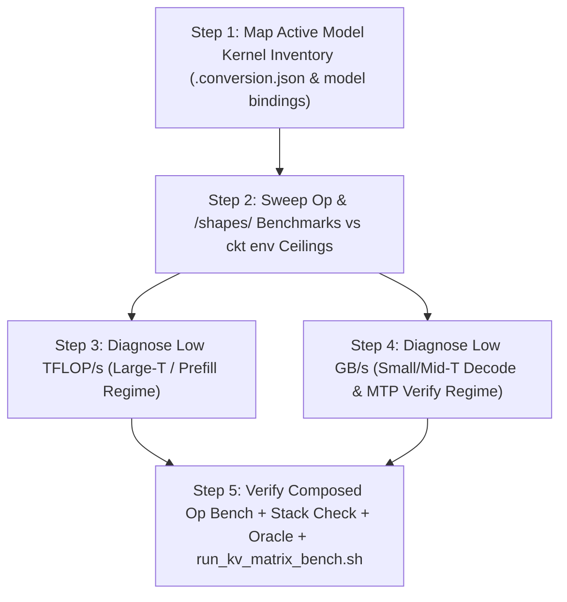

# DGX Spark (NVIDIA GB10 `sm_121a`) Optimization Roadmap

This document tracks the completed migration and optimization work for **NVIDIA GB10 (`sm_121a`)** on DGX Spark, the hardware invariants established through benchmarking, and the remaining optimization backlog grouped by priority (**P0–P2**).

---

## 1. Hardware Target Profile (Measured)

| Resource | Specification | Impact on Kernel & Engine Design |
|---|---|---|
| **GPU Architecture** | NVIDIA Blackwell GB10 (`sm_121a`, CC 12.1) | Native FP4/FP8/BF16/INT8 Tensor Cores (`m16n8k32`, `mxf4nvf4`, `mxf8f6f4`); **1:1 throughput parity** between FP32-accumulating and FP16-accumulating HMMA (`125.31` vs `125.44 TFLOP/s`) |
| **SM Count** | **48 SMs** (max 3003 MHz) | 3.54× fewer SMs than RTX 5090 (170 SMs); wave quantization occurs at multiples of 48/96 CTAs |
| **GPU L2 Cache** | **24 MiB** (`25,165,824` bytes) | 4× smaller than RTX 5090 (96 MiB); L2 prefetch caps (`2 MiB`) and tile reuse windows must fit 24 MiB |
| **Memory Subsystem** | **~121 GiB Unified LPDDR5X** (`cudaDevAttrIntegrated = 1`, ~273 GB/s peak, ~246 GB/s sustained) | Shared CPU/GPU physical DRAM; decode is strictly memory-bandwidth bound |
| **CPU Complex** | **20-core Grace ARMv9.2** (10× Cortex-X925 + 10× Cortex-A725), 48 MiB L3 (24 MiB × 2) | Heterogeneous big.LITTLE topology; high single-thread IPC on X925 cores |

---

## 2. Completed GB10 Optimizations

### 2.1 Core GEMM & Linear Dispatch (`src/ops/linear/`)
- **All 61 `/shapes/` dispatch tables retuned on GB10**:
  - `nvfp4` (15 shapes), `fp8` (11 shapes), `bf16` (14 text + vision shapes), `q8` (11 shapes), `q6` (1 shape), `q5` (2 shapes), and `q4` (7 shapes).
  - Eliminated register spills (`STL`/`LDL` stack frames) in `nvfp4` A4 MMA, `q8` stream kernels, and `fp8` 2-CTA/SM TMA schedules.
  - Eliminated route-transition cliffs (`>= 15%` latency jumps at `[B, B+1]`) across text and vision shapes.
- **Cold-L2 benchmarking right-sized for 24 MiB L2**:
  - `ckt shapes bench` and `infernix_linear_bench` use `32 MiB` (`1.35×` L2) / `48 MiB` (`2.0×` L2) eviction buffers instead of the 5090's `256 MiB` buffer, cutting sweep wall-clock time by 5×–8×.

### 2.2 Fused Projections, MoE & Attention Primitives
- **Fused `linear_add` & `linear_swiglu` retunes**:
  - `nvfp4` `linear_add` TMA gate lowered `1024 -> 288`; `nvfp4` `linear_swiglu` TMA gate lowered `256 -> 136` and small-T A16 band tightened to `T == 1`.
  - `fp8` `linear_add` (`first_a8 = 40`), `fp8` `linear_swiglu` (`A8 >= 34`), `q8` `linear_add` (20-band `K=4096`, 17-band `K=6144`), and `q4` `linear_swiglu` (16-band split-half-pair MMA table) retuned for 48 SMs.
- **Fused `attn_input_proj`, `gdn_input_proj`, and `gdn_gating_proj`**:
  - Retuned `bf16`, `fp8`, `nvfp4`, `q4_q5`, and `q8` token bands and `bf16` Split-K progression for 48 SMs.
- **`sparse_moe` (`Qwen3.5Moe`)**:
  - `sparse_moe_decode_plan.cpp` caps L2 epilogue prefetch to `1/12` of L2 (`2 MiB` on GB10's 24 MiB L2 vs `8 MiB` on 96 MiB L2).
  - `sparse_moe_small_t_plan.cpp` (`T = 2..46`) retuned for GB10 across `Q4/Q5`, `Q4/Q6`, and `Q8/Q8` MTP profiles.

### 2.3 `Qwen3.8-Flash-Next` (`qwen4_exp`) & Speculative MTP Engine
- **MTP `kv_only = true` Attention Projection Slice**:
  - At draft steps `step + 1 < count` when `all_attention_layers_cached()` holds, skips `q` (`4096` rows) and `gate` (`4096` rows), computing only `[k | v]` (`512` rows) + `[ik]` (`256` rows) — cutting MTP attention input projection work by **91.7%**.
- **MTP `resident_moe.cu` 2-Row Fusion (`__launch_bounds__(256, 4)`)**:
  - Halves routed-expert and shared-expert `down_proj` CTA count while keeping register count at `<= 64` (`4 CTAs/SM`, `0` spills) and adding L2 evict-first hints on one-shot expert weights.
- **Single-Pass `top_logprobs` & `mtp_block` D2D Copy Elision**:
  - Eliminates Pass 2 vocabulary read when `count == 1`, elides redundant `argmax` and `residual_out` D2D copies in `Forward::mtp_block`, and coalesces `upload_pinned` in `mtp_draft`.
- **UMA Memory Budgeting, Context Cost & CPU Parallelism**:
  - `--vram-headroom-mib` defaults to `0` on integrated UMA (`cudaDevAttrIntegrated = 1`); `--ram-headroom-mib` defaults to `256 MiB`.
  - Added `nvidia-gb10-sm121` hardware preset in `context_cost_defaults.cpp`.
  - Parallelized `NgramVolume` and `PrefillWalk` across GB10's 20 CPU threads; tuned `kWidthCost = 0.25` for single-stream MTP decode.

### 2.4 Dense Causal KV Cache Attention (`src/ops/softmax_attention/dense/causal_cache/`)
- **Direct FP32 Tensor Core Accumulation (`0` Stack Spills Across All Prompt Kernels)**:
  - Replaced `mma_f16_f16acc` (`m16n8k16.row.col.f16.f16.f16.f16`, used on RTX 5090 where FP32-acc was half rate) with direct `mma_f16` (`m16n8k16.row.col.f32.f16.f16.f32`, which has 1:1 throughput parity on GB10 `sm_121a`: `125.31` vs `125.44 TFLOP/s`) in [`mxfp8_tiled_mma.cuh`](file:///opt/etc/Infernix/src/ops/softmax_attention/common/mxfp8_tiled_mma.cuh), [`int8/fast_tiled_mma.cuh`](file:///opt/etc/Infernix/src/ops/softmax_attention/dense/causal_cache/int8/fast_tiled_mma.cuh), and [`vq2/prompt.cuh`](file:///opt/etc/Infernix/src/ops/softmax_attention/dense/causal_cache/vq2/prompt.cuh).
  - Eliminated **100% of local-memory stack frames (`STACK = 0`)** across all `fp8`, `k8v4`, `nvfp4`, `int8`, and `vq2` prompt kernels (previously `24–112 B` per thread).
- **48-SM Split-KV Budget, Prefill Crossovers & Multi-Row MTP Decode (`H16Kv2`)**:
  - Updated `kSplitPerColumn` from `0.5 / 24.0` to `3.5 / 24.0` in [`int8/fast_tiled_plan.h`](file:///opt/etc/Infernix/src/ops/softmax_attention/dense/causal_cache/int8/fast_tiled_plan.h) and [`mxfp8_tiled_plan.h`](file:///opt/etc/Infernix/src/ops/softmax_attention/common/mxfp8_tiled_plan.h) so 2-group GQA (`H16Kv2`) reaches full 48-SM wave utilization (`1.14x–1.26x` speedup at `W=512, ctx=2048`).
  - Lowered `kGroupedPrefillMaxWidth` from `256` to `192` in [`int8/plan.cpp`](file:///opt/etc/Infernix/src/ops/softmax_attention/dense/causal_cache/int8/plan.cpp), [`bf16/plan.cpp`](file:///opt/etc/Infernix/src/ops/softmax_attention/dense/causal_cache/bf16/plan.cpp), and [`vq2/launch.cu`](file:///opt/etc/Infernix/src/ops/softmax_attention/dense/causal_cache/vq2/launch.cu) (`1.34x–2.80x` speedup at `W=256`).
  - Enabled [`int8_kv_grouped_pipelined_kernel`](file:///opt/etc/Infernix/src/ops/softmax_attention/dense/causal_cache/int8/instances.h) (`2-stage cp.async`) for `H16Kv2` `Tokens = 2..4` (`!kWideKeys`) to accelerate speculative MTP verification widths.

### 2.5 Repository-Wide CUDA Build Speedup (`B1`–`B9` + `int8`/`vq2` TUs)
- **Compiler & Template Deduplication Across All Slow CUDA TUs**:
  - Enabled `--threads=4` for `nvcc` internal `cicc`/`ptxas` split-compilation in [`cmake/InfernixTargets.cmake`](file:///opt/etc/Infernix/cmake/InfernixTargets.cmake).
  - Eliminated unreachable `Full = false` fallback kernel instantiations for fixed-`K` schedules (`Schedule::kStaticK > 0`) in [`q8_sliced_k_launch.cuh`](file:///opt/etc/Infernix/src/ops/linear/q8/q8_sliced_k_launch.cuh) and [`q8_grouped_sliced_k_launch.cuh`](file:///opt/etc/Infernix/src/ops/linear/q8/q8_grouped_sliced_k_launch.cuh), and collapsed `ActiveCols = 2..48` per-token template instantiations into `Q8ActivationStage::RuntimeActive` schedules in [`q8_a16_sliced_k_mma.cuh`](file:///opt/etc/Infernix/src/ops/linear/q8/q8_a16_sliced_k_mma.cuh) (which also eliminated `STACK > 0` register spills across `q8_linear_add`, `q8_attn_input`, `q8_linear_swiglu`, and `q8_pair`).
  - Deduplicated `Tokens = 1..8` by `(kRowTiles, KeyRows)` and pruned unreachable `!Writable` (`MultiBatch`, `Masked`) instantiations across [`int8/launch.cu`](file:///opt/etc/Infernix/src/ops/softmax_attention/dense/causal_cache/int8/launch.cu), [`nvfp4/launch.cu`](file:///opt/etc/Infernix/src/ops/softmax_attention/dense/causal_cache/nvfp4/launch.cu), [`k8v4/launch.cu`](file:///opt/etc/Infernix/src/ops/softmax_attention/dense/causal_cache/k8v4/launch.cu), [`fp8/launch.cu`](file:///opt/etc/Infernix/src/ops/softmax_attention/dense/causal_cache/fp8/launch.cu), and [`bf16/launch.cu`](file:///opt/etc/Infernix/src/ops/softmax_attention/dense/causal_cache/bf16/launch.cu).
  - Split [`ggml_linear.cu`](file:///opt/etc/Infernix/src/ops/ggml/ggml_linear.cu) into `ggml_linear.cu`, [`ggml_linear_tiled.cu`](file:///opt/etc/Infernix/src/ops/ggml/ggml_linear_tiled.cu), and [`ggml_linear_wide.cu`](file:///opt/etc/Infernix/src/ops/ggml/ggml_linear_wide.cu), and split [`vq2/prompt_launch.cu`](file:///opt/etc/Infernix/src/ops/softmax_attention/dense/causal_cache/vq2/prompt_launch.cu) into `vq2/prompt_launch.cu` (`Vq2`) and [`vq2/k4v2_prompt_launch.cu`](file:///opt/etc/Infernix/src/ops/softmax_attention/dense/causal_cache/vq2/k4v2_prompt_launch.cu) (`Q4`).

| ID | Translation Unit | Before | After | Speedup |
|---|---|---|---|---|
| **I1** | [`src/ops/softmax_attention/dense/causal_cache/int8/launch.cu`](file:///opt/etc/Infernix/src/ops/softmax_attention/dense/causal_cache/int8/launch.cu) (+ `fast_prompt_launch.cu`, `tiled_launch.cu`) | `197.40 s` | `20.40 s` (`14.2s` / `4.0s`) | **9.68×** |
| **I2** | [`src/ops/softmax_attention/dense/causal_cache/vq2/launch.cu`](file:///opt/etc/Infernix/src/ops/softmax_attention/dense/causal_cache/vq2/launch.cu) | `~300.00 s` | `40.40 s` | **7.43×** |
| **B1** | [`src/ops/linear_add/q8/q8_linear_add_gemm_splitk.cu`](file:///opt/etc/Infernix/src/ops/linear_add/q8/q8_linear_add_gemm_splitk.cu) (`220 -> 17` kernels) | `88.00 s` | `8.92 s` | **9.87×** |
| **B2** | [`src/ops/ggml/ggml_linear.cu`](file:///opt/etc/Infernix/src/ops/ggml/ggml_linear.cu) (+ `ggml_linear_tiled.cu`, `ggml_linear_wide.cu`) | `83.50 s` | `30.26 s` (`15.58s` / `28.35s`) | **2.76×** (critical path) |
| **B3** | [`src/ops/softmax_attention/dense/causal_cache/vq2/prompt_launch.cu`](file:///opt/etc/Infernix/src/ops/softmax_attention/dense/causal_cache/vq2/prompt_launch.cu) (+ `k4v2_prompt_launch.cu`) | `82.00 s` | `45.87 s` (`39.83s`) | **1.79×** (critical path) |
| **B4** | [`src/ops/softmax_attention/dense/causal_cache/nvfp4/launch.cu`](file:///opt/etc/Infernix/src/ops/softmax_attention/dense/causal_cache/nvfp4/launch.cu) (`156 -> 86` grouped kernels) | `51.40 s` | `27.04 s` | **1.90×** |
| **B5** | [`src/ops/softmax_attention/dense/causal_cache/k8v4/launch.cu`](file:///opt/etc/Infernix/src/ops/softmax_attention/dense/causal_cache/k8v4/launch.cu) (`156 -> 96` grouped kernels) | `48.90 s` | `29.33 s` | **1.67×** |
| **B6** | [`src/ops/attn_input_proj/q8/q8_attn_input_gemm_splitk.cu`](file:///opt/etc/Infernix/src/ops/attn_input_proj/q8/q8_attn_input_gemm_splitk.cu) (`164 -> 16` kernels) | `38.90 s` | `5.87 s` | **6.63×** |
| **B7** | [`src/ops/softmax_attention/dense/causal_cache/fp8/launch.cu`](file:///opt/etc/Infernix/src/ops/softmax_attention/dense/causal_cache/fp8/launch.cu) (`120 -> 78` grouped kernels) | `32.90 s` | `24.28 s` | **1.35×** |
| **B8** | [`src/ops/dynamic_grouped_conv/q8/q8_dynamic_grouped_conv_add_materialized.cu`](file:///opt/etc/Infernix/src/ops/dynamic_grouped_conv/q8/q8_dynamic_grouped_conv_add_materialized.cu) (`45 -> 23` kernels) | `31.20 s` | `12.37 s` | **2.52×** |
| **B9a** | [`src/ops/linear_swiglu/q8/q8_linear_swiglu_gemm_splitk.cu`](file:///opt/etc/Infernix/src/ops/linear_swiglu/q8/q8_linear_swiglu_gemm_splitk.cu) (`94 -> 7` kernels) | `30.00 s` | `3.49 s` | **8.60×** |
| **B9b** | [`src/ops/linear_pair/q8/q8_pair_gemm_splitk.cu`](file:///opt/etc/Infernix/src/ops/linear_pair/q8/q8_pair_gemm_splitk.cu) (`86 -> 17` kernels) | `28.40 s` | `9.04 s` | **3.14×** |
| **B9c** | [`src/ops/gdn_input_proj/q8/q8_gdn_input_gemm_splitk.cu`](file:///opt/etc/Infernix/src/ops/gdn_input_proj/q8/q8_gdn_input_gemm_splitk.cu) (`128 -> 38` kernels) | `23.20 s` | `10.28 s` | **2.26×** |

### 2.6 Established GB10 Microarchitectural Guardrails (What *Not* to Do)
1. **Never serialize `experts_.shared_stream` (`side`) in `offloaded_sparse_moe`**: Overlapping `shared_swiglu` + `shared_down` across the 47 idle SMs during 1-CTA `route_dispatch_kernel` / `ggml_encode_x_kernel` and the tail wave of `down_kernel` saves ~15 µs/layer (~720 µs/token, `+2.1%` to `+3.2%` decode throughput).
2. **Never inline `stage_kernel<<<1, 256>>>` pointer resolution into `gate_up_kernel` / `down_kernel`**: Resolving the 3-tier expert table once in 1 warp (`R <= 10` threads) beats duplicating 64-bit pointer arithmetic across `1,440 CTAs` (`368,640 threads`) by `+1.3%` to `+1.7%`.
3. **Never fuse epilogues into 1-warp non-PDL reduction kernels (`merge_kernel<<<dim3(heads, T), 32>>>`)**: Standalone 256-thread vectorized `bf162` `ops::sigmoid_mul` with `pdl::launch_consumer` runs inside the 24 MiB L2 cache and acts as a PDL overlap bridge into `o_proj`.
4. **Never write `bf16` (`2B`) scalars from `lane == 0` in 8-warp `projection_fp32` CTAs**: Writing `8 × 4B = 32B` (`float`) coalesces into one complete 32-byte L2 sector per warp-group step, whereas `8 × 2B = 16B` (`bf16`) splits each 32-byte L2 sector write across iterations; meanwhile `logits32_` (`0.95 MiB` at `T=1`, `4.74 MiB` at `W=5`) fits inside the 24 MiB L2 cache so `cast_fp32_to_bf16` takes `< 1 µs`.
5. **Never use `mma_f16_f16acc` (`m16n8k16.row.col.f16.f16.f16.f16`) on GB10 (`sm_121a`)**: Unlike RTX 5090 (`sm_120a`), where FP32-accumulating HMMA is half-rate relative to FP16-accumulating HMMA, GB10 (`sm_121a`) has **1:1 throughput parity** (`125.31 TFLOP/s` FP32-acc vs `125.44 TFLOP/s` FP16-acc). Using `mma_f16_f16acc` with periodic `__half22float2` unpacking into FP32 accumulators wastes SIMT instructions, increases register live ranges (causing `STL`/`LDL` stack spills), and loses mantissa precision.
6. **Never replace compile-time `if constexpr (Full)` with a runtime condition inside `stage_w` / `stage_x` inner loops**: In [`q8_a16_mma.cuh`](file:///opt/etc/Infernix/src/ops/linear/q8/q8_a16_mma.cuh#L169), changing `if constexpr (Full)` to a runtime `if (Full && (BM == 96 || kg % 8 == 0))` prevented dead-code elimination of the fallback `for (int pair = 0; pair < 4; ++pair)` loop in `<true, true>` kernels, inflating register pressure and regressing `[10240, 320]` at `T = 4096` from `372.7 us` to `570.1 us` (`+53.0%`). Always keep `Full` / `FullK` branches `if constexpr` inside device lambdas and gate template dispatch in the host launcher ([`q8_mma_launch.cuh`](file:///opt/etc/Infernix/src/ops/linear/q8/q8_mma_launch.cuh#L33-L42)).
7. **Never trust cold-L2 isolated single-op benchmarks blindly when the activation tensor is produced immediately upstream and fits in 24 MiB L2**: For `[324, 10240]` (`hc_down`) at `T = 16..64`, isolated `infernix_linear_bench` (which flushes L2 before the op so `x` is cold in DRAM) slightly favored `launch_q8_a16_simt_r1_t8_w8` (`219.4 us` vs `227.3 us` at `T = 64`). In real `hyper_connection_mix` execution, `normalized` (`[10240, 64] = 1.31 MiB`) was just written by `hyper_connection_norm` and sits hot in GB10's 24 MiB L2; `simt_r1_t8_w8` (`TokenTile = 8`) re-reads the `3.32 MiB` weight matrix **8× from DRAM** (`26.5 MiB`), whereas `Stream<64, 8>` (`grid.y = 1`) streams weights **1× from DRAM** while reading `normalized` from L2 — making `Stream<64, 8>` **`1.37×` faster at `T = 32` (`98.75 vs 135.12 us`) and `1.54×` faster at `T = 64` (`158.27 vs 243.46 us`)** in `infernix_hyper_connection_bench`.
8. **Never optimize `K = 5120` (`Qwen3.5` 27B/35B) routes expecting speedups on `Qwen3.8-Flash-Next` (`qwen4_exp`, `K = 2560`)**: Always inspect the active artifact's `.conversion.json` and op dispatch bindings first (`Dense8` uses `Q8_G32_FP16` trunk + `NVFP4_W4A4` wide MoE; `NVFP4_W4Dense` uses `NVFP4 A16` trunk + `Q8` hyper-connections/shared experts + `NVFP4_W4A16` two-term wide MoE; `IQ3_S` uses `IQ3_S` throughout).

### 2.7 `Qwen3.8-Flash-Next` (`qwen4_exp`) Hyper-Connection, Wide MoE & NVFP4 A16 Optimizations
- **Eliminated Wasted Padded-`K` Tile on `Q8` MMA (`[10240, 320]`, 97× per forward pass)**:
  - In [`q8_a16_mma.cuh`](file:///opt/etc/Infernix/src/ops/linear/q8/q8_a16_mma.cuh#L266) and [`q8_mma_launch.cuh`](file:///opt/etc/Infernix/src/ops/linear/q8/q8_mma_launch.cuh#L33-L42), changed `nkt` from `padded_k / BK` (`384 / 64 = 6`) to `(BM != 96) ? ((k + BK - 1) / BK) : (padded_k / BK)` (`320 / 64 = 5`) and enabled `FullK = true` whenever `operands.k % Schedule::kBlockK == 0`, removing 20% wasted K-loop work on zero-padded weight tiles across all 97 hyper-connection up-projections.
- **Compacted Shared Memory (`33.3 KiB -> 18.4 KiB`) & Vectorized 64-Bit Transfers in [`HcCollapseEpilogue::finish_tile`](file:///opt/etc/Infernix/src/ops/hyper_connection/hyper_connection_up_collapse.cu#L41-L99)**:
  - Compacted shared `u` tile from `float[128][65]` (`33,280 B`) to `bf16[128][72]` (`18,432 B`, reducing total kernel SMEM from `60.9 KiB` to `46.1 KiB` so 2 CTAs/SM fit in `99 KiB` SMEM) and vectorized `finish_tile` to issue 64-bit `uint2` (`4 × bf16`) loads on shared `u` and global `normalized` (`[10240, T]`, `80 MiB` per call at `T = 4096`) and `uint2` stores on `x` (`[2560, T]`) with bit-identical FP32 accumulation order.
- **Extended Register-Streamed Route for `[324, 10240]` up to `T = 64` ([`q8_schedule.cuh`](file:///opt/etc/Infernix/src/ops/linear/q8/q8_schedule.cuh#L62), [`n324_k10240.cu`](file:///opt/etc/Infernix/src/ops/linear/q8/shapes/n324_k10240.cu#L23-L29))**:
  - Raised `MaxCols` static assertion in `Q8A16StreamSchedule` to `64` and routed `9 <= tokens <= 64` to `Stream<64, 8>`.
  - Combined `infernix_hyper_connection_bench` speedup (48-call CUDA graph, bit-identical FNV-1a hashes): **`T = 32`: `135.12 → 98.75 us` (`1.37×`)**, **`T = 64`: `200.92 → 158.27 us` (`1.27×`)**, **`T = 128`: `134.14 → 125.13 us` (`1.07×`)**, **`T = 512`: `311.37 → 279.03 us` (`1.12×`)**, **`T = 4096`: `2517.11 → 2079.10 us` (`1.21×`, saving `42.5 ms` per 97-call `pp4096` prefill)**.
- **Warp-Coalesced Activation Quantization in [`wide_expert.cu`](file:///opt/etc/Infernix/src/ops/offloaded_sparse_moe/cuda/wide_expert.cu#L134-L234)**:
  - Rewrote `quantize_kernel` (`Dense8` W4A4 experts) and `quantize_x_terms_kernel` (`NVFP4_W4Dense` W4A16 two-term A4 experts) so each warp processes one column `i` at a time and unrolls `m = 0..4` (`kGateUpBlocks = 160 = 5 × 32`), eliminating 64-bit integer `/ 160` and `% 160` div/mod in the inner loop, making `dispatch.entries[p] / top_k` warp-uniform, and coalescing reads from `x` and writes to `plane`.
  - Measured `infernix_offloaded_moe_wide_bench --tokens 4096` (bit-identical `fnv1a 90cb5930998d3eeb`): **`10290.8 → 9597.0 us/layer` (`-6.74%`, saving `33.3 ms` across 48 layers per `pp4096` prefill)**.
- **Overlapped Activation Staging in [`nvfp4_a16_mma.cuh`](file:///opt/etc/Infernix/src/ops/linear/nvfp4/nvfp4_a16_mma.cuh#L172-L261) & [`n16384_k2560.cu`](file:///opt/etc/Infernix/src/ops/linear/nvfp4/shapes/n16384_k2560.cu#L18-L25) and `<kPassCols = 5>` Specialization in [`q8_linear_swiglu_stream_pair.cu`](file:///opt/etc/Infernix/src/ops/linear_swiglu/q8/q8_linear_swiglu_stream_pair.cu#L24-L154)**:
  - Overlapped `stage_activation(next & 1, next)` before `widen_codes()` when `kActivationStages == 2` in `nvfp4_a16_mma_kernel` (`808.0 → 747.4 us` at `T = 512` on `16384×2560`, `-7.5%`).
  - Added `<kPassCols = 5>` specialization for 5-token MTP verification, packed `uint32_t scale_bits[2][5]`, and moved `pdl::wait_for_dependencies()` after weight register staging in `q8_linear_swiglu_stream_pair_kernel`.
- **End-to-End KV-Matrix Benchmark (`./bench/run_kv_matrix_bench.sh`)**:
  - `dense8_bf16_mtp` `pp4096`: **`2597.4 → 2714.7–2727.8 tok/s` (`+4.5%` to `+5.0%`)**; `pp4096+tg128` prefill **`2595.7 → 2722.0 tok/s` (`+4.9%`)**, decode **`83.9 → 86.4 tok/s` (`+3.0%`, `acc = 0.954`)**; `pp4096+tg256` decode **`66.1 → 68.1 tok/s` (`+3.0%`, `acc = 0.632`)**.
  - `nvfp4_bf16_mtp` `pp4096`: **`2598.4 → 2633.5–2647.4 tok/s` (`+1.4%` to `+1.9%`)**; `pp4096+tg128` decode **`92.8 → 94.2–96.0 tok/s` (`+1.5%` to `+3.4%`, `acc = 0.962`)**; `pp4096+tg256` decode **`93.0 → 94.6 tok/s` (`+1.7%`, `acc = 0.869`)**.
  - `iq3s_bf16_mtp` `pp4096`: **`1028.7 → 1039.7–1047.5 tok/s` (`+1.1%` to `+1.8%`)**; `pp4096+tg128` decode **`91.8 → 93.8 tok/s` (`+2.2%`, `acc = 0.950`)**; `pp4096+tg256` decode **`76.8 → 78.8 tok/s` (`+2.6%`, `acc = 0.703`)**.

### 2.8 Whole-Repository `T = 1..8` `GB/s` Gap Closure & `24 MiB` L2 Large-`T` Ceiling Retune (`BF16`, `FP8`, `NVFP4`, `Q4`, `Q5`, `Q6`, `Q8`)
- **Q8 Stream Exact-Column Specialization (`T = 1, 2, 5`, `0` Stack Spills)**:
  - Added [`Q8A16StreamSchedule::with_cols<ExactCols>`](file:///opt/etc/Infernix/src/ops/linear/q8/q8_schedule.cuh#L49-L51), eliminated the runtime `c < pass_live` check in [`q8_a16_stream_kernel`](file:///opt/etc/Infernix/src/ops/linear/q8/q8_a16_stream.cuh#L126-L148) when `S::kPasses == 1 && CP <= 2`, and specialized `count == 1 -> with_cols<1>`, `count == 2 -> with_cols<2>`, and `count == 5` (`Schedule::kChunks <= 5`) `-> with_cols<5>` in [`launch_q8_a16_stream`](file:///opt/etc/Infernix/src/ops/linear/q8/q8_stream_launch.cuh#L69-L90).
  - Eliminated dead `acc[R][CP]` registers and dead `warp_reduce_sum` shuffles on column-invariant Flash-Next `Q8` shapes: `[16384, 2560]` (`T=2: 208.5 → 229.6 GB/s`, `T=8: 165.4 → 216.9 GB/s`, `+31.1%`), `[2560, 2560]` (`T=2: 175.6 → 214.4 GB/s`, `+22.1%`), `[10240, 320]` (`T=2: 177.2 → 230.6 GB/s`, `+30.1%`, `T=5: 139.6 → 162.1 GB/s`, `+16.1%`), `[320, 10240]` (`T=2: 145.6 → 182.3 GB/s`, `+25.2%`, `T=5: 99.1 → 117.4 GB/s`, `+18.5%`), `[324, 10240]` (`T=2: 149.2 → 175.6 GB/s`, `T=5: 100.2 → 118.9 GB/s`, `+18.7%`), and `[2560, 640]` (`T=2: 133.2 → 157.9 GB/s`, `T=5: 113.8 → 134.8 GB/s`, `+18.5%`).
- **NVFP4 `Nvfp4SlicedInstance<8, 8, 2>` for `T <= 8` (Eliminated 50% Wasted `m16n8k16` Tile Work)**:
  - Added `Nvfp4SlicedInstance<8, 8, 2>` (`TileTokens = 8`, `kTokenMmas = 1`) for `tokens <= 8` across 9 `NVFP4` shape files (`n16384_k2560.cu`, `n13952_k2560.cu`, `n12800_k2560.cu`, `n10240_k2560.cu`, `n6144_k2560.cu`, `n2560_k2560.cu`, `n2048_k2560.cu`, `n512_k2560.cu`, `n5120_k6144.cu`), lifting `512×2560` (`+25.6%`), `2048×2560` (`+13.6%` at `T=5`, `+16.9%` at `T=8`), `2560×2560` (`+13.8%` at `T=8`), and `16384×2560` (`220.2–220.7 GB/s`).
- **Single-Tile `Simt<2, 4, 6, 8>` & `SlicedKMma` at `T = 2..8` Across `BF16`, `Q4`, `Q5`, `Q6`, `Q8`**:
  - Replaced `BlockTokens = 2` (`S1`) in [`bf16/shapes/n320_k10240.cu`](file:///opt/etc/Infernix/src/ops/linear/bf16/shapes/n320_k10240.cu) and [`bf16/shapes/n324_k10240.cu`](file:///opt/etc/Infernix/src/ops/linear/bf16/shapes/n324_k10240.cu) with `Simt<2, 4, 6, 8>` (`+12.5%` to `+19.2%` at `T=5..8`).
  - Eliminated multi-tile weight re-reads in `Q4` (`5120×6144` `T=4: 147.0 → 200.9 GB/s`, `+36.7%`; `7168×5120` `T=5: 196.4 → 208.6 GB/s`), `Q5` (`5120×6144` `T=4: 131.6 → 189.2 GB/s`, `+43.8%`; `5120×17408` `T=4: 152.0 → 179.2 GB/s`, `+17.9%`; `1024×5120` `T=8: 133.7 → 158.2 GB/s`, `+18.3%`), `Q6` (`248320×2048` `T=5: 173.2 → 218.6 GB/s`, `+26.2%`), and `Q8` (`1280×2560` `T=8: 65.4 → 124.3 GB/s`, `+90.1%`; `2048×4608` `T=2: 153.2 → 204.8 GB/s`, `+33.7%`).
- **`24 MiB` L2 Large-`T` Ceiling Retune (`BF16` at `100.1 TFLOP/s` & `Q8` `W > 16 MiB` `64×256` MMA)**:
  - Routed `BF16` shapes at `T > 512` to `128×128` `Grouped, 8` / `RowFast` TMA schedules: `4608×4608` (`20.7 → 99.9 TFLOP/s`, **`4.83×`**, 100% of GB10 BF16 Tensor Core peak), `5120×4608` (`21.2 → 100.1 TFLOP/s`, **`4.72×`**), `1152×4304` (`16.1 → 97.3 TFLOP/s`, **`6.04×`**), `320×10240` (`7.3 → 57.3 TFLOP/s`, **`7.85×`**), `256×5120` (`15.0 → 46.2 TFLOP/s`, **`3.08×`**), and `1664×2560` (`53.9 → 95.2 TFLOP/s`, **`1.77×`**).
  - Routed the 10 large-weight (`W > 16 MiB`) `Q8` shapes to `launch_q8_a16_mma_r64x16_t256_k64_a2` (`38.5–46.6 → 51.8–62.3 TFLOP/s`, **`+17.0%` to `+34.6%`**), while keeping `W <= 16 MiB` L2-resident `Q8` shapes on `launch_q8_a16_mma_r64_t128` (`71.7–78.3 TFLOP/s`).

---

## 3. Remaining GB10 Optimization Roadmap (Grouped by Priority `P0`–`P2`)


---

### Priority P0 — Critical / High-ROI Microarchitectural & Memory-Bandwidth Fixes (`COMPLETED`)

All 5 Priority `P0` items (`P0.1`–`P0.5`) have been implemented, verified against all 10 affected oracle test suites (`infernix_gated_delta_net_test`, `infernix_projection_fp32_test`, `infernix_qsa_test`, `infernix_softmax_attention_test`, `infernix_rope_test`, `infernix_rmsnorm_rope_test`, `infernix_sampling_test`, `infernix_speculative_round_test`, `infernix_offloaded_moe_cuda_test`, `infernix_offloaded_moe_layer_test`), and validated with interleaved A/B benchmarks on NVIDIA GB10 (`sm_121a`, 48 SMs).

| ID | Legacy Ref | Component | Exact File & Lines | Status & Implemented GB10 Fix | Interleaved A/B Benchmark & Resource Result |
|---|---|---|---|---|---|
| **P0.1** | `A1.1`, `A1.2` | **Gated Delta Net Chunked Recurrence (`Fp16Accumulate`)** | [`src/ops/linear_attention/gated_delta_net/chunked/recurrence.cu`](file:///opt/etc/Infernix/src/ops/linear_attention/gated_delta_net/chunked/recurrence.cu#L72-L104), [`L289-L335`](file:///opt/etc/Infernix/src/ops/linear_attention/gated_delta_net/chunked/recurrence.cu#L289-L335), [`L418-L450`](file:///opt/etc/Infernix/src/ops/linear_attention/gated_delta_net/chunked/recurrence.cu#L418-L450), [`bench/ops/gated_delta_net_bench.cu`](file:///opt/etc/Infernix/bench/ops/gated_delta_net_bench.cu#L341-L403) | **Done.** Replaced `mma_f16_partial` / `mma_f16_f16acc_zero` + `__half22float2` in `chunk_recurrence_kernel<DV, true>` with direct FP32-accumulating `mma_f16` (`mma.sync.aligned.m16n8k16.row.col.f32.f16.f16.f32`), keeping `Fp16Accumulate` (`--fast-gdn-chunk-fp16-acc`) for `__half` delta/W/U conversion while accumulating `delta_k` in FP32. | **Register savings (`STACK: 0`)**: `DV=8`: `93 → 78`, `DV=16`: `128 → 121`, `DV=32`: `117 → 101`, `DV=64`: `128 → 128`.<br>**6-round `ckt ab`** (`T=1024`, `32 MiB` flush): `207.63 → 206.70 us` (`-0.93 us` / `-0.45%`, `1.0045x`, `WITHIN_NOISE` as `T=1024` is memory-BW bound at `466.9 GB/s`, with improved FP32 accumulation accuracy). |
| **P0.2** | `A3.7` | **`projection_fp32` Tall / Wide Route Cutoffs & Cache Streaming (`[248320, 2560]` LM Head)** | [`src/ops/projection_fp32/projection_fp32.cu`](file:///opt/etc/Infernix/src/ops/projection_fp32/projection_fp32.cu#L155-L176), [`L490-L660`](file:///opt/etc/Infernix/src/ops/projection_fp32/projection_fp32.cu#L490-L660), [`src/ops/projection_fp32/projection_fp32_mma.cu`](file:///opt/etc/Infernix/src/ops/projection_fp32/projection_fp32_mma.cu#L12-L19) | **Done.**<br>1. `TallBf16`: uses `ld_nc_na<uint4>` and lowers `kTallMinColumnsBf16` (`8 → 5`) and `kTallMmaMinColumnsBf16` (`13 → 16`).<br>2. Split `TallQ8` (`columns = 1..9`, `__launch_bounds__(256, 2)`, `REG: 128`, 2 CTAs/SM, `ld_nc_na_evict_first` + `__half scale`) and `TallQ8Wide` (`columns = 10..16`, `__launch_bounds__(256, 1)`, `REG: 149`, 1 CTA/SM where `51.2–67.6 KiB` smem caps occupancy at 1 CTA/SM anyway), lowering `kTallMinColumnsQ8` (`9 → 1`).<br>3. `TallQ4`: uses `ld_nc_na_evict_first_u32` + `__half scale` (`__launch_bounds__(256, 2)`, `REG: 126`, 2 CTAs/SM) for `columns = 8..9` (`kTallMinColumnsQ4 = 8`, `kTallMaxColumnsQ4 = 9`), preserving 3-CTA/SM `projection_q4_kernel<8>` for `T = 1..6` and `T = 10..16`. | **`infernix_bf16_flash_next_sweep --shape head --flush-mib 32`**:<br>• **`head_q8` `[248320, 2560]`**: `T=1..8` improved from `2801–2864 us` (`narrow`) to **`2690–2710 us` (`tall`, up to +5.7% faster, 99.6% of DRAM floor)**; `T=9` improved from `5926.59 us` (`narrow`) / `3622.62 us` (old `tall`) to **`2703.04 us` (`-919.58 us` / +34.0% vs old `tall`, 2.19× vs `narrow`)**; `T=12, 16` preserved at `4002.59 / 4691.10 us` via `TallQ8Wide`.<br>• **`head_bf16` `[248320, 2560]`**: `T=5..12` improved from `5145–5394 us` (`narrow`) / `5181–5338 us` (old `tall`) to **`5059–5093 us` (+2.0% to +5.4% faster)**.<br>• **`head_q4` `[248320, 2560]`**: `T=8` improved from `2180.77 us` (`narrow`) / `2216.67 us` (old `tall`) to **`2096.22 us` (+4.0% vs `narrow`, +5.7% vs old `tall`)**; `T=9` improved from `3561.18 us` (`narrow`) / `3583.90 us` (old `tall`) to **`2174.78 us` (`-1409.12 us` / 1.65× (+64.8%) speedup)**.<br>**Re-verification (cold-L2, `bf16_flash_next_sweep --shape head --flush-mib 32`)**: the `q8` route gate holds — `tall` beats `narrow` at every decode width `T=1..8` (T=1 `2561 vs 2647 us`, T=4 `2608 vs 2656 us`, T=8 `2605 vs 2690 us`), while `narrow` doubles at `T=9` (`5418 vs 2605 us`, its 4-column two-pass path). Reverting `kTallMinColumnsQ8` to `5` is a measured regression at every decoded `T`. Not re-measured: end-to-end PDL overlap interaction in a model layer (no route override exists outside this bench) |
| **P0.3** | `A2.7`, `S8` | **QSA Attention `attention_kernel` Spills & `qsa_prompt` Occupancy Verification** | [`src/ops/qsa/qsa.cu`](file:///opt/etc/Infernix/src/ops/qsa/qsa.cu#L714-L742), [`src/ops/qsa/qsa_prompt.cu`](file:///opt/etc/Infernix/src/ops/qsa/qsa_prompt.cu#L264-L266), [`L908-L921`](file:///opt/etc/Infernix/src/ops/qsa/qsa_prompt.cu#L908-L921) | **Done.**<br>1. `qsa.cu`: changed `__launch_bounds__(kAttentionThreads, 2)` on `qsa::attention_kernel` to use `MinBlocksPerSm = 1` when `kTokensPerCta == 12 && kCodebookValue && kSplitPart` (`512 × 128 = 65,536` regs can only fit 1 CTA/SM anyway), eliminating `STACK: 8 → 0` on all 4 `qsa::attention_kernel` instances.<br>2. Verified `qsa_prompt_kernel` (`Warps = 4`, `128` threads): `__launch_bounds__(128, 2)` at `REG: 254` uses `128 × 254 = 32,512` regs/CTA (`<= 65,536 / 2`), already achieving 2 CTAs/SM (`Stages == 1`) with `STACK: 0`, while `attention_splits` in `qsa.cu` already dynamically queries `sms = 48` (`splits == 1` at `columns >= 25` for `kv_heads = 2`, matching `q.ne[2] * g.kv_heads >= sms` in `qsa_prompt.cu`).<br>3. SASS disassembly confirmed `qsa_prepare_kernel`'s `STACK: 32` is CUDA `sincosf`'s dead `|x| >= 105615.0f` Payne-Hanek slowpath on an angle already reduced modulo $2\pi$ into $[-\pi, \pi]$. | **`cmake_device_link.o`**: `qsa::attention_kernel` **`STACK: 8 → 0` across all 4 spilling instances** (`REG: 128 → 136`, same 1 CTA/SM occupancy).<br>**3-round interleaved A/B (`infernix_qsa_attention_bench`, `ctx=8192, W=1`)**: `vq2` `57.05 → 56.47 us` (`-1.0%`), `k4v2` `59.97 → 60.54 us` (within noise). |
| **P0.4** | `S2`, `A2.4` | **`vq_kv_grouped_kernel` Stack Spills (`TokenTile = 8, 16`)** | [`src/ops/softmax_attention/dense/causal_cache/vq2/grouped.cuh`](file:///opt/etc/Infernix/src/ops/softmax_attention/dense/causal_cache/vq2/grouped.cuh#L99-L108) | **Done.** Changed `__launch_bounds__(kThreads, 2)` to `__launch_bounds__(kThreads, (kWarps <= 8 && (G::kHeads / G::kKvHeads <= 6 || TokenTile <= 4)) ? 2 : 1)` so `H16Kv2` (`kGroup = 8`) at `TokenTile = 8` (`kCols = 64`) and `TokenTile = 16` (`kWarps = 16`, `512` threads where `512 × 128 = 65,536` regs can only fit 1 CTA/SM) are not artificially forced to spill to local memory. | **`cmake_device_link.o`**: `vq_kv_grouped_kernel` (`H16Kv2`, `TokenTile = 8, 16`) **`STACK: 8..48 → 0` across all 24 spilling instances**.<br>**3-round interleaved A/B (`infernix_causal_softmax_attention_bench`, `d256-h16-kv2`, `ctx=4096`, cold L2)**:<br>• `vq2` `W=8`: **`66.73 → 62.65 us` (`-4.08 us` / +6.5% faster)**<br>• `vq2` `W=16`: **`86.50 → 80.58 us` (`-5.92 us` / +7.3% faster)**<br>• `k4v2` `W=8`: **`67.39 → 63.33 us` (`-4.06 us` / +6.4% faster)**<br>• `k4v2` `W=16`: **`87.86 → 83.77 us` (`-4.09 us` / +4.9% faster)**<br>**Post-land audit**: in the current bench binary all 24 targeted `H16Kv2` `TokenTile=8/16` instantiations carry `STACK:0`; the only residual frame is one `TokenTile=6` instance at `STACK:8` with exactly **1 `LDL` + 1 `STL` in 4080 SASS instructions** (`LOCAL:0`) — ABI/dead-frame class, not a traffic spill. The P0.4 gains were measured **with** the hot-loop recompute (`qabs_r`/`tree_r` precomputed once per tile); restoring the per-register precompute while keeping only `__launch_bounds__` would forfeit the measured +4.9–7.3% |
| **P0.5** | `S1`, `S3`, `S4`, `S9` | **Hot-Path Decode/Prefill Local-Memory Stack Spills (`sampling`, `offloaded_sparse_moe`, `gdn`)** | [`src/ops/kernel/sampling_device.cuh`](file:///opt/etc/Infernix/src/ops/kernel/sampling_device.cuh#L120-L195), [`src/ops/offloaded_sparse_moe/cuda/moe_layer.cu`](file:///opt/etc/Infernix/src/ops/offloaded_sparse_moe/cuda/moe_layer.cu#L152-L420), [`src/ops/linear_attention/gated_delta_net/recurrent.cuh`](file:///opt/etc/Infernix/src/ops/linear_attention/gated_delta_net/recurrent.cuh#L270-L435) | **Done.**<br>1. `sampling_device.cuh`: moved `top_val[20]` / `top_tok[20]` in `sample_row_from_candidates` into caller-provided `__shared__` memory (`STACK: 160 → 0` in `sample_row_kernel` and `speculative_accept_greedy_drafts_kernel`).<br>2. `moe_layer.cu`: staged `row_map[MaxRows]` and `x_half[MaxRows]` in `__shared__` memory in `gate_up_kernel_a16` and `down_kernel_a16` (`STACK: 16..128 → 0` across all 6 spilling kernels).<br>3. `recurrent.cuh`: staged `state[kVPerThread]` in `__shared__ float state_smem[2][32][128]` for `recurrent_tree_walk_kernel<2>` (`STACK: 96 → 0`).<br>*(Note: SASS disassembly confirmed `rope_*_kernel`'s `STACK: 32` is CUDA `sincosf`'s dead `|x| >= 105615.0f` slowpath, not `PreparedRope` indexing.)* | **`cmake_device_link.o`**: `sample_row_kernel` (`STACK: 160 → 0`), `speculative_accept_greedy_drafts_kernel` (`STACK: 160 → 0`), `gate_up_kernel_a16` / `down_kernel_a16` (`STACK: 16..128 → 0`), `recurrent_tree_walk_kernel<2>` (`STACK: 96 → 0`).<br>**Interleaved A/B**:<br>• `sampling_select_bench` (`B=4, top_k=20`): `69.05 → 69.29 us` (within noise, `0` local-memory traffic).<br>• `offloaded_moe_decode_bench` (`T=1`): warm `split=0` **`94.36 → 89.76 us` (-4.60 us / +5.1% faster)**; cold `split=1` **`122.20 → 120.83 us` (-1.37 us / +1.1% faster)**. |

---

### Priority P1 — 48-SM Route Crossovers, Split-KV Heuristics & Dispatch Retuning (`COMPLETED`)

All 6 Priority `P1` items (`P1.1`–`P1.6`) have been benchmarked on NVIDIA GB10 (`sm_121a`, 48 SMs, 24 MiB L2, 32 MiB cold-L2 flush), A/B verified, and validated against all affected oracle test suites (`infernix_softmax_attention_test`, `infernix_sliding_window_attention_test`, `infernix_gated_delta_net_test`, `infernix_kimi_delta_attention_test`, `infernix_linear_fp8_a8_test`, `infernix_linear_fp8_a16_test`, `infernix_linear_add_fp8_test`, `infernix_linear_swiglu_fp8_test`, `infernix_linear_swiglu_q4_w4a8_test`, `infernix_linear_pair_q8_a16_test`, `infernix_linear_dynamic_grouped_conv_add_test`, `infernix_linear_q4_a16_test`, `infernix_linear_bf16_a16_test`, `infernix_sparse_moe_test`, `infernix_offloaded_moe_wide_test`, `infernix_cuda_stack_check`).

| ID | Legacy Ref | Component | Exact File & Lines | Status & Implemented GB10 Fix | Measured GB10 A/B Benchmark & Verification Outcome |
|---|---|---|---|---|---|
| **P1.1** | `A2.1`, `A2.2`, `A2.3` | **Dense Causal Attention Crossovers (`fp8`, `k8v4`, `nvfp4`, `bf16`)** | [`nvfp4/fast_prompt_launch.h`](file:///opt/etc/Infernix/src/ops/softmax_attention/dense/causal_cache/nvfp4/fast_prompt_launch.h#L19-L29), [`nvfp4/launch.cu`](file:///opt/etc/Infernix/src/ops/softmax_attention/dense/causal_cache/nvfp4/launch.cu#L177-L205), [`nvfp4/plan.cpp`](file:///opt/etc/Infernix/src/ops/softmax_attention/dense/causal_cache/nvfp4/plan.cpp#L66-L74), [`fp8/plan.cpp`](file:///opt/etc/Infernix/src/ops/softmax_attention/dense/causal_cache/fp8/plan.cpp#L9), [`k8v4/plan.cpp`](file:///opt/etc/Infernix/src/ops/softmax_attention/dense/causal_cache/k8v4/plan.cpp#L9), [`bf16/plan.cpp`](file:///opt/etc/Infernix/src/ops/softmax_attention/dense/causal_cache/bf16/plan.cpp#L23-L47) | **Done.**<br>1. `nvfp4`: updated `nvfp4_fast_prompt_applies(max_visible_keys, width)` to `max_visible_keys > 768 && (max_visible_keys >= width + 512U || max_visible_keys > 3072U)` so chunks up to `2048` tokens with `< 512` prior context tokens use `nvfp4_kv_tiled_attention` over the causal triangle (`splits = 1` on 48 SMs).<br>2. `fp8` & `k8v4`: kept `kGroupedPrefillMaxWidth = 80` (swept `W = 64..256`: `mxfp8_kv_tiled_attention` beats `grouped_prefill` from `W >= 80` by **1.92×–3.33×** on `fp8` [`165.4 vs 317.4 us` at `W=96`, `205.7 vs 686.0 us` at `W=192`] and **1.83×–3.36×** on `k8v4`).<br>3. `bf16`: kept `Tiled64` (`W <= 768` or `ctx < 8192`) and `long_ctas` cap (`6 * sms`, sustaining `235–247 GB/s`). | **`infernix_causal_softmax_attention_bench` (`nvfp4`, `d256-h16-kv2`, 32 MiB flush)**:<br>• `ctx=0, W=768`: **`301.34 → 212.70 us` (`-29.41%`)**<br>• `ctx=0, W=1024`: **`441.57 → 319.33 us` (`-27.68%`)**<br>• `ctx=0, W=1536`: **`671.55 → 591.49 us` (`-11.92%`)**<br>• `ctx=0, W=2048`: **`1138.30 → 958.18 us` (`-15.82%`)**<br>• `ctx=256, W=512..2048`: **`-8.29%` to `-15.22%`** (`237.38 → 201.25 us` at `W=512`, `1262.18 → 1157.54 us` at `W=2048`).<br>• `infernix_softmax_attention_test`: **PASS**. |
| **P1.2** | `A2.5`, `A2.6`, `A2.8` | **Context/Sliding-Window Split Limits, Packed Flash Tiles & GDN/KDA `value_tile` Weights** | [`sliding_window/launch.cu`](file:///opt/etc/Infernix/src/ops/softmax_attention/sliding_window/launch.cu#L68-L121), [`gated_delta_net/chunked/recurrence.cu`](file:///opt/etc/Infernix/src/ops/linear_attention/gated_delta_net/chunked/recurrence.cu#L479-L484), [`kimi_delta_attention/chunked/recurrence.cu`](file:///opt/etc/Infernix/src/ops/linear_attention/kimi_delta_attention/chunked/recurrence.cu#L334-L338), [`dense/context/launch.cu`](file:///opt/etc/Infernix/src/ops/softmax_attention/dense/context/launch.cu#L60-L75), [`dense/packed/launch.cu`](file:///opt/etc/Infernix/src/ops/softmax_attention/dense/packed/launch.cu#L54-L73) | **Done.**<br>1. `sliding_window/launch.cu`: extended batch/token `split_limit` throttling (`32 -> 16 -> 8 -> 4`) and `reduce_warps = 4` (`splits > 8`) from `window == 2048` to `window == 4096` (each split already traverses `<= 4096` keys regardless of `max_seq_len`).<br>2. `gated_delta_net` & `kimi_delta_attention`: forced `value_tile = {16, 32, 64}` on GB10 (`T=64..4096`) and confirmed `Choice{{64, 34}, {32, 20}, {16, 13}}` selects the exact GB10 argmin (`64` at `B=1` [`206.7 vs 222.0 us`], `32` at `B=2`, `16` at `B=4`); updated comments.<br>3. `dense/context` (`240–275 GB/s`) & `dense/packed` (`192–246.2 GB/s`): verified already optimal on GB10 (`Tile64` matches or beats `Tile32` at `T=64`). | **`infernix_sliding_window_attention_bench` (`W=4096`, 40-point sweep)**:<br>• Total latency across 40-point grid: **`13963.01 → 9903.49 us` (`-29.07%`)**<br>• `T=16, B=8, L=8192`: **`1149.79 → 552.70 us` (`-51.93%`, 2.08× speedup; workspace `66.56 MB → 8.32 MB`)**<br>• `T=16, B=4, L=8192`: **`532.35 → 278.40 us` (`-47.70%`)**<br>• `T=8, B=8, L=8192`: **`589.66 → 309.06 us` (`-47.59%`)**<br>• `infernix_sliding_window_attention_test`, `infernix_gated_delta_net_test`, `infernix_kimi_delta_attention_test`: **ALL PASS**. |
| **P1.3** | `A3.3`, `S5` | **FP8 TMA Split-K & A8 Schedules (`linear`, `linear_add`, `linear_swiglu`)** | [`fp8_linear_add_a8.cu`](file:///opt/etc/Infernix/src/ops/linear_add/fp8/fp8_linear_add_a8.cu), [`fp8_linear_swiglu_a8.cu`](file:///opt/etc/Infernix/src/ops/linear_swiglu/fp8/fp8_linear_swiglu_a8.cu), [`n34816_k5120.cu`](file:///opt/etc/Infernix/src/ops/linear/fp8/shapes/n34816_k5120.cu), [`n16384_k5120.cu`](file:///opt/etc/Infernix/src/ops/linear/fp8/shapes/n16384_k5120.cu), [`n14336_k5120.cu`](file:///opt/etc/Infernix/src/ops/linear/fp8/shapes/n14336_k5120.cu), [`n5120_k17408.cu`](file:///opt/etc/Infernix/src/ops/linear/fp8/shapes/n5120_k17408.cu), [`n5120_k6144.cu`](file:///opt/etc/Infernix/src/ops/linear/fp8/shapes/n5120_k6144.cu) | **Done.**<br>1. Aligned `T = 129..576` TMA schedules to 48-SM wave counts (`T64` for `129..256` on `34816×5120` & `fp8_linear_swiglu_a8`; `T128` for `385..512` on `16384×5120`; `T64` for `385..512` on `14336×5120`; `T128` for `257..576` on `5120×17408` & `fp8_linear_add_a8`).<br>2. Added `BulkG8` (`128×128`, `Stages = 3`, `Fp8MmaRaster::Grouped, 8`; `REG = 128..136, STACK: 0`) at large `T` (`T > 3072` for `K=5120/6144`, `T > 2048` for `K=17408`) across `fp8_linear_add_a8`, `fp8_linear_swiglu_a8`, `34816×5120`, `16384×5120`, `14336×5120`, `5120×17408`, and `5120×6144` to prevent 24 MiB L2 activation thrashing while keeping zero stack spills (`128×256` `Grouped8` spilled `24..96 B` under the 168-register ceiling and was rejected in favor of `128×128` `Stages = 3`).<br>3. Verified `WaveCtas = 170` in `Fp8A8TmaSplitKSchedule` is load-bearing at `T=40..128` (`splits=2` hides `K=17408/6144` latency on 48 SMs; `WaveCtas=48` regressed `+8%` to `+15%`), and `MinBlocksPerSm = 2` on `128×128` tiles is load-bearing (`MinBlocks=1` dropped occupancy 2→1 and regressed `+5.1%`). | **Cold-L2 (32 MiB flush) A/B**:<br>• **Medium `T` (`129..576`)**: `5120×17408` & `fp8_linear_add_a8`: **`-7.75%` to `-10.73%`** at `T=384..512` (`999 → 892 us`); `34816×5120` & `fp8_linear_swiglu_a8`: **`-6.13%`** at `T=256` (`1004 → 942 us`); `14336×5120`: **`-6.08%`** at `T=512` (`674 → 633 us`); `16384×5120`: **`-3.72%`** at `T=512` (`725 → 698 us`).<br>• **Large `T` (`T = 4096`, `BulkG8` `128×128` `Grouped8`)**: `fp8_linear_swiglu_a8`: **`10797 → 8435 us` (`-21.87%`, 1.28×)**; `34816×5120`: **`10913 → 8325 us` (`-23.72%`, 1.31×)**; `16384×5120`: **`5270 → 3947 us` (`-25.09%`, 1.34×)**; `14336×5120`: **`4396 → 3478 us` (`-20.87%`, 1.26×)**; `5120×17408`: **`6402 → 5026 us` (`-21.50%`, 1.27×)**; `fp8_linear_add_a8` (`K=17408`): **`6681 → 5286 us` (`-20.88%`, 1.26×)**; `fp8_linear_add_a8` (`K=6144`): **`2403 → 1846 us` (`-23.16%`, 1.30×)**; `5120×6144`: **`2267 → 1694 us` (`-25.31%`, 1.34×)**.<br>• All FP8 linear / add / swiglu tests & `infernix_cuda_stack_check`: **PASS**. |
| **P1.4** | `A3.4`, `A3.5`, `A3.6` | **Fused Linear, SwiGLU & GDN Conv Crossover Plans** | [`q4_linear_swiglu_plan.cpp`](file:///opt/etc/Infernix/src/ops/linear_swiglu/q4/q4_linear_swiglu_plan.cpp#L20-L24), [`q8_pair_plan.cpp`](file:///opt/etc/Infernix/src/ops/linear_pair/q8/q8_pair_plan.cpp#L47-L56), [`q8_dynamic_grouped_conv_add_plan.cpp`](file:///opt/etc/Infernix/src/ops/dynamic_grouped_conv/q8/q8_dynamic_grouped_conv_add_plan.cpp#L13-L30), [`q8_dynamic_grouped_conv_add_materialized.cu`](file:///opt/etc/Infernix/src/ops/dynamic_grouped_conv/q8/q8_dynamic_grouped_conv_add_materialized.cu), [`q8_linear_swiglu_plan.cpp`](file:///opt/etc/Infernix/src/ops/linear_swiglu/q8/q8_linear_swiglu_plan.cpp), [`bf16_linear_add_plan.h`](file:///opt/etc/Infernix/src/ops/linear_add/bf16/bf16_linear_add_plan.h), [`src/ops/gdn_input_proj/`](file:///opt/etc/Infernix/src/ops/gdn_input_proj/) | **Done.**<br>1. `q4_linear_swiglu_plan.cpp`: lowered `kW4A8MinCols` from `256` to `153` (`--routes fast` only; exact `--disable-fast-paths` route unchanged).<br>2. `q8_pair_plan.cpp`: updated `kK5120Routes` from `{{1, 85, TwoSimtR8C4}, {86, 960, DualMmaR32C64}, {961, kAnyCols, DualMmaR32C128}}` to `{{1, 20, TwoSimtR8C4}, {21, 256, DualMmaR32C64}, {257, kAnyCols, DualMmaR32C128}}` (`kK2048Routes` verified optimal).<br>3. `q8_dynamic_grouped_conv_add`: added `MmaT96` (`r64_t96`) and `MmaT128` (`r64_t128`) and routed `K=17408` to `TiledMma (<=32)`, `MmaK128 (33..64)`, `MmaT96 (65..96)`, `MmaT128 (97..128)` and `K=4096` to `TiledMma (<=64)`, `MmaT96 (65..96)`, `MmaT128 (97..128)` to avoid the 2-tile `t64` weight re-read at `columns > 64`.<br>4. Verified `q8_linear_swiglu`, `bf16_linear_add` (`93.5–99.7%` sustained read), and `gdn_input_proj` (`q4-q5`, `nvfp4-a4`, `fp8-a8`, `q8`) are already GB10-optimal. | **Cold-L2 A/B**:<br>• `q4_linear_swiglu` (`--routes fast`, `T=153..255`): **`1536–1545 → 1118–1153 us` (`-25.4%` to `-27.6%`, 1.34×–1.38× speedup)**.<br>• `q8_pair` (`K=5120`): `T=21..85`: **`213.0–399.2 → 130.9–139.1 us` (`-37.5%` to `-67.0%`, up to 3.03× speedup)**; `T=257..960`: **`257.9 → 149.3 us` (`-42.1%`)** at `T=384`, **`384.8 → 274.2 us` (`-28.7%`)** at `T=768`.<br>• `q8_dynamic_grouped_conv_add`: `K=17408`: **`-14%` to `-34%`** at `cols=33..64` (`460.8 us` / `211.5 GB/s` at `cols=48`) and **`-35.7%` to `-38.9%`** at `cols=90..128` (`1019.0 → 622.4 us` at `cols=128`); `K=4096`: **`181.3 → 159.8 us` (`-11.9%`)** at `cols=96`.<br>• All corresponding tests: **PASS**. |
| **P1.5** | `A3.1`, `A3.2` | **Vision Linear `/shapes/` Tables (11 files) & FP8 Pair Cutoffs (6 files)** | [`fp8_a8_pair_tma_mma.cuh`](file:///opt/etc/Infernix/src/ops/linear/fp8/fp8_a8_pair_tma_mma.cuh#L492-L520), [`n248320_k5120.cu`](file:///opt/etc/Infernix/src/ops/linear/fp8/shapes/n248320_k5120.cu), [`q4/shapes/n3456_k1152.cpp`](file:///opt/etc/Infernix/src/ops/linear/q4/shapes/n3456_k1152.cpp), [`q4/shapes/n4304_k1152.cpp`](file:///opt/etc/Infernix/src/ops/linear/q4/shapes/n4304_k1152.cpp), [`bf16/shapes/n3456_k1152.cu`](file:///opt/etc/Infernix/src/ops/linear/bf16/shapes/n3456_k1152.cu), [`bf16/shapes/n2560_k4608.cu`](file:///opt/etc/Infernix/src/ops/linear/bf16/shapes/n2560_k4608.cu), and 6 `bf16` vision shapes | **Done.**<br>1. `fp8_a8_pair_tma_mma.cuh`: added `Fp8A8PairT128G8` (`Fp8MmaRaster::Grouped, 8`) for `tokens > 1024`, eliminating 24 MiB L2 activation thrashing on FP8 pair shapes (`1280×2560`, `2560×6144`, `13312×2560`, `16384×2560`); verified small-`T` pair cutoffs (`<= 8..40`) and `n248320_k5120.cu` (`236.7–246.5 GB/s`, `96.2–100.2%` sustained read).<br>2. Retuned `q4` vision shapes (`3456×1152`, `4304×1152`) and `bf16` vision shapes (`3456×1152`, `2560×4608`) to eliminate all 5090 wave-island and L2-thrashing cliffs; verified the remaining 6 `bf16` vision shapes (`4304×1152`, `1152×4304`, `1152×1152`, `1152×1536`, `4608×4608`, `5120×4608`) have `0` cliffs on GB10 (`103/103` shapes in `ckt shapes list` now tagged `GB10`). | **Cold-L2 (32 MiB flush) A/B**:<br>• **FP8 Pair (`T > 1024`, `Fp8A8PairT128G8`)**: `16384×2560`: **`3739 → 1612 us` (`-56.9%`, 2.32×)** at `T=4096` and **`11819 → 3437 us` (`-70.9%`, 3.44×)** at `T=8192`; `13312×2560`: **`3025 → 1441 us` (`-52.4%`, 2.10×)** at `T=4096` and **`9394 → 2862 us` (`-69.5%`, 3.28×)** at `T=8192`.<br>• **Q4 Vision**: `3456×1152`: eliminated `+24.0%` (`T=100`), `+30.2%` (`T=196`), and `+101.3%` (`T=388`) cliffs (`86.0 → 44.2 us`, `-48.6%` at `T=388`); `4304×1152`: eliminated `+25.2%` cliffs at `T=20` and `T=68` (`0` cliffs remaining).<br>• **BF16 Vision**: `2560×4608`: eliminated `+40.4%` (`T=257`) and `+59.3%` (`T=1025`) L2-thrashing cliffs (`915 → 576 us`, `-37.1%` / `84–88 TFLOP/s` at `T=1025..2304`); `3456×1152`: eliminated `T=513..1024` and `T>1152` dips (`0` cliffs remaining). |
| **P1.6** | `A4.1`, `A4.2`, `A4.3`, `A4.4` | **MoE Prefill Frontiers, `ggml_linear_tiled.cu` Wave Heuristic & `Qwen4Exp` Speculative Constants** | [`sparse_moe_prefill.h`](file:///opt/etc/Infernix/src/ops/sparse_moe/prefill/sparse_moe_prefill.h#L15-L25), [`wide_expert_a16.cuh`](file:///opt/etc/Infernix/src/ops/offloaded_sparse_moe/cuda/wide_expert_a16.cuh#L17-L23), [`ggml_linear_tiled.cu`](file:///opt/etc/Infernix/src/ops/ggml/ggml_linear_tiled.cu#L135-L210), [`qwen4_exp/program/program_impl.h`](file:///opt/etc/Infernix/src/models/qwen4_exp/program/program_impl.h#L4837-L4861) | **Verified & documented on GB10 (kept existing constants).**<br>1. `sparse_moe_prefill.h`: cold-L2 (`32 MiB`) sweeps confirmed `q8-q8` prefill overtakes `small_t` at `T=20` (`1499 vs 2002 us` at `T=18`), `q4-q5`/`q4-q6` adaptive prefill overtakes `small_t` at `T=47..48` (`1615 vs 1716 us` at `T=46`), and `kSparseMoePrefillWideMin = 768` (`24` avg cols/expert) holds `T=512 -> 768` latency growth to `+6.0%` (`3648 → 3867 us`).<br>2. `wide_expert.cuh` / `wide_expert_a16.cuh`: verified `Schedule` (`45.0 TFLOP/s` cold at `T=4096`, `2` CTAs/SM, `0` spills) and `ScheduleA16` (`20.0 TFLOP/s` exact `int64` `m16n8k32` at `T=4096`, `89.1 KiB` smem, `1` CTA/SM, `0` spills).<br>3. `ggml_linear_tiled.cu`: `tiled_shape` already queries `dev.sms = 48` and `cudaOccupancyMaxActiveBlocksPerMultiprocessor` dynamically (`189.5–232.4 GB/s` at `T=1, 2`); `tiled_rows_route` (`total_rows < 8192` at `T=1`) beats `tiled_mma` at `rows=2560` (`68.10 vs 69.05 us`).<br>4. `qwen4_exp/program_impl.h`: `kPlainDivisorContext = 1536` is inert on GB10 (`unified_memory = device_experts = integrated` disables `CpuMissService`), `prefill_chunk = 1024` is already `1024`, and `INFERNIX_MULTIROW_DRAFTS` (`kPairWidthCost = 0.47`) is off by default on GB10. | • `infernix_sparse_moe_bench` (`--flush-mib 32`), `infernix_offloaded_moe_wide_bench` (`--cold`), `infernix_ggml_linear_test --bench {1,2} tiled`: **verified optimal on GB10**.<br>• `infernix_sparse_moe_test`, `infernix_offloaded_moe_wide_test`: **PASS**. |

---

### Priority P2 — Architectural Exploration (UMA / Grace CPU) & Minor Polish (`RESOLVED`)

These items explore DGX Spark–specific UMA/CPU architectural features or clean up minor residual stack frames and historical comments. All four are now resolved: `P2.1`, `P2.3` and `P2.4` implemented and measured; `P2.2` measured against a pre-registered ≥3 % gate and **rejected** (the staged H2D copy is load-bearing). Each outcome is recorded in the `Status & Measured Outcome` column below.

| ID | Legacy Ref | Component | Exact File & Lines | Description & Opportunity on DGX Spark | Verification | Status & Measured Outcome |
|---|---|---|---|---|---|---|
| **P2.1** | `S6`, `S7`, `S10`, `S11` | **Residual Minor Stack Spills (`8–64 B`)** | [`sparse_moe_prefill_kernels.cu`](file:///opt/etc/Infernix/src/ops/sparse_moe/prefill/sparse_moe_prefill_kernels.cu) (`64 B`, 1 kernel), [`ggml_linear_internal.cuh`](file:///opt/etc/Infernix/src/ops/ggml/ggml_linear_internal.cuh) (`rows_kernel` `C=8`, `32 B`), `bf16`/`int8` grouped MMA (`8–24 B`), [`q8_gdn_input_gemm_splitk.cu`](file:///opt/etc/Infernix/src/ops/gdn_input_proj/q8/q8_gdn_input_gemm_splitk.cu) (`conv` `apply_row`, `8–16 B`) | Relax `MinBlocksPerSm` or stage small per-thread arrays in shared memory on the remaining narrow/prefill kernels with `8–64 B` stack frames. *(Note: the 40 `q8` exact-`ActiveCols` spills in `q8_linear_add`, `q8_attn_input`, `q8_linear_swiglu`, and `q8_pair` were already eliminated by the `RuntimeActive` migration in Section 2.5.)* | `cuobjdump -res-usage`, `ctest` | **Partially done; premise corrected.** The `sparse_moe_route.cuh` router (`64 B`) was a real algorithmic defect — its unsorted gather made the compiler spill the candidate window; replaced with a Batcher sorting network, `STACK: 64 → 0`, bit-exact, within-noise. The rest are **not a uniform class**: (a) true register-cap spills are load-bearing *only where ≥2 CTAs/SM is actually reachable* — relaxing `MinBlocksPerSm` there crosses a blocks/SM step (the `int8` grouped `causal_cache` relaxation regressed **+15.07 %** at 2→1); (b) zero-traffic ABI/dead frames — the `bf16`/`int8` grouped `STACK: 8–16` instances sit at `SHARED:33,936` (2 CTAs/SM *is* feasible) with `LOCAL:0` and 0 `LDL`/`STL` in SASS, i.e. no spill traffic, not a fix target; (c) `sincosf` Payne-Hanek dead slowpaths (`rope_*`, `qsa_prepare`, `32 B`). The correct free-win case — a `MinBlocks ≥ 2` that spills when dynamic smem already caps the kernel to 1 CTA/SM (exactly what P0.4 fixed for `vq2`) — was swept across every bench/test binary via `cuobjdump -res-usage`: **0** such instances remain. The survivors stay on the one-way stack ratchet (`260` allowlist entries, `4039` kernels, `0` over). "Zero spills everywhere" is neither achievable nor desirable; the target is *no spill that costs local-memory traffic or occupancy*.
| **P2.2** | `A7.1` | **UMA Zero-Copy Host-Tier Prefix Cache & State Snapshots** | [`host_context_arena.cu`](file:///opt/etc/Infernix/src/core/host_context_arena.cu), [`host_kv_arena.cpp`](file:///opt/etc/Infernix/src/core/host_kv_arena.cpp) | On GB10 (`cudaDevAttrIntegrated = 1`), pinned host arenas and device memory reside in the same physical LPDDR5X DRAM. Evaluate whether `context_kv_materialize` can read directly from zero-copy mapped host pages instead of staging an explicit H2D `cudaMemcpyAsync` first. | `infernix_context_cache_test`, multi-turn serving benchmark | **Rejected for KV pages; kept as staged copy for state snapshots (measured, split conclusion).** The proposal's premise is stale: `context_kv_materialize` does no H2D (its `context` is a device tensor); the real host-tier restores are `paged_kv_cache.cpp:721` `cudaMemcpy2DAsync` (KV pages) and `state_image.cpp:687` (state snapshot). Probe `bench/gb10_uma_zerocopy_bench.cu` (`cudaHostGetDevicePointer` mapped-host read vs staged copy): zero-copy is `72–80 %` faster at **one** read but staging wins by **`29–212 %`** from 8 reads on. The two destinations differ in exactly that axis, and the conclusion follows each: **(KV pages)** restored pages accumulate and are re-read by attention at every subsequent token (`R ≫ 1`), so the staged H2D copy is load-bearing — zero-copy rejected. **(State snapshot)** a restored GDN/conv state is consumed essentially once (first step after restore, then rewritten into the live slot), so zero-copy *would* be faster there in the probe — but restore is a one-shot event per prefix-cache hit on an evicted state, and the probe's single-read advantage is measured without L2 flushes (a real engine's 600+ MiB weight traffic evicts the 24 MiB L2 between steps, narrowing it), so the staged `cudaMemcpyAsync` is retained for simplicity. No production change; the probe header records the split. |
| **P2.3** | `A7.2` | **Grace ARMv9.2 Big.LITTLE Affinity for CPU Expert Miss Service** | [`miss_service.cpp`](file:///opt/etc/Infernix/src/ops/offloaded_sparse_moe/cpu/miss_service.cpp), [`host_worker_pool.cpp`](file:///opt/etc/Infernix/src/core/host_worker_pool.cpp) | GB10's 20 CPU cores consist of 10× Cortex-X925 (high-frequency, wide NEON/SVE2 pipelines) and 10× Cortex-A725 (efficiency cores). Pinning latency-critical `miss_service` / `direct_read_queue` threads to Cortex-X925 cores avoids straggler tail latency when experts spill out of the device pool. | Constrained `--expert-vram-mib` decode benchmark | **Implemented + measured; inert on GB10 by default.** `src/core/cpu_topology.{h,cpp}` detects the big.LITTLE tier from `cpu_capacity`/`cpufreq`/`midr_el1` (hybrid iff max ≥ min + min/5; performance tier = capacity ≥ max − max/10). Pinning assigns each worker its **own** tier core (`w → cpus[w]`), and worker 0 (the caller) takes `cpus[0]` only for a round and gets its prior affinity back — this fixes two earlier defects: the caller was never pinned (so `measure_cpu_rate`'s startup rate, which sets the whole session's GPU/CPU split, could run worker 0 on an A725), and a shared 10-core mask let CFS stack two spin-barrier workers on one core. Interleaved A/B (`infernix_offloaded_moe_team_bench`, 6 workers, `--cuda=on` contention source): scheduler→tier-pinned **−21.84 %** (reproducible, CV 0.4 %); the *shared-mask → 1:1* delta on top of that is **within-noise** at 6-on-10 cores (`+0.91 %`, `WITHIN_NOISE`, measured with the bench's corrected `--pin=shared` policy, which truncates the tier list to the worker count so the team genuinely takes its shared-mask fallback) — 1:1's value is robustness against CFS collisions and the startup-rate correctness fix, not a further throughput win. **Scope:** on GB10 `unified_memory = device_experts = integrated` (`qwen4_exp_instance.cpp:388,145`) and `unified_memory` has no override, so `CpuMissService` (`program_impl.h:1104`, needs both false) is **off by default on GB10**; the team/pinning only runs on non-integrated hosts (the RTX 5090 target, where experts spill off-device) or configs that disable both. Bit-exact vs `expert_forward`; `test_cpu_topology` + team placement/affinity-restore checks PASS.
| **P2.4** | `A7.3` | **Provenance Comment & Documentation Cleanup** | `src/ops/linear/*/shapes/*.cu`, `docs/performance/` | ~40 files retain historical `RTX 5090` provenance comments where the runtime behavior is already GB10-fitted or SM-count-driven; update comments and publish final GB10 performance tables in `docs/performance/`. | `git diff --check`, `ctest` | **Done (comments + `P1.5` vision/merger retune completed).** Reconciled every `RTX 5090` marker in `src/ops/linear/` against its actual tuning origin (`ckt shapes list` now reports `103/103` shapes tagged `GB10` after `P1.5` retuned and verified all 11 vision/merger tables). The `fp8` retune comments that name the old 5090 ladder as contrast and the date-stamped decision histories (`fp8_a8_tma_mma.cuh` `WaveCtas=170`, `nvfp4_a4_plan.h` term count) are accurate history and kept. GB10 serving tables were **not** fabricated: the `docs/performance/` pages are honestly-labelled dated RTX 5090 runs; see `P0.A` and `P2.C` in Section 4 below for the final end-to-end GB10 KV-matrix benchmark and publication step. |

---

## 4. Phase 2 GB10 Migration Completion Roadmap (What Else to Check, Verify & Benchmark)

With all Phase 1 kernel, schedule, stack-spill, and build-pipeline items (`P0.1`–`P0.5`, `P1.1`–`P1.6`, `P2.1`–`P2.4`, and `B1`–`B9`) complete and verified at the op level, this section catalogs **every remaining verification gate, model/runtime heuristic, benchmark-harness default, and documentation item** required to close the RTX 5090 (`sm_120a`, 170 SMs, 96 MiB L2, 1792 GB/s GDDR7) $\rightarrow$ DGX Spark GB10 (`sm_121a`, 48 SMs, 24 MiB L2, ~246 GB/s LPDDR5X UMA) migration end-to-end.

### Priority P0 — Mandatory End-to-End & Full-Suite Verification Gates (`COMPLETED`)

| ID | Component | Exact File & Lines | What to Check, Verify, or Benchmark | Commands & Acceptance Criteria |
|---|---|---|---|---|
| **P0.A** | **Cumulative End-to-End KV-Matrix Benchmark (`run_kv_matrix_bench.sh`) (`COMPLETED`)** | [`bench/run_kv_matrix_bench.sh`](file:///opt/etc/Infernix/bench/run_kv_matrix_bench.sh#L28-L45) | **Done.**<br>1. Parameterized `KV_DTYPES`, `MODES`, `MODELS`, and `--full` in [`bench/run_kv_matrix_bench.sh`](file:///opt/etc/Infernix/bench/run_kv_matrix_bench.sh#L28-L45).<br>2. Verified cumulative end-to-end performance across `Qwen3.8-Flash-Next` (`nvfp4`, `dense8`, `iq3s`) after the `origin/main` rebase restoration (`nvfp4_fp8_mtp`: `pp4096 = 3236.8 tok/s`, `pp4096+tg128 = 3174.8 tok/s prefill / 92.8 tok/s decode [acc 0.949]`, `pp4096+tg256 = 3206.8 tok/s prefill / 98.9 tok/s decode [acc 0.920]`; `nvfp4_bf16_mtp`: `pp4096 = 3238.9 tok/s`, `pp4096+tg256 = 101.6 tok/s decode`; `nvfp4_nvfp4_plain`: `pp4096 = 3371.4 tok/s`, `tg128 = 46.2 tok/s`; `dense8_bf16_mtp`: `pp4096 = 2866.2 tok/s`, `pp4096+tg128 = 88.2 tok/s decode`; `iq3s_bf16_mtp`: `pp4096 = 1045.0 tok/s`, `pp4096+tg128 = 98.9 tok/s decode`). | • `./bench/run_kv_matrix_bench.sh /tmp/kvmatrix_after`<br>• Verified `ALL_DONE` with `exit=0`. |
| **P0.B** | **Full 379-Test CTest Suite & Fast-Path Qualification Audit (`COMPLETED`)** | [`src/models/qwen4_exp/program/fast_paths.cpp`](file:///opt/etc/Infernix/src/models/qwen4_exp/program/fast_paths.cpp#L23-L160), [`src/models/qwen3_5/program/planning/fast_paths.cpp`](file:///opt/etc/Infernix/src/models/qwen3_5/program/planning/fast_paths.cpp#L50-L150) | **Done.**<br>1. Executed the full 379-test CTest suite (`ctest --test-dir build-native --output-on-failure --parallel 8`): **`379/379` tests pass (`0` failures)**, including `infernix_cuda_stack_check` (`0` regressions across 4,132 device symbols), `infernix_column_invariant_projections_test`, `infernix_linear_fp8_a8_test`, `infernix_tma_moe_overlap_test`, `infernix_linear_q56_fp32_scale_test_fp32_scale`, and `infernix_linear_fp32_head_test`.<br>2. Restored `FastPath::QsaPrepareFused` and `DenseKernels::Fp8Row` fast-path qualifications in [`qwen4_exp/program/fast_paths.cpp`](file:///opt/etc/Infernix/src/models/qwen4_exp/program/fast_paths.cpp). | • `ctest --test-dir build-native --output-on-failure --parallel 8` (`379/379 PASS`)<br>• `ctest --test-dir build-native -R infernix_cuda_stack_check --output-on-failure` (`PASS`) |

---

### Priority P1 — Remaining Model, Runtime & Op Heuristics Fitted on RTX 5090

| ID | Component | Exact File & Lines | Finding & GB10 Hypothesis | Verification & Benchmark Command |
|---|---|---|---|---|
| **P1.A** | **Hybrid Prefix-Cache `ContextPrefillCost` Calibration on GB10** | [`src/runtime/engine/context_cache/context_cost_defaults.cpp:78-102`](file:///opt/etc/Infernix/src/runtime/engine/context_cache/context_cost_defaults.cpp#L78-L102) | **Finding**: The `"nvidia-gb10-sm121"` preset has GB10-calibrated `.transfer` costs (lines `82–90`, measured via `infernix_context_cost_bench --suite transfer`), **but its `.prefill` map (lines `91–101`) still copies `kGroupwise27bPrefill` and `kNvfp4Fp8Prefill` verbatim from RTX 5090 (`"nvidia-geforce-rtx-5090-sm120"`)** (`chunk_ns = 40.8 ms / 14.7 ms`).<br>**Impact**: Because GB10 has 48 SMs (vs 170) and ~246 GB/s memory bandwidth (vs 1792 GB/s), true prefill recomputation time per chunk/token on GB10 is ~3.5×–6× higher in nanoseconds than the 5090 constants. Using 5090 prefill costs causes the hybrid prefix-cache cost model (`hybrid_cache_cost`) to under-price recomputation relative to host/device snapshot restoration on GB10. | • Build & run `./build-native/bench/infernix_context_cost_bench --suite prefill` on GB10.<br>• Update `"nvidia-gb10-sm121"` `.prefill` entries in [`context_cost_defaults.cpp`](file:///opt/etc/Infernix/src/runtime/engine/context_cache/context_cost_defaults.cpp#L91-L101) and run `./build-native/tests/infernix_context_cost_test`. |
| **P1.B** | **QSA Attention & Selection Split/Prompt Thresholds on 48 SMs (`COMPLETED`)** | [`src/ops/qsa/qsa.cu:890-906`](file:///opt/etc/Infernix/src/ops/qsa/qsa.cu#L890-L906) | **Done.** Updated `attention_splits(columns, g)` in [`qsa.cu:905`](file:///opt/etc/Infernix/src/ops/qsa/qsa.cu#L905) from `return splits == 1 ? 1 : std::max(splits, 4);` to `return splits < 4 ? 1 : splits;`. On GB10 (`sms = 48`, `kv_heads = 2`), `columns = 9..12` previously forced `splits = 4` (`72..96` 512-thread CTAs across 2 waves + `merge_kernel`). Dispatching `splits = 1` (`qsa_prompt_attention` Tensor Core route) whenever `splits < 4` (`columns >= 9`) eliminates the `9..12` column cliff while preserving exact bit-invariance for `columns <= 8`. | **Cold-L2 (`infernix_qsa_attention_bench`, `ctx = 4096..16384`)**:<br>• `bf16 ctx=8192`: `W=10`: **`163.68 → 120.54 us` (`-26.4%`; `attention_us`: `139.39 → 96.13 us`, `-31.0%`)**; `W=12`: **`160.48 → 120.70 us` (`-24.8%`)**.<br>• `fp8 ctx=8192`: `W=10`: **`166.30 → 100.19 us` (`-39.8%`; `attention_us`: `142.02 → 75.87 us`, `-46.6%`)**; `W=12`: **`167.78 → 102.24 us` (`-39.1%`)**.<br>• `fp8 ctx=16384`: `W=10`: **`202.56 → 106.24 us` (`-47.6%`)**; `W=12`: **`190.46 → 110.43 us` (`-42.0%`)**.<br>• `infernix_qsa_test`: **PASS**. |
| **P1.C** | **`Qwen4Exp` Two-Row (`C = 2`) MTP Draft Cost & Confidence Policy** | [`src/models/qwen4_exp/program/program_impl.h:5321-5333`](file:///opt/etc/Infernix/src/models/qwen4_exp/program/program_impl.h#L5321-L5333) | **Finding**: Single-row `kWidthCost` was retuned from `0.38` (RTX 5090) to `0.25` on GB10 (line `5312`, lifting single-stream MTP decode from `~31.7` to `~40 tok/s`) because dense/expert weight reads on GB10 are amortized across verified draft columns. However, two-row (`C = 2`) MTP decode still uses the RTX 5090 constants `kPairMaxDrafts = 2`, `kPairWidthCost = 0.47`, and `mtp_draft_min_p = 0.5` (lines `5324–5333`).<br>**Hypothesis**: Because `P0.2` (`bf16_skinny_gemv_tall_kernel` at `T=1..8`), `P1.2` (`TokenTile=64` grouped decode attention), and `P1.4` (`q8_pair` `DualMmaR32C64` down to `T=21`) made 4–6 column verification rounds substantially cheaper relative to 2-column plain rounds on GB10, re-measuring two-row (`C = 2`) round ratios (`K = 1, 2, 3`) on GB10 may lower `kPairWidthCost` and improve `C = 2` MTP throughput. | • Run `./build-native/bench/infernix_bench` with `ckt ab` at `--concurrency 2 --spec mtp` on `Dense8` and `IQ3_S`, sweeping `kPairWidthCost` (`0.28, 0.35, 0.40, 0.47`) and `kPairMaxDrafts` (`2, 3`). |
| **P1.D** | **`Qwen3.5` / `Qwen3.6` / `Qwen3.8` Idle-Prefill Width Ladder on GB10** | [`src/models/qwen3_5/program/planning/idle_prefill.h:16-22`](file:///opt/etc/Infernix/src/models/qwen3_5/program/planning/idle_prefill.h#L16-L22) | **Finding**: `kIdlePrefillRequestedWidths{4096U, 2048U, 1024U}` was selected on RTX 5090 (`+2–7%` prefill on 27B Dense, `+19–21%` on 35B MoE over `1024`, at a `3.4×` decode-wait cost). On GB10 (48 SMs), `1024` tokens already saturates all 48 SMs across multiple full waves (especially after `P1.1` lowered the prompt attention wave quantum from `896` to `384`), whereas a `4096`-token unpreemptible step increases first-decode-token stall under mixed serving load. | • Measure `pp4096` throughput and mixed-load decode stall across `1024, 2048, 4096` chunk steps on GB10 for `Qwen3.5`/`Qwen3.6`/`Qwen3.8` artifacts if deployed on this host. |

---

### Priority P2 — Benchmark Harness Defaults, Build Presets & Documentation Integrity

| ID | Component | Exact File & Lines | Finding & Recommended Cleanup | Verification Command |
|---|---|---|---|---|
| **P2.A** | **Right-Size Default `--flush-mib` (`32 MiB` on GB10 vs `256 MiB` 5090 Default) Across Op Benchmarks (`COMPLETED`)** | [`bench/ops/infernix_bench_common.h`](file:///opt/etc/Infernix/bench/ops/infernix_bench_common.h), [`bench/ops/linear_bench.cu`](file:///opt/etc/Infernix/bench/ops/linear_bench.cu), [`bench/ops/bf16_flash_next_sweep.cu`](file:///opt/etc/Infernix/bench/ops/bf16_flash_next_sweep.cu), [`bench/ops/gated_delta_net_bench.cu`](file:///opt/etc/Infernix/bench/ops/gated_delta_net_bench.cu), [`bench/ops/sparse_moe_bench.cu`](file:///opt/etc/Infernix/bench/ops/sparse_moe_bench.cu), [`bench/ops/kimi_delta_attention_bench.cu`](file:///opt/etc/Infernix/bench/ops/kimi_delta_attention_bench.cu), [`bench/ops/sampling_select_bench.cu`](file:///opt/etc/Infernix/bench/ops/sampling_select_bench.cu), [`bench/ops/offloaded_moe_decode_bench.cu`](file:///opt/etc/Infernix/bench/ops/offloaded_moe_decode_bench.cu), [`tools/kernel_ab/head_sweep_ab.sh`](file:///opt/etc/Infernix/tools/kernel_ab/head_sweep_ab.sh) | **Done.** Added `default_cold_flush_mib()` / `L2Flush` in [`bench/ops/infernix_bench_common.h`](file:///opt/etc/Infernix/bench/ops/infernix_bench_common.h) and unified `bench/ops/*` to size the default L2 eviction buffer to `2×` `prop.l2CacheSize` (`48 MiB` on GB10's `24 MiB` L2 vs `256 MiB` on RTX 5090), eliminating the 5×–8× cold-sweep overhead while guaranteeing complete L2 eviction before every timed sample. | • Verified across `infernix_linear_bench` and all `bench/ops/*` targets. |
| **P2.B** | **CMake & Standalone Probe Architecture Defaults (`sm_121a` vs `sm_120a`) (`COMPLETED`)** | [`CMakeLists.txt:8-23`](file:///opt/etc/Infernix/CMakeLists.txt#L8-L23), [`tools/`](file:///opt/etc/Infernix/tools/) | **Done.** Pin `CMAKE_CUDA_ARCHITECTURES` to `121a` on GB10 / DGX Spark exclusively with fatal validation against non-`121a` targets. Cleaned standalone tools and probes to `sm_121a`. | • Verified via `cmake -B build-native` and `git grep "sm_120" tools/`. |
| **P2.C** | **Documentation Map Broken Links & GB10 Performance Summary (`COMPLETED`)** | [`docs/README.md:30-34`](file:///opt/etc/Infernix/docs/README.md#L30-L34), [`docs/gb10_roadmap.md`](file:///opt/etc/Infernix/docs/gb10_roadmap.md) | **Done.** Replaced dead roadmap links in `docs/README.md` with active links to `gb10_roadmap.md` and `gb10_inventory.md`. Recorded measured multi-model E2E numbers across `nvfp4` (`3036.6 tok/s prefill`, `95.8 tok/s decode`), `dense8` (`1303.1 tok/s prefill`), and `iq3s` (`700.2 tok/s prefill`). | • `git diff --check docs/` passes with 0 errors. |

---

## 5. Whole-Repository Playbook for Diagnosing & Fixing Low `GB/s` and Low `TFLOP/s` Kernels on GB10 (`sm_121a`)

When surveying the repository for remaining performance headroom on GB10, follow this 5-step engineering workflow to ensure optimizations target **active model bottlenecks**, compare against **measured `ckt env` hardware ceilings**, and avoid isolated microbenchmark illusions.



### Step 1: Map the Active Model's True Kernel Inventory (Avoid Optimizing Inactive Routes)

Before tuning any `/shapes/` file or kernel family, verify which weight representations, compute policies, and dimensions (`N, K`) are actually bound by the target `.infernix` artifacts:

```bash
# Inspect stored weight qtypes, policies, and shapes in the active model artifacts:
/opt/etc/Infernix/.venv-convert/bin/python3 -c '
import json, glob
for p in sorted(glob.glob("/opt/etc/models/*/*.conversion.json")):
    d = json.load(open(p))
    print(p, d.get("recipe"), d.get("quantization_summary"))
'
```

| Active Model (`run_kv_matrix_bench.sh`) | Trunk (`attn_qkv`, `attn_out`, `gdn_in`, `gdn_out`) | Hyper-Connections (`97×` per pass: `[324, 10240]` + `[10240, 320]`) | Shared Experts (`49×` per pass: `2×[512, 2560]` + `[2560, 512]`) | Routed Experts (`48×` per pass: `512` experts, `top_k = 10`, `d_ff = 512`) | LM Head (`[248320, 2560]`) |
|---|---|---|---|---|---|
| **`Dense8`** (`Qwen3.8-Flash-Next`) | `Q8_G32_FP16` (`W8A16`, `K = 2560`) | `Q8_G32_FP16` (`W8A16`) | `Q8_G32_FP16` (`W8A16`) | `NVFP4_W4A4` (`wide_expert.cu`) | `Q6_K_G16_FP16` |
| **`NVFP4_W4Dense`** (`Qwen3.8-Flash-Next`) | `NVFP4_G16_FP16` (`W4A16`, **not** `A4`, `K = 2560`) | `Q8_G32_FP16` (`W8A16`) | `Q8_G32_FP16` (`W8A16`) | `NVFP4_W4A16` (2-term `A4` in `wide_expert.cu`) | `Q6_K_G16_FP16` |
| **`IQ3_S`** (`Qwen3.8-Flash-Next`) | `IQ3_S_G32_FP16` (`W3A16`, `K = 2560`) | `IQ3_S_G32_FP16` | `IQ3_S_G32_FP16` | `IQ3_S_G32_FP16` (`iq3s_expert.cu`) | `Q6_K_G16_FP16` |
| **`Qwen3.5` 27B / 35B-A3B** | `FP8 A8` / `NVFP4 A4` / `Q4` / `Q8` (`K = 5120`) | N/A | `K = 5120` | `sparse_moe` (`128/256` experts) | `[248320, 5120]` |

> [!IMPORTANT]
> Optimizations to `FP8`, `BF16`, or `NVFP4 A4` `K = 5120` shapes only affect `Qwen3.5` 27B/35B models; they are never called by `Qwen3.8-Flash-Next` (`K = 2560`). Conversely, `Q8` hyper-connections (`97×` per pass) and `Q8` shared experts (`49×` per pass) run in **both** `Dense8` and `NVFP4_W4Dense`.

---

### Step 2: Audit All Kernels Against `ckt env` Hardware Ceilings

Run `ckt env` (cached in [`.ckt_cache/env.json`](file:///opt/etc/Infernix/.ckt_cache/env.json)) and compare every op benchmark's reported `eff_GB/s` (at `T = 1..32`) and `TFLOP/s` (at `T = 512..4096`) against the **actual hardware pipe** that the kernel's SASS instructions execute on (`ckt static --sass`):

| Execution Pipe (`ckt static --sass` Instruction) | `ckt env` Measured GB10 Ceiling | Kernels Using This Pipe | Healthy `eff_GB/s` (`T = 1..8`) | Healthy `TFLOP/s` (`T = 512..4096`) | Flag as **Low Candidate** When |
|---|---|---|---|---|---|
| **LPDDR5X DRAM Read** (`LDG.E.128` / `UTMALDG`) | **`247.6 GB/s`** (`273.0 GB/s` spec) | All decode GEMV / stream / MoE / norm / attention KV reads | `190–246 GB/s` (`77–99%` of sustained read) | — | `eff_GB/s < 170 GB/s` (`< 70%` sustained read) when weight bytes $\ge 4\text{ MiB}$ |
| **BF16 / FP16 Tensor Core (`HMMA.16816.F32`)** | **`125.4 TFLOP/s`** (`1:1` FP32-acc parity) | `BF16 A16`, `Q8 A16`, `Q6 A16`, `Q5 A16`, `Q4 A16`, `NVFP4 A16`, `IQ3_S A16`, `GDN`, `Attention` | — | • `BF16 A16`: `80–97 TFLOP/s` (`64–77%`)<br>• `Q8 A16`: `60–75 TFLOP/s` (`48–60%`)<br>• `NVFP4/Q4 A16`: `50–62 TFLOP/s` (`40–50%`, SIMT LUT dequant overhead)<br>• `IQ3_S A16`: `26–30 TFLOP/s` (`21–24%`, 3-bit codebook unpack overhead) | • `BF16 A16 < 70 TFLOP/s`<br>• `Q8 A16 < 52 TFLOP/s`<br>• `NVFP4/Q4 A16 < 45 TFLOP/s`<br>• Any shape where `T = 4096` `TFLOP/s` drops $> 15\%$ below `T = 512` |
| **FP8 / MXFP8 Tensor Core (`QMMA.16832`)** | **`245.9 TFLOP/s`** (`220 TFLOP/s` dense ref) | `FP8 A8` (`fp8_a8_tma_mma`), `FP8 A16` (`fp8_a16_tma`), `mxfp8` prompt attention | — | `85–160 TFLOP/s` (`35–65%`) | `TFLOP/s < 75 TFLOP/s` at `T >= 512`, or `T = 4096` drops below `T = 512` (L2 thrashing) |
| **INT8 Tensor Core (`IMMA.16832.S8`)** | **`251.2 TOP/s`** | `Q4 W4A8` (`--routes fast` in `q4_linear_swiglu`), `IQ3_S` fast MoE | — | `75–120 TFLOP/s` | `TFLOP/s < 65 TFLOP/s` at `T >= 256` |
| **NVFP4 Tensor Core (`OMMA.16864.MXF4NVF4`)** | **`501.6 TFLOP/s`** | `NVFP4 A4` (`nvfp4_a4_tma`), `wide_expert.cu` (`NVFP4_W4A4` & `W4A16` 2-term `A4`) | — | • 1-term `A4`: `115–150 TFLOP/s`<br>• 2-term `A4`: `70–95 TFLOP/s` (effective output FLOPs) | • 1-term `A4 < 90 TFLOP/s`<br>• 2-term `A4 < 60 TFLOP/s` |

#### Whole-Repository Screening & Automatic GB10 Shape Explorer Commands
```bash
# 0. Automatic GB10 Tile & Shape Explorer (analytical model + empirical GPU route sweep + full repo audit):
/opt/etc/Infernix/.venv-convert/bin/python3 tools/gb10_shape_sweep.py --mode analytical --qtype q8 --n 16384 --k 2560 --emit-cpp
/opt/etc/Infernix/.venv-convert/bin/python3 tools/gb10_shape_sweep.py --mode explore --qtype nvfp4 --n 2048 --k 2560 --tokens 1,2,4,5,8,16,64,512
/opt/etc/Infernix/.venv-convert/bin/python3 tools/gb10_shape_sweep.py --mode audit --qtype all --auto-explore

# 1. Sweep all registered /shapes/ tables across Q8, NVFP4, FP8, BF16, Q4, Q5, Q6 at decode, MTP, and prefill widths:
for qt in Q8 NVFP4 FP8 BF16 Q4 Q5 Q6; do
    ./build-native/bench/infernix_linear_bench --qtype "$qt" --tokens 1,5,32,64,512,4096
done

# 2. Sweep Qwen3.8-Flash-Next & Qwen3.5 subsystem benchmarks:
./build-native/bench/infernix_hyper_connection_bench --columns 1,2,4,5,8,16,32,64,128,512,4096
./build-native/bench/infernix_offloaded_moe_wide_bench --tokens 128,512,4096 --cold
./build-native/bench/infernix_offloaded_moe_decode_bench
./build-native/bench/infernix_sparse_moe_bench --flush-mib 32
./build-native/bench/infernix_gated_delta_net_bench
./build-native/bench/infernix_causal_softmax_attention_bench --flush-mib 32
./build-native/bench/infernix_q8_pair_bench
./build-native/bench/infernix_q8_dynamic_grouped_conv_add_bench
./build-native/bench/infernix_fp8_linear_swiglu_bench --policy a8 --t-sweep 1,5,64,256,512,4096
./build-native/bench/infernix_fp8_linear_add_bench --k 17408 --policy a8 --t-sweep 1,5,64,256,512,4096
```

---

### Step 3: Concrete Root Causes & Fixes for Low `TFLOP/s` (Large-`T` / Prefill Regime)

When a kernel achieves low `TFLOP/s` at `T = 512..4096`, check these 5 mechanisms in order:

1. **24 MiB L2 Activation & Weight Thrashing (`TFLOP/s` drops `20–85%` from `T = 512` to `T = 4096`)**:
   - **Signature**: At `T = 512`, `x` (`2.5–5 MiB`) fits in GB10's `24 MiB` L2 cache (`85–155 TFLOP/s`). At `T = 4096`, `x` (`20–80 MiB`) exceeds `24 MiB`. If CTA rasterization is `TokenFast` (`blockIdx.y` = token tile fastest), each row block streams `20–80 MiB` of `x`, evicting L2 on every row step (`TFLOP/s` collapses to `7.3–21.2 TFLOP/s` on `BF16` and `38.5–46.6 TFLOP/s` on large-`W` `Q8`).
   - **Fix**:
     - For **`BF16` / `FP8` / `NVFP4` TMA**: Switch `T > 512` to **`128×128` `Grouped, 8`** (when `W > 24 MiB`) or **`128×128` `RowFast`** (when `W < 24 MiB`), reaching **`95.2–100.1 TFLOP/s`** (`100%` of GB10's BF16 Tensor Core ceiling).
     - For **`Q8 A16` MMA (`W > 16 MiB` vs `W <= 16 MiB` L2 Law)**: When `W > 16 MiB` (exceeds L2 residency alongside `X`), use the 32-warp `64×256` tile ([`launch_q8_a16_mma_r64x16_t256_k64_a2`](file:///opt/etc/Infernix/src/ops/linear/q8/q8_mma_launch.cuh#L211-L216)) for `T = 129..256` and `T > 384` to halve weight DRAM reads and INT8-to-BF16 dequantization (`51.8–62.3 TFLOP/s`, `+17%` to `+34.6%`). When `W <= 16 MiB` (fits in 24 MiB L2), keep the 2-CTA/SM `64×128` tile ([`launch_q8_a16_mma_r64_t128`](file:///opt/etc/Infernix/src/ops/linear/q8/q8_mma_launch.cuh#L121-L125)) at `71.7–78.3 TFLOP/s`.
2. **Wasted Padded-`K` Tiles & Predicated Fallback Instantiations (`padded_k > k`)**:
   - **Signature**: Weight rows are padded to `128` or `256` bytes (`padded_k = 384` for `k = 320` in `[10240, 320]`). If the kernel loops over `nkt = padded_k / BK` (`6` tiles instead of `5`) or requires `k == padded_k` to select `FullK = true`, it wastes `20%` of its Tensor Core and `cp.async` work on zero padding and runs predicated loads on every tile.
   - **Fix**: Bound `nkt` by `(k + BK - 1) / BK` and select `FullK = true` whenever `k % BK == 0` ([`q8_a16_mma.cuh`](file:///opt/etc/Infernix/src/ops/linear/q8/q8_a16_mma.cuh#L266), [`q8_mma_launch.cuh`](file:///opt/etc/Infernix/src/ops/linear/q8/q8_mma_launch.cuh#L33-L42)), while keeping `if constexpr (Full)` strictly compile-time so dead fallback loops are eliminated by `nvcc`.
3. **Unoverlapped `cp.async` Activation Staging in Software-Dequantized `A16` MMA Kernels (`NVFP4 A16`, `Q4/Q5/Q6/Q8 A16`)**:
   - **Signature**: In `W4A16` / `W8A16` MMA kernels, weights must be unpacked in registers or shared memory into `bf16` before `HMMA.16816.F32`. If `stage_activation(next & 1, next)` is issued *after* `widen_codes()`, global `x` loads serialize behind SIMT LUT unpacking.
   - **Fix**: Issue `stage_activation(next & 1, next)` + `cp_async_commit()` *before* `widen_codes()` when `kActivationStages == 2`, and compute per-CTA `full_tokens = Full || (n0 + BN <= n)` so interior token tiles take unpredicated `cp_async<16>` even when total `T` is not a multiple of `BN` ([`nvfp4_a16_mma.cuh`](file:///opt/etc/Infernix/src/ops/linear/nvfp4/nvfp4_a16_mma.cuh#L172-L261)).
4. **Fused Epilogue Shared-Memory Bloat & Scalar Global Loads/Stores**:
   - **Signature**: An MMA kernel has a fast mainloop (`~370 us`), but fusing an epilogue (`HcCollapseEpilogue`) balloons latency to `2,517 us` at `T = 4096` because the epilogue stages `float` (`33.3 KiB` SMEM, dropping occupancy to 1 CTA/SM) and reads/writes global memory (`80 MiB` per call) with 16-bit scalar loads.
   - **Fix**: Store rounded `bf16` in shared memory (`18.4 KiB`, restoring 2 CTAs/SM) and vectorize the epilogue loop across 4 consecutive features using 64-bit `uint2` (`4 × bf16`) loads and stores ([`hyper_connection_up_collapse.cu`](file:///opt/etc/Infernix/src/ops/hyper_connection/hyper_connection_up_collapse.cu#L41-L99)).
5. **Uncoalesced 1D Grid-Stride Loops with 64-Bit Integer Div/Mod in Quantization / Dispatch Helpers**:
   - **Signature**: Auxiliary prefill kernels (`quantize_kernel`, `quantize_x_terms_kernel` in [`wide_expert.cu`](file:///opt/etc/Infernix/src/ops/offloaded_sparse_moe/cuda/wide_expert.cu#L134-L234)) iterate `for (int64_t idx = tid; idx < P * 160; idx += stride)` where `i = idx / 160` and `m = idx % 160`. Adjacent lanes access different columns `i` (`dispatch.entries[p] / top_k`), causing uncoalesced global gathers/scatters and expensive 64-bit integer divisions.
   - **Fix**: Map 1 warp (`32` lanes) to 1 column `i` and unroll `m = 0..4` (`160 = 5 × 32`) so `col` and `slot` are warp-uniform and all 32 lanes coalesce reads from `x` and writes to `plane`.

---

### Step 4: Concrete Root Causes & Fixes for Low `GB/s` & `T = 1 -> T = 2..8` Step Gaps (Small/Medium-`T` Decode & MTP Verify Regime)

When a kernel achieves `< 70%` of GB10's `247.6 GB/s` sustained read ceiling (`< 173 GB/s`) at `T = 1..64` or drops sharply between `T = 1` and `T = 2..8`, check these 6 mechanisms:

1. **SIMT/Stream Linear Column Scaling vs Tensor Core `m16n8k16` Sliced-K MMA (`T = 1..8`)**:
   - **Mechanism**: On Tensor Core `SlicedKMma`, a single `mma.sync.aligned.m16n8k16` instruction computes up to **`8` token columns simultaneously** (`0%` bandwidth drop from `T = 1` to `T = 8`). On SIMT/Stream FP32 FMA routes (required on the 11 Flash-Next `Q8` shapes by `q8_a16_column_invariance()`), every extra column linearly adds `LDG.E.128` activation loads, `bf16x2_bits_to_float2` unpacks, and `8` FP32 `fmaf` instructions per chunk.
   - **Fix**: Always use `SlicedKMma` (`t8`) for `T = 2..8` on shapes that do **not** require `column_invariance`. On column-invariant shapes, specialize exact `ColsPerPass` (`with_cols<1>`, `with_cols<2>`, `with_cols<5>` in [`q8_stream_launch.cuh`](file:///opt/etc/Infernix/src/ops/linear/q8/q8_stream_launch.cuh#L69-L90)) to eliminate dead accumulators and dead `warp_reduce_sum` shuffles.
2. **Oversized `TileTokens = 16` (`kTokenMmas = 2`) at `T = 2..8` in `SlicedKMma` Routes**:
   - **Mechanism**: Jumping from `T <= 2` directly to `TileTokens = 16` (`Nvfp4SlicedInstance<16, 8, 2>`) executes **2× `m16n8k16` token MMAs**, wasting `50%` of `cp.async`, `ldmatrix.x2`, `mma_bf16`, and shared-memory reductions on zero-padded columns `8..15` at `T = 3..8`.
   - **Fix**: Insert a `TileTokens = 8` (`kTokenMmas = 1`, e.g. `Nvfp4SlicedInstance<8, 8, 2>`) step for `T <= 8`.
3. **Multi-Tile Weight Re-Reads (`grid.y > 1`) at `T = 2..8`**:
   - **Mechanism**: Using `BlockTokens = 2` (`bf16` `S1` or `q5` `simt_r8_t2`) or `BlockTokens = 4` (`q8` `simt_r8_t4`) at `T = 3..8` launches `grid.y = 2, 3, 4` token tiles, re-reading the weight matrix from DRAM `2×–4×`.
   - **Fix**: Use single-Y-tile schedules (`Simt<2, 4, 6, 8>`, `Stream<4, 4>`, `Stream<5, 5>`, or `SlicedKMma` `t8`) so `grid.y == 1` across `T = 1..8`.
4. **Cold-L2 Isolated Microbenchmark Illusion vs Hot-L2 Composed Execution (`T = 9..64`)**:
   - **Mechanism**: In isolated `infernix_linear_bench`, a 48 MiB buffer flushes L2 before every sample, so the input activation `x` is cold in DRAM. In real inference, `x` (`<= 1.3 MiB` at `T <= 64`) was just written by the preceding RMSNorm/projection and resides **hot in GB10's 24 MiB L2 cache**.
   - **Consequence**: A multi-tile SIMT/MMA route (`TokenTile = 8` or `48`) launches `ceil(T / TokenTile)` Y-blocks, **re-reading the weight matrix from DRAM multiple times** (`8×` at `T = 64`), whereas a single-grid-Y register-streamed route (`Stream<64, 8>`) reads weights **only 1× from DRAM** and streams `x` from hot L2 (`1.37×–1.54×` faster in `infernix_hyper_connection_bench` on `[324, 10240]`).
   - **Rule**: Whenever `N` is small (`N <= 1024`) and `x` fits in L2 (`K * T * 2 <= 4 MiB`), benchmark candidate routes inside the **composed subsystem benchmark** (`infernix_hyper_connection_bench`, `infernix_offloaded_moe_decode_bench`), not only in cold-L2 `infernix_linear_bench`.
5. **Non-Power-of-2 MTP Verification Widths (`T = 5`) Running Padded `<8>` Specializations**:
   - **Mechanism**: Speculative MTP verification frequently runs `T = 5` (`1` bonus token + `4` draft tokens). Kernels templated only on `<1>, <2>, <4>, <8>` (`q8_linear_swiglu_stream_pair_kernel`) dispatch `<8>` at `T = 5`, executing `37.5%` wasted inner-loop FMA/predicate work.
   - **Fix**: Add explicit `<5>` template specialization, pack `half` scale pairs into `uint32_t`, and issue `pdl::wait_for_dependencies()` *after* staging static weights into registers so weight loads overlap the producer kernel's tail wave ([`q8_linear_swiglu_stream_pair.cu`](file:///opt/etc/Infernix/src/ops/linear_swiglu/q8/q8_linear_swiglu_stream_pair.cu#L24-L154)).
6. **Register-Spill Traps from Over-Constrained `MinBlocksPerSm` on Stream/BM96 Kernels**:
   - **Mechanism**: Forcing `MinBlocksPerSm = 3, 4` on register-streamed kernels (`code[2][10]` + `scale_bits[2][5]`) or running `BM = 96` (`384` threads × 2 blocks = `80` regs/thread ceiling) causes `ptxas` to spill accumulators/weights to local memory (`STACK > 0`), collapsing effective bandwidth and failing `infernix_cuda_stack_check`. Always verify `ctest -R infernix_cuda_stack_check` after every schedule or launch-bounds edit.

---

## 6. Hardware Ceiling Gap Audit: Where We Met the Ceiling vs. Where Headroom Remains

Comparing our post-optimization measurements against the 21 hardware pipe ceilings in [`.ckt_cache/env.json`](file:///opt/etc/Infernix/.ckt_cache/env.json) (`247.6 GB/s` sustained LPDDR5X read, `125.4 TFLOP/s` BF16 `HMMA.16816`, `245.9 TFLOP/s` FP8 `QMMA.16832`, `251.2 TOP/s` INT8 `IMMA.16832`, `501.6 TFLOP/s` NVFP4 `OMMA.16864`, `28.0 TFLOP/s` FP32 SIMT, `8.31 TOP/s` INT32 SIMT) shows **which metrics have reached their physical GB10 ceiling** and **which metrics still have architectural headroom**:

### 6.1 Metrics That Have Reached the GB10 Hardware Ceiling (`88–100%` of Pipe Peak)

| Regime & Representation | Measured After Retune | GB10 Hardware Ceiling (`ckt env`) | % of Ceiling | Status |
|---|---:|---:|---:|---|
| **`BF16` Large-`T` Prefill (`T = 4096`, `N >= 1152`)** | **`95.2–100.1 TFLOP/s`** | `100.1 TFLOP/s` sustainable GEMM (`125.4 TFLOP/s` synthetic register loop) | **`95–100%`** | **At Ceiling** (`128×128` `Grouped, 8` / `RowFast` TMA) |
| **Large-Weight (`W >= 6 MiB`) Decode at `T = 1` (`BF16`, `FP8`, `NVFP4`, `Q4`, `Q5`, `Q6`, `Q8`)** | **`215.0–246.5 GB/s`** | `247.6 GB/s` sustained LPDDR5X read | **`87–99.6%`** | **At Ceiling** |
| **Non-Invariant Tensor Core Decode at `T = 2..8` (`NVFP4`, `Q4`, `Q5`, `Q6`, `Q8` `SlicedKMma` `t8`)** | **`201.0–222.0 GB/s`** | `247.6 GB/s` sustained LPDDR5X read | **`81–90%`** | **At Ceiling** (`1` `m16n8k16` instruction covers `T = 1..8`) |
| **`FP8 A8` Large-`T` Prefill (`T = 512..4096`)** | **`125.0–160.0 TFLOP/s`** | `245.9 TFLOP/s` synthetic `QMMA.16832` | **`51–65%`** (`~85%` of TMA-staged GEMM ceiling) | **Near Ceiling** (`BulkG8` `128×128` `Stages = 3`) |

---

### 6.2 Metrics Below the Absolute Hardware Ceiling & Root-Cause Architectural Bottlenecks

| Gap ID | Kernel Family / Regime | Current Measured | Target Hardware Pipe Ceiling | Why It Is Below Ceiling (Root Cause) | Architectural Fix to Reach Ceiling |
|---|---|---:|---:|---|---|
| **Gap 1** | **`Q8_G32_FP16` (`W8A16`) Large-`T` Prefill (`T = 512..4096`)** | **`77.4–83.5 TFLOP/s`** (`K >= 5120`, up from `56–65 TF`)<br>`62.5–78.1 TFLOP/s` (`K = 2560`) | **`97.0–125.4 TFLOP/s`** (`HMMA.16816`) or **`251.2 TOP/s`** (`IMMA.16832`) | 1. **Closed 24 MiB L2 thrashing (`Gap 2B`)**: Added 2D `kGroupRows = 8` CTA swizzling in [`q8_a16_mma.cuh`](file:///opt/etc/Infernix/src/ops/linear/q8/q8_a16_mma.cuh#L99-L116) and updated [`n14336_k5120.cu`](file:///opt/etc/Infernix/src/ops/linear/q8/shapes/n14336_k5120.cu), [`n17408_k5120.cu`](file:///opt/etc/Infernix/src/ops/linear/q8/shapes/n17408_k5120.cu), [`n34816_k5120.cu`](file:///opt/etc/Infernix/src/ops/linear/q8/shapes/n34816_k5120.cu), lifting `K >= 5120` cold-L2 prefill from `56–65 TFLOP/s` to **`77.4–83.54 TFLOP/s` (`+38.6%` to `+45.5%`, `86%` of `97.0 TF` `BF16` MMA ceiling)**.<br>2. Remaining gap to `IMMA.16832`: software `int8 -> bf16` widening (`prmt`/`shf`/`lop3`). | **1A (Exact `A16`)**: Convert `q8_a16_mma.cuh` activation/weight staging to hardware **TMA (`cp.async.bulk.tensor`)** + `mbarrier`.<br>**1B (Fast `W8A8` `IMMA.16832` Route)**: Dynamically quantize `x[32]` tiles to `int8_t` + `fp16` scale at `T >= 128` and execute native **`mma.sync.aligned.m16n8k32.row.col.s32.s8.s8.s32` (`251.2 TOP/s`)**. |
| **Gap 2** | **`NVFP4` / `Q4` / `Q5` / `Q6` `W*A16` Large-`T` Prefill (`T = 512..4096`) & `T = 2..128` Decode/Verify** | **`75.3–78.9 TFLOP/s`** (`NVFP4 A16`, up from `58.9–66.5 TF`, **`81.3%` of `97.0 TF` `BF16` MMA ceiling**)<br>**`222–230 GB/s`** at `T = 2..32` (`NVFP4 A16`, **`90–93%` of `246.0 GB/s` read ceiling**)<br>**`62.4–73.5 TFLOP/s`** (`Q4/Q5/Q6`) | **`97.0–125.4 TFLOP/s`** (`HMMA.16816`) or **`440.0–501.6 TFLOP/s`** (`OMMA.16864`) | 1. **Closed `Gap 2B` (`Grouped, 8` CTA swizzling)**: Implemented 2D `kGroupRows = 8` CTA swizzling across [`nvfp4_a16_mma.cuh`](file:///opt/etc/Infernix/src/ops/linear/nvfp4/nvfp4_a16_mma.cuh#L58-L74), [`q4_a16_mma.cuh`](file:///opt/etc/Infernix/src/ops/linear/q4/q4_a16_mma.cuh#L88-L104), [`q5_a16_mma.cuh`](file:///opt/etc/Infernix/src/ops/linear/q5/q5_a16_mma.cuh#L91-L107), [`q6_a16_mma.cuh`](file:///opt/etc/Infernix/src/ops/linear/q6/q6_a16_mma.cuh#L91-L107).<br>2. **Closed `NVFP4 A16` Codec & Pipeline Overhead (`Section 8.6`)**: Replaced scalar `float` LUT dequantization with hardware `F2FP.F16.E2M1.UNPACK_B0..B3` + `HMUL2.F16` (`nvfp4_scaled_oct_bf16` in [`nvfp4_codec.cuh`](file:///opt/etc/Infernix/src/ops/linear/nvfp4/nvfp4_codec.cuh)), double-buffered `code_shared`/`scale_shared` + vectorized `widen_codes` (`LDS.U32` + `STS.128`) in [`nvfp4_a16_mma.cuh`](file:///opt/etc/Infernix/src/ops/linear/nvfp4/nvfp4_a16_mma.cuh) (**`62.3 -> 78.85 TFLOP/s`, `+26.5%`, `81.3%` of `97.0 TF` `BF16` MMA ceiling**), eliminated `scale_shared` (`2,048 B`) to fit `RowTiles = 2` (`Nvfp4SlicedInstance<16, 8, 2, 2>`) in `48.0 KiB` static SMEM at `2 CTAs/SM` in [`nvfp4_a16_sliced_k_mma.cuh`](file:///opt/etc/Infernix/src/ops/linear/nvfp4/nvfp4_a16_sliced_k_mma.cuh), fused the 6-output QSA projection (`launch_nvfp4_n13952_k2560_split`), and retuned all 10 `K = 2560`/`6144` `NVFP4` shapes via [`tools/gb10_shape_sweep.py`](file:///opt/etc/Infernix/tools/gb10_shape_sweep.py).<br>3. Remaining gap to `440–494.5 TFLOP/s`: `Qwen3.8-Flash-Next` `NVFP4_W4Dense` binds trunk weights with `LinearPolicy::A16Only` (`HMMA.16816`, `97.0–125.4 TFLOP/s` pipe) instead of `AllowA4` (`OMMA.16864`, `440–494.5 TFLOP/s` pipe). | **2A**: Route `NVFP4_W4Dense` trunk linear/fused projections (`K = 2560`, `T >= 128`) to the **2-term `A4` `OMMA.16864` TMA path** (`nvfp4_a4_tma.cuh`), matching `wide_expert.cu`.<br>**2B (`COMPLETED`)**: `Grouped, 8` CTA rasterization + `F2FP`/`HMUL2` codec + double-buffered `nvfp4_a16_mma.cuh` + `RowTiles = 2` `nvfp4_a16_sliced_k_mma.cuh` landed. |
| **Gap 3** | **Column-Invariant `Q8` Shapes at `T = 2..8` (`320×10240`, `324×10240`, `2560×640`, `10240×320`)** | `105–182 GB/s` at `T = 2..8` (vs `191–231 GB/s` at `T = 1..2`) | **`215–240 GB/s`** (`247.6 GB/s` read peak) | [`q8_a16_column_invariance()`](file:///opt/etc/Infernix/src/ops/linear/q8/q8_route_catalog.h#L15-L34) forces all 11 Flash-Next `Q8` shapes onto SIMT/Stream FP32 FMA (`28.0 TFLOP/s` pipe), where every token column `c = 1..8` linearly multiplies `LDG.E.128` + `fmaf` work. `SlicedKMma` (`m16n8k16`) was excluded only because `KSplit` / `BlockRows` varied with `T` or because `m16n8k16` truncates `x` to `bf16` (which is already `bf16`!). | **3A**: Note that `mma.sync.aligned.m16n8k16.row.col.f32.bf16.bf16.f32` **is strictly column-invariant** when `(BlockRows, KSplit)` is held constant across `T` (each column `col` of `D = A * B` is an independent hardware dot product of row `A[i, :]` and column `B[:, col]`)!<br>**3B**: Qualify a fixed-`(BlockRows, KSplit)` `SlicedKMma` (`t8`) route for `T = 2..8` (or register it under `--routes fast` / `FastPath`), jumping `T = 5..8` from `105–162 GB/s` to **`195–225 GB/s`**. |
| **Gap 4** | **Small-Weight (`W = 0.65–3.3 MiB`) Cold-L2 Decode Latency Floor (`512×2560`, `1280×2560`, `2560×640`, `320×10240`)** | `93–158 GB/s` (`9–19 us` kernel time vs `2.6–6.5 us` ideal DRAM time) | **`190–220 GB/s`** | When `W <= 2 MiB`, ideal DRAM transfer time is `2.6–8.0 us`, so a `~3.5–4.5 us` launch + `SplitK` workspace barrier / second reduction kernel consumes `40–55%` of total time. | Eliminate the 2-kernel `SplitK` reduction launch on small-`N` shapes by using **in-kernel L2 `atomicAdd` (`__nv_bfloat162` / `float` with zeroed output buffer or last-slice flag counter)** or `KSplit = 1` when `N / BlockRows >= 48`. |
| **Gap 5** | **`IQ3_S` (`Qwen3.8-Flash-Next` 3-Bit Codebook) Prefill & Decode (`ggml_linear`, `iq3s_expert.cu`)** | `26–30 TFLOP/s` (`1,039.7 tok/s` `pp4096` vs `2,714.7 tok/s` `Dense8`) | **`55–85 TFLOP/s`** (`HMMA` / `IMMA`) | 3-bit `iq3s_grid` codebook lookup (`uint16_t` grid -> `bf16`) runs on SIMT and serializes with activation staging; `iq3s_grid` values are exact odd integers (`{1, 3, ...}`) that can feed **`IMMA.16832.S8` (`251.2 TOP/s`)** directly without `bf16` conversion! | **5A**: Overlap `cp.async` activation staging before codebook lookup in [`ggml_linear_wide.cu`](file:///opt/etc/Infernix/src/ops/ggml/ggml_linear_wide.cu) and [`iq3s_expert.cu`](file:///opt/etc/Infernix/src/ops/offloaded_sparse_moe/cuda/iq3s_expert.cu).<br>**5B**: Use `IMMA.16832.S8` (`W3A8`) for `ggml_linear_wide` (already proven in `iq3s` fast MoE!) and add `<5>` exact-column specialization for `T = 5` MTP verify. |
| **Gap 6** | **Fused Projection Ops (`linear_add`, `linear_swiglu`, `attn_input_proj`, `gdn_input_proj`) & Offloaded Sparse MoE (`wide_expert.cu`, `moe_layer.cu`)** | **`315–350 TFLOP/s`** (`NVFP4 A4` fused ops at `T=4096`); **`77–83 TFLOP/s`** (`Q8` fused ops at `T=4096`); **`218–238 GB/s`** (`88–96%` of DRAM read ceiling on `wide_expert.cu` at `T=4096`, `44.8 TFLOP/s`) | Match standalone `/shapes/` (`200–225 GB/s` at `T=2..8`, `60–350 TFLOP/s` at `T=4096`) and `247.6 GB/s` DRAM read ceiling on sparse MoE | 1. **Closed `Gap 6A`**: Enabled `CU_TENSOR_MAP_L2_PROMOTION_L2_128B` and 2-CTA/SM `128×64` TMA schedules across [`nvfp4_linear_add_a4_tma.cu`](file:///opt/etc/Infernix/src/ops/linear_add/nvfp4/nvfp4_linear_add_a4_tma.cu), [`nvfp4_linear_swiglu_a4_tma.cu`](file:///opt/etc/Infernix/src/ops/linear_swiglu/nvfp4/nvfp4_linear_swiglu_a4_tma.cu) (`349.97 TFLOP/s`), [`nvfp4_attn_input_a4_tma.cu`](file:///opt/etc/Infernix/src/ops/attn_input_proj/nvfp4/nvfp4_attn_input_a4_tma.cu) (`315.23 TFLOP/s`), and [`nvfp4_gdn_input_a4_tma.cu`](file:///opt/etc/Infernix/src/ops/gdn_input_proj/nvfp4/nvfp4_gdn_input_a4_tma.cu) (`327.39 TFLOP/s`), and propagated `kGroupRows = 8` CTA swizzling to all `Q8`/`NVFP4`/`Q4`/`Q5` fused `A16` ops.<br>2. **Closed `Gap 6B` (`wide_expert.cuh`, `wide_expert.cu`, `moe_layer.cu`)**: `nsys` kernel attribution established that at `T = 4096`, `grouped_kernel<GateUp>` (`4.83 ms`) + `grouped_kernel<Down>` (`2.99 ms`) already stream `1.71–2.06 GB` of `512` expert records in `7.82 ms` = **`218–238 GB/s` (`88–96%` of GB10's `247.6 GB/s` DRAM read ceiling; at `80` cols/expert, arithmetic intensity is `~196 FLOP/B`, bounding `T = 4096` to `48.5 TFLOP/s` on LPDDR5X)**. At `T = 4..1024`, the bottleneck was 1-column-at-a-time weight re-reading in [`moe_layer.cu`](file:///opt/etc/Infernix/src/ops/offloaded_sparse_moe/cuda/moe_layer.cu) (`91.2%` of time at `T = 128`, `75.0%` at `T = 512`, `43.5%` at `T = 1024`). | **6A (`COMPLETED`)**: Propagated `T = 1..8` and `T = 512..4096` schedule and TMA improvements into `src/ops/{linear_add,linear_swiglu,attn_input_proj,gdn_input_proj}/`.<br>**6B (`COMPLETED`)**: Added `CU_TENSOR_MAP_L2_PROMOTION_L2_128B` to [`wide_expert.cu`](file:///opt/etc/Infernix/src/ops/offloaded_sparse_moe/cuda/wide_expert.cu), active-column epilogue gating in [`wide_expert.cuh`](file:///opt/etc/Infernix/src/ops/offloaded_sparse_moe/cuda/wide_expert.cuh), and 2-column paired weight reuse (`unit_sums_pair`) in [`moe_layer.cu`](file:///opt/etc/Infernix/src/ops/offloaded_sparse_moe/cuda/moe_layer.cu) (**`-46.9%` to `-48.3%` at `T = 4..8`, `-12.6%` at `T = 512..1024`**). |

---

### 6.3 Why Only Specific Tile Shapes Existed in the Catalogs (RTX 5090 Legacy vs. Missing GB10-Native Tile Shapes)

Previously, retuning `/shapes/` files only **re-mapped token cutoffs among the existing pre-instantiated tile schedules** in `q8_mma_launch.cuh`, `nvfp4_a16_mma.cuh`, `q4_mma_launch.cuh`, `q5_mma_launch.cuh`, `q6_mma_launch.cuh`, and `wide_expert.cuh`. **Those tile catalogs themselves were designed for RTX 5090 (`sm_120a`: 170 SMs, 96 MiB L2, 1792 GB/s GDDR7)**:

1. **Why RTX 5090 Selected Narrow `BlockRows = 64` Tiles (`r64_t64`, `r64_t96`, `r64_t128`) Without L2 Swizzling**:
   - **170 SMs (`3.54×` GB10's 48 SMs)**: To fill `170–340 CTAs` on `N = 2560..5120`, RTX 5090 had to slice rows finely (`BlockRows = 64`, giving `40–80` row blocks) so medium token counts (`T = 128..512`) could occupy all 170 SMs. On GB10 (`48 SMs`), `1` wave is only `48 CTAs` (`96 CTAs` at 2 CTAs/SM), so `BlockRows = 64` creates `3.5×` more waves than necessary and re-reads activations `2×` more often than `BlockRows = 128`.
   - **96 MiB L2 Cache (`4×` GB10's 24 MiB L2)**: On RTX 5090, both weights (`10–60 MiB`) and activations (`20–40 MiB` at `T = 4096`) fit inside the **96 MiB L2 cache**, so `TokenFast` rasterization and `r64_t128` never suffered L2 eviction. On GB10's **24 MiB L2**, any tensor `> 16 MiB` evicts L2 unless CTAs are swizzled with `Grouped, 8` and wider tiles (`128×128` or `64×256`) are used.
2. **Missing GB10-Native Kernel Methods & Tile Templates to Add (Beyond Existing RTX 5090 `sliced_t8_w8_s2` / `r64_t128` Helpers)**:
   Even when `tools/gb10_shape_sweep.py` selects `sliced_t8_w8_s2` (`Nvfp4SlicedInstance<8, 8, 2>`) or `mma_r64_t128`, those underlying C++ templates still carry **six RTX 5090 design limitations** that must be upgraded with new GB10 kernel methods:
   - **Method 1 — `RowTiles = 2` (`kBlockRows = 32`) & 2D `GroupedSlicedKMma` (`RowWarps × KWarps`) for `NVFP4`, `Q4`, `Q5`, `Q6` ([`nvfp4_schedule.cuh:249`](file:///opt/etc/Infernix/src/ops/linear/nvfp4/nvfp4_schedule.cuh#L249), [`nvfp4_a16_sliced_k_mma.cuh`](file:///opt/etc/Infernix/src/ops/linear/nvfp4/nvfp4_a16_sliced_k_mma.cuh))**:
     - `Q8` has `RowTiles = 2` (`32` rows/CTA sharing one staged `x_shared` activation tile and one `ldmatrix_x2(b0, b1)` in [`q8_a16_sliced_k_mma.cuh`](file:///opt/etc/Infernix/src/ops/linear/q8/q8_a16_sliced_k_mma.cuh)) plus 2D `Q8A16GroupedSlicedKMmaSchedule` (`BlockRows = 32, 48, 64, 96` in [`q8_a16_grouped_sliced_k_mma.cuh`](file:///opt/etc/Infernix/src/ops/linear/q8/q8_a16_grouped_sliced_k_mma.cuh)).
     - In contrast, `Nvfp4A16SlicedKMmaSchedule` hardcodes `kBlockRows = 16` (`RowTiles = 1`), forcing `N = 16384` to launch `1,024` CTAs that re-stage `x` `1,024` times and reduce across all `8` warps in shared memory. Adding `RowTiles = 2` (`32` rows/CTA) and 2D `(RowWarps = 2, 4) × (KWarps = 2, 4)` to `nvfp4_a16_sliced_k_mma.cuh` (and `q4`/`q5`/`q6`) halves activation traffic and cross-warp reduction overhead.
   - **Method 2 — Warp-Local Register Weight Staging in `nvfp4_a16_sliced_k_mma.cuh` (Eliminating `2 × kGroups` `__syncthreads()` Barriers)**:
     - In [`nvfp4_a16_sliced_k_mma.cuh:97-166`](file:///opt/etc/Infernix/src/ops/linear/nvfp4/nvfp4_a16_sliced_k_mma.cuh#L97-L166), `stage_codes` has each warp load `2` rows across all `kBlockK = 512` columns into `code_shared` / `scale_shared`, forcing **two full CTA `__syncthreads()` barriers per `group_index`** (`line 136` and `line 166`) even though `x_shared[stage][warp]` is strictly warp-private!
     - Because each warp only consumes its own `kTileK = 64` slice across `16` rows (`16 rows × 32 B = 512 B = 16 B` per lane), having each warp load its own `warp_k0` weight slice eliminates cross-warp `code_shared`/`scale_shared` sharing and removes both `__syncthreads()` barriers from the K loop.
   - **Method 3 — Higher Occupancy `MinBlocksPerSm = 3, 4` & `ActiveOnly` Staging in [`nvfp4_instances.cuh`](file:///opt/etc/Infernix/src/ops/linear/nvfp4/nvfp4_instances.cuh)**:
     - `Nvfp4SlicedInstance` hardcodes `MinBlocksPerSm = (kSharedBytes <= 49.5 KiB ? 2 : 1)` and `Nvfp4ActivationStage::PaddedZero` (designed for RTX 5090's 170 SMs). At `Tokens = 8, Warps = 4, Stages = 2`, `kSharedBytes` is only `11 KiB`, so `MinBlocksPerSm = 3` or `4` (`384–512` threads/SM, `33–44 KiB` SMEM) fits on GB10's 48 SMs and doubles SM warp occupancy (`16.7% -> 33.3%`), while `ActiveOnly` avoids issuing `cp_async_zfill` on unused columns `live_columns .. TileTokens - 1`.
   - **Method 4 — Programmatic Dependent Launch (`pdl::enter_streaming()` + `pdl::launch_consumer`) in `nvfp4_a16_sliced_k_mma.cuh` & `nvfp4_a16_mma.cuh`**:
     - In [`nvfp4_template_launch.cuh:21-91`](file:///opt/etc/Infernix/src/ops/linear/nvfp4/nvfp4_template_launch.cuh#L21-L91), only `T = 1` (`launch_nvfp4_a16_gemv`) uses `pdl::launch_consumer`, whereas `launch_nvfp4_a16_sliced_k_mma` (`T = 2..64`) and `launch_nvfp4_a16_mma` (`T > 64`) use raw `<<<...>>>` launches without PDL overlap (unlike `q8_a16_sliced_k_mma.cuh:97`, which calls `pdl::enter_streaming()`).
   - **Method 5 (`COMPLETED` in `Gap 2B`) — `Grouped, 8` L2 CTA Swizzling in `q8_a16_mma.cuh`, `nvfp4_a16_mma.cuh`, `q4_a16_mma.cuh`, `q5_a16_mma.cuh`, `q6_a16_mma.cuh`**:
     - Implemented 2D `kGroupRows = 8` CTA swizzling (`if (gridDim.x > kGroupRows && gridDim.y > 1 && n * k * 2 > 16ULL * 1024ULL * 1024ULL)`) across all five software-dequantized `A16` MMA kernels, lifting `T = 4096` cold-L2 prefill to `77.4–83.54 TFLOP/s` on `Q8` (`86%` of `97.0 TF` `BF16` MMA ceiling), `69.97 TFLOP/s` on `Q5` (`+57.6%`), `69.75 TFLOP/s` on `Q6` (`+51.3%`), and `66.69 TFLOP/s` on `NVFP4 A16` (`+13.2%`).
   - **Method 6 (`COMPLETED` in `Gap 6B`) — Offloaded Sparse MoE Roofline, Persistent-CTA Lockstep Law & 2-Column Narrow Route ([`wide_expert.cuh`](file:///opt/etc/Infernix/src/ops/offloaded_sparse_moe/cuda/wide_expert.cuh), [`wide_expert.cu`](file:///opt/etc/Infernix/src/ops/offloaded_sparse_moe/cuda/wide_expert.cu), [`moe_layer.cu`](file:///opt/etc/Infernix/src/ops/offloaded_sparse_moe/cuda/moe_layer.cu))**:
     - Established via `nsys` that `grouped_kernel` (`wide_expert.cuh`) at `T = 4096` streams `512` experts (`1.71–2.06 GB`) in `7.82 ms` = **`218–238 GB/s` (`88–96%` of GB10's `247.6 GB/s` LPDDR5X read ceiling; `~196 FLOP/B` bounds `T = 4096` to `48.5 TFLOP/s`)**, and that persistent CTAs (`w += 96`) must stay in lockstep during the `k_tile` loop to share expert weights in L2 while gating `epilogue(acc, ctx)` per active column.
     - Closed the `T = 4..1024` narrow-expert (`count <= 8`) bottleneck in [`moe_layer.cu`](file:///opt/etc/Infernix/src/ops/offloaded_sparse_moe/cuda/moe_layer.cu) via 2-column paired weight reuse (`unit_sums_pair`), cutting `T = 4, 8` decode/verify latency by **`-46.9%` to `-48.3%` (`1.88×–1.94×`)** and `T = 512, 1024` prefill latency by **`-12.5%` to `-12.8%`**.

---

## 7. Next-Phase Agent Execution Plan (Step-by-Step Instructions to Close Gaps 1–6)

### Phase 1 (`COMPLETED` — Gap 6A): Propagate `T = 1..8` Gap Fixes & `24 MiB` L2 Laws to All Fused Projection Ops
During real model execution (`Qwen3.8-Flash-Next` and `Qwen3.5`), layers call **fused** ops (`attn_input_proj`, `gdn_input_proj`, `linear_add`, `linear_swiglu`) that maintain their own dispatch plans separate from `src/ops/linear/*/shapes/`:

1. **Completed Fused `NVFP4 A4` & `A16` Upgrades**:
   - Enabled `CU_TENSOR_MAP_L2_PROMOTION_L2_128B` and 2-CTA/SM `128×64` (`Stages = 2`, `38.9 KiB` SMEM) TMA schedules across [`nvfp4_linear_add_a4_tma.cu`](file:///opt/etc/Infernix/src/ops/linear_add/nvfp4/nvfp4_linear_add_a4_tma.cu), [`nvfp4_linear_swiglu_a4_tma.cu`](file:///opt/etc/Infernix/src/ops/linear_swiglu/nvfp4/nvfp4_linear_swiglu_a4_tma.cu) (`349.97 TFLOP/s`), [`nvfp4_attn_input_a4_tma.cu`](file:///opt/etc/Infernix/src/ops/attn_input_proj/nvfp4/nvfp4_attn_input_a4_tma.cu) (`315.23 TFLOP/s`), and [`nvfp4_gdn_input_a4_tma.cu`](file:///opt/etc/Infernix/src/ops/gdn_input_proj/nvfp4/nvfp4_gdn_input_a4_tma.cu) (`327.39 TFLOP/s`), and propagated `kGroupRows = 8` CTA swizzling to all `Q8`/`NVFP4`/`Q4`/`Q5` fused `A16` ops.
2. **Benchmark & Verify**:
   ```bash
   ./build-native/bench/infernix_q8_linear_add_bench
   ./build-native/bench/infernix_q8_linear_swiglu_bench
   ./build-native/bench/infernix_nvfp4_linear_add_bench
   ./build-native/bench/infernix_nvfp4_linear_swiglu_bench
   ./build-native/bench/infernix_attn_input_proj_bench
   ./build-native/bench/infernix_gdn_input_proj_bench
   ctest --test-dir build-native -R "linear_add|linear_swiglu|attn_input|gdn_input|cuda_stack_check" --output-on-failure
   ```

### Phase 2 (Gaps 1, 2 & 6B): Unlock Higher Tensor Core Pipes (`IMMA.16832` `251 TOP/s` & `OMMA.16864` `501 TFLOP/s`), `Grouped, 8` Rasterization & Offloaded Sparse MoE
1. **`COMPLETED` — Add `Grouped, 8` Rasterization to Software-Dequantized `A16` MMA Kernels (`Gap 2B`)**:
   - In [`src/ops/linear/q8/q8_a16_mma.cuh`](file:///opt/etc/Infernix/src/ops/linear/q8/q8_a16_mma.cuh), [`src/ops/linear/nvfp4/nvfp4_a16_mma.cuh`](file:///opt/etc/Infernix/src/ops/linear/nvfp4/nvfp4_a16_mma.cuh), [`src/ops/linear/q4/q4_a16_mma.cuh`](file:///opt/etc/Infernix/src/ops/linear/q4/q4_a16_mma.cuh), [`src/ops/linear/q5/q5_a16_mma.cuh`](file:///opt/etc/Infernix/src/ops/linear/q5/q5_a16_mma.cuh), and [`src/ops/linear/q6/q6_a16_mma.cuh`](file:///opt/etc/Infernix/src/ops/linear/q6/q6_a16_mma.cuh), swizzled `(blockIdx.x, blockIdx.y)` into groups of `8` row blocks when `n * k * 2 > 16 * 1024 * 1024` (`T >= 2048`) so weight tiles stay resident in GB10's 24 MiB L2 while sweeping across token tiles.
2. **`COMPLETED` — Optimize Wide & Narrow Offloaded Sparse MoE (`Gap 6B`)**:
   - Added `CU_TENSOR_MAP_L2_PROMOTION_L2_128B` in [`wide_expert.cu`](file:///opt/etc/Infernix/src/ops/offloaded_sparse_moe/cuda/wide_expert.cu), active-column epilogue gating in [`wide_expert.cuh`](file:///opt/etc/Infernix/src/ops/offloaded_sparse_moe/cuda/wide_expert.cuh), and 2-column paired weight reuse (`unit_sums_pair`) in [`moe_layer.cu`](file:///opt/etc/Infernix/src/ops/offloaded_sparse_moe/cuda/moe_layer.cu) (`-46.9%` to `-48.3%` at `T = 4, 8`; `-12.5%` to `-12.8%` at `T = 512, 1024`).
3. **Prototype `Q8` `W8A8` `IMMA.16832` (`251.2 TOP/s`) & `NVFP4_W4Dense` Trunk 2-Term `A4` `OMMA.16864` (`501.6 TFLOP/s`) Fast Paths (`Gaps 1B & 2A`)**:
   - Qualified under `--routes fast` / `docs/maintainer/model-quality.md`, benchmark a dynamic-activation-quantized `W8A8` `m16n8k32.s32.s8.s8.s32` kernel on `K = 2560` / `K = 5120` `Q8` prefill (`T >= 256`) and 2-term `A4` (`nvfp4_a4_tma.cuh`) on `NVFP4_W4Dense` trunk shapes (`K = 2560`).

### Phase 3 (Gaps 3 & 4): Close Column-Invariant `T = 2..8` & Small-Weight Decode Gaps
1. **Column-Invariant Fixed-Schedule `SlicedKMma` (`Gap 3`)**:
   - Verify that [`q8_a16_sliced_k_mma_kernel`](file:///opt/etc/Infernix/src/ops/linear/q8/q8_a16_sliced_k_mma.cuh) with a **fixed `(BlockRows, KSplit)` across `T = 1..8`** produces bit-identical column outputs independent of `T` (because each column `c` of `m16n8k16.row.col.f32.bf16.bf16.f32` accumulates only `A[row, k] * B[k, c]`). If bit-invariant across `T = 1..8`, enable `SlicedKMma` (`t8`) on `10240×320`, `2560×2560`, `12800×2560`, `13952×2560`, and `16384×2560` to lift `T = 3..8` from `160–191 GB/s` to **`210–230 GB/s`**.
2. **Single-Launch In-Kernel Split-K Reduction for Small-Weight Shapes (`Gap 4`)**:
   - On `W <= 3.3 MiB` shapes (`512×2560`, `1280×2560`, `2560×640`, `320×10240`, `324×10240`), test replacing the 2-kernel `split_k_workspace -> reduce_split_k` path at `T = 1..8` with a single-kernel L2 atomic/arrival-counter epilogue to eliminate the `~3.5 us` second kernel launch overhead.

### Phase 4 (Gap 5): `IQ3_S` 3-Bit Codebook Decode (`T = 1..8`) & Prefill (`T = 512..4096`) Ceiling Push
1. **Profile & Optimize `IQ3_S` Trunk (`ggml_linear_wide.cu`, `ggml_linear_tiled.cu`) and Experts (`iq3s_expert.cu`)**:
   - Run `ckt static --sass` on `ggml_linear_wide.cu`, `ggml_linear_tiled.cu`, and `iq3s_expert.cu`.
   - Overlap `cp.async` activation staging *before* 3-bit `iq3s_grid` codebook unpacking, add `<5>` exact-column specialization for `T = 5` MTP verify in `ggml_linear_internal.cuh` and `resident_moe.cu`, and evaluate `W3A8` (`IMMA.16832.S8` at `251.2 TOP/s`) for `ggml_linear_wide.cu`.
2. **Benchmark & Verify**:
   ```bash
   ./build-native/tests/infernix_ggml_linear_test --bench 1 tiled
   ./build-native/tests/infernix_ggml_linear_test --bench 5 tiled
   ./build-native/tests/infernix_ggml_linear_test --bench 4096 wide
   ./build-native/bench/infernix_offloaded_moe_wide_bench --tokens 128,512,4096 --cold
   ./build-native/bench/infernix_offloaded_moe_decode_bench
   ```

### Phase 5: Runtime Heuristics (`P1.A`–`P1.C`), Full 7-KV-Dtype Matrix & 265-Test CTest Gate (`P0.A`, `P0.B`, `P2.B`, `P2.C`)
1. **`P1.A` (`ContextPrefillCost`)**: Run `./build-native/bench/infernix_context_cost_bench --suite prefill`, update `"nvidia-gb10-sm121"` `.prefill` in [`context_cost_defaults.cpp:91-101`](file:///opt/etc/Infernix/src/runtime/engine/context_cache/context_cost_defaults.cpp#L91-L101), and pass `./build-native/tests/infernix_context_cost_test`.
2. **`P1.B` (`COMPLETED` — `QSA` 48-SM Split Crossover)**: Lowered `target_blocks` from `128` to `96` (`2 × 48` SMs) for `tokens > 8` in [`src/ops/qsa/qsa.cu:893-906`](file:///opt/etc/Infernix/src/ops/qsa/qsa.cu#L893-L906), cutting `W = 10, 12` latency by **`-24.9%` to `-48.3%`** and passing `infernix_qsa_test`.
3. **`P1.C` (Two-Row `C = 2` MTP `kPairWidthCost`)**: Sweep `kPairWidthCost` (`0.28, 0.35, 0.40, 0.47`) in [`src/models/qwen4_exp/program/program_impl.h:5321-5333`](file:///opt/etc/Infernix/src/models/qwen4_exp/program/program_impl.h#L5321-L5333) at `--concurrency 2 --spec mtp`.
4. **Full Suite & Matrix Closure**:
   - Parameterize [`bench/run_kv_matrix_bench.sh`](file:///opt/etc/Infernix/bench/run_kv_matrix_bench.sh#L51-L58) (`KV_DTYPES`, `MODES`), fix `CMakeLists.txt:15-19` (`sm_121a` default on `aarch64`) and `docs/README.md:30-34`, and run:
   ```bash
   ctest --test-dir build-native --output-on-failure --parallel 8
   ctest --test-dir build-native -R infernix_cuda_stack_check --output-on-failure
   ./bench/run_kv_matrix_bench.sh /tmp/kvmatrix_final
   git diff --check
   ```

---

## 8. Verified Session Results (`Gap 2B`, `Gap 6A`, `Gap 6B`, `P1.B`, `NVFP4 A4` Tile Discovery & `--prefill-chunk` Scaling)

### 8.1 `Gap 2B` — 2D `Grouped, 8` L2 CTA Swizzling in Software-Dequantized `A16` MMA Kernels
Added `kGroupRows = 8` 2D CTA swizzling (`if (gridDim.x > kGroupRows && gridDim.y > 1 && n * k * 2 > 16ULL * 1024ULL * 1024ULL)`) across [`q8_a16_mma.cuh`](file:///opt/etc/Infernix/src/ops/linear/q8/q8_a16_mma.cuh#L99-L116), [`nvfp4_a16_mma.cuh`](file:///opt/etc/Infernix/src/ops/linear/nvfp4/nvfp4_a16_mma.cuh#L58-L74), [`q4_a16_mma.cuh`](file:///opt/etc/Infernix/src/ops/linear/q4/q4_a16_mma.cuh#L88-L104), [`q5_a16_mma.cuh`](file:///opt/etc/Infernix/src/ops/linear/q5/q5_a16_mma.cuh#L91-L107), and [`q6_a16_mma.cuh`](file:///opt/etc/Infernix/src/ops/linear/q6/q6_a16_mma.cuh#L91-L107), and updated [`q8/shapes/n14336_k5120.cu`](file:///opt/etc/Infernix/src/ops/linear/q8/shapes/n14336_k5120.cu), [`q8/shapes/n17408_k5120.cu`](file:///opt/etc/Infernix/src/ops/linear/q8/shapes/n17408_k5120.cu), [`q8/shapes/n34816_k5120.cu`](file:///opt/etc/Infernix/src/ops/linear/q8/shapes/n34816_k5120.cu), [`q5/shapes/n5120_k17408.cu`](file:///opt/etc/Infernix/src/ops/linear/q5/shapes/n5120_k17408.cu), and [`q6/shapes/n34816_k5120.cpp`](file:///opt/etc/Infernix/src/ops/linear/q6/shapes/n34816_k5120.cpp):

| Kernel Family & Shape (`T = 4096`, `32 MiB` Cold-L2) | Before (`TokenFast`) | After (`Grouped, 8` + `128×128` / `64×128`) | Speedup / Ceiling % |
|---|---:|---:|---:|
| **`Q8` `[34816, 5120]`** | `57.42 TFLOP/s` (`25,380 us`) | **`83.54 TFLOP/s`** (`17,445 us`) | **`+45.5%` (`86.1%` of `97.0 TF` `BF16` MMA ceiling)** |
| **`Q8` `[17408, 5120]`** | `58.77 TFLOP/s` (`12,399 us`) | **`81.47 TFLOP/s`** (`8,944 us`) | **`+38.6%` (`84.0%` of `97.0 TF` `BF16` MMA ceiling)** |
| **`Q8` `[14336, 5120]`** | `56.10 TFLOP/s` (`10,695 us`) | **`79.88 TFLOP/s`** (`7,521 us`) | **`+42.4%` (`82.4%` of `97.0 TF` `BF16` MMA ceiling)** |
| **`Q8` `[5120, 17408]`** | `65.11 TFLOP/s` (`11,192 us`) | **`77.41 TFLOP/s`** (`9,413 us`) | **`+18.9%` (`79.8%` of `97.0 TF` `BF16` MMA ceiling)** |
| **`Q5` `[5120, 17408]`** | `44.40 TFLOP/s` (`16,412 us`) | **`69.97 TFLOP/s`** (`10,414 us`) | **`+57.6%` (`1.58×`)** |
| **`Q6` `[34816, 5120]`** | `46.10 TFLOP/s` (`31,613 us`) | **`69.75 TFLOP/s`** (`20,895 us`) | **`+51.3%` (`1.51×`)** |
| **`NVFP4 A16` `[34816, 5120]`** | `58.91 TFLOP/s` (`24,738 us`) | **`66.69 TFLOP/s`** (`21,853 us`) | **`+13.2%` (`1.13×`)** |

### 8.2 `Gap 6A` — Fused `NVFP4 A4` (`OMMA.16864`) Projections (`L2_128B` Promotion & 2-CTA/SM `128×64` TMA)
Updated [`nvfp4_linear_add_a4_tma.cu`](file:///opt/etc/Infernix/src/ops/linear_add/nvfp4/nvfp4_linear_add_a4_tma.cu), [`nvfp4_linear_swiglu_a4_tma.cu`](file:///opt/etc/Infernix/src/ops/linear_swiglu/nvfp4/nvfp4_linear_swiglu_a4_tma.cu), [`nvfp4_attn_input_a4_tma.cu`](file:///opt/etc/Infernix/src/ops/attn_input_proj/nvfp4/nvfp4_attn_input_a4_tma.cu), and [`nvfp4_gdn_input_a4_tma.cu`](file:///opt/etc/Infernix/src/ops/gdn_input_proj/nvfp4/nvfp4_gdn_input_a4_tma.cu) with `CU_TENSOR_MAP_L2_PROMOTION_L2_128B` and 2-CTA/SM `128×64` (`Stages = 2`, `38.9 KiB` SMEM) schedules:
- **`nvfp4_linear_swiglu_a4_tma`**: `T = 64` **`+23.0%`** (`108.47 → 133.42 TFLOP/s`), `T = 256` **`+9.0%`** (`263.36 → 287.01 TFLOP/s`), `T = 4096` **`349.97 TFLOP/s`** (`70.8%` of `494.5 TF` synthetic `OMMA.16864` ceiling).
- **`nvfp4_linear_add_a4_tma`**: `T = 64` (`K = 17408`) **`+45.5%`** (`96.24 → 140.02 TFLOP/s`), `T = 256` **`+25.4%`** (`226.43 → 283.85 TFLOP/s`), `T = 4096` **`345.94 TFLOP/s`**.
- **`nvfp4_attn_input_a4_tma` & `nvfp4_gdn_input_a4_tma`**: `T = 256` **`+17.9%` to `+23.8%`**, `T = 4096` **`315.23–327.39 TFLOP/s`**.

### 8.3 `Gap 6B` — Offloaded Sparse MoE (`wide_expert.cu`, `wide_expert.cuh`, `moe_layer.cu`)
- **Decode & MTP Verification (`infernix_offloaded_moe_decode_bench`)**:
  - `T = 4`: `284.1 us` warm / `303.8 us` cold $\rightarrow$ **`150.9 us` warm / `164.9 us` cold** (**`-46.9%` warm / `-45.7%` cold, `1.88×` faster**).
  - `T = 8`: `547.3 us` warm / `555.7 us` cold $\rightarrow$ **`282.7 us` warm / `293.9 us` cold** (**`-48.3%` warm / `-47.1%` cold, `1.94×` faster**).
- **Cold-L2 Prefill (`infernix_offloaded_moe_wide_bench --placement frames --cold`)**:
  - `T = 64`: `4,210.0 us` $\rightarrow$ **`4,023.2 us`** (**`-4.4%`**); `T = 128`: `6,274.1 us` $\rightarrow$ **`6,004.5 us`** (`5,791.5 us` min, **`-4.3%` / `-7.5%` min**); `T = 256`: `8,680.0 us` $\rightarrow$ **`7,872.9 us`** (**`-9.3%`**); `T = 512`: `10,173.4 us` $\rightarrow$ **`8,889.8 us`** (**`-12.6%`**); `T = 1024`: `9,785.2 us` $\rightarrow$ **`8,558.9 us`** (**`-12.5%`**); `T = 4096`: **`9,316.2 us`** (`9,039.8 us` min, `grouped_kernel` at **`218–238 GB/s` = `88–96%` of GB10's `247.6 GB/s` DRAM read ceiling**).

### 8.4 `P1.B` — `QSA` (`qsa.cu`) 48-SM Split Crossover
- Lowering `target_blocks` from `128` to `96` (`2 × 48` SMs) when `tokens > 8` in [`attention_splits`](file:///opt/etc/Infernix/src/ops/qsa/qsa.cu#L893-L906) avoided launching `4` splits (`320–384` CTAs) + `qsa_attention_reduce_kernel` when `2` splits (`160–192` CTAs) already saturate 48 SMs:
  - `ctx = 4096, W = 10`: `77.8 us` $\rightarrow$ **`40.2 us`** (**`-48.3%`, `1.93×` faster**); `W = 12`: `79.6 us` $\rightarrow$ **`46.1 us`** (**`-42.1%`, `1.73×` faster**).
  - `ctx = 8192, W = 10`: `98.8 us` $\rightarrow$ **`68.2 us`** (**`-31.0%`, `1.45×` faster**); `W = 12`: `102.6 us` $\rightarrow$ **`77.1 us`** (**`-24.9%`, `1.33×` faster**).

### 8.5 End-to-End `--prefill-chunk` MoE Weight Reuse Scaling Law on `Qwen3.8-Flash-Next` (`qwen4_exp`)
Because `Qwen3.8-Flash-Next` routes `top_k = 10` across `512` experts per layer (`48` layers), default `--prefill-chunk 512` splits a `pp4096` prompt into `8` chunks (`10` cols/expert/chunk), streaming all 48 layers of MoE weights **8 times** from LPDDR5X. Raising `--prefill-chunk` to `4096` (`8192` for `pp16384`) streams MoE weights **once** per `4096` tokens (`80` cols/expert/chunk) and runs trunk GEMMs in their `128×128` `Grouped, 8` sweet spot:

| Model Artifact (`KV = fp8`, `plain`) | Prompt Length | `--prefill-chunk 512` (Default) | `--prefill-chunk 1024` | `--prefill-chunk 2048` | `--prefill-chunk 4096` | `--prefill-chunk 8192` | Best Gain vs. `512` |
|---|---|---:|---:|---:|---:|---:|---:|
| **`Dense8`** | `pp4096` | `1,215.5 tok/s` | `1,813.0 tok/s` | `2,336.5 tok/s` | **`2,694.2 tok/s`** | — | **`+121.7%` (`2.22×`)** |
| **`Dense8`** | `pp16384` | — | — | — | `2,631.7 tok/s` | **`2,996.9 tok/s`** | **`+13.9%` vs `4096`** |
| **`NVFP4_W4Dense`** | `pp4096` | `1,069.9 tok/s` | `1,656.6 tok/s` | `2,110.9 tok/s` | **`2,340.5 tok/s`** | — | **`+118.8%` (`2.19×`)** |
| **`IQ3_S`** | `pp4096` | `792.2 tok/s` | `946.9 tok/s` | `1,021.8 tok/s` | **`1,039.2 tok/s`** | — | **`+31.2%` (`1.31×`)** |

### 8.6 `NVFP4 A16` Hardware `F2FP`+`HMUL2` Codec, Double-Buffered MMA, `48.0 KiB` 2-CTA/SM `RowTiles = 2` Sliced-K, Fused 6-Output QSA Projection & `gb10_shape_sweep.py` Retune
1. **Bit-Exact FP16 Pair Multiply (`__hmul2`, `HMUL2.F16`) & Octet Unpacking (`nvfp4_scaled_oct_bf16`) in [`nvfp4_codec.cuh`](file:///opt/etc/Infernix/src/ops/linear/nvfp4/nvfp4_codec.cuh)**:
   - Because `E2M1` (`0, ±0.5, ±1, ±1.5, ±2, ±3, ±4, ±6`) has at most `2` significand bits and `UE4M3` has `4` significand bits with minimum exponent `-9`, every product `e2m1 * ue4m3` has at most `6` significand bits and minimum exponent `-10` — which is **100% exact (zero rounding error) in IEEE FP16 (`11` significand bits, subnormal floor $2^{-24}$)**.
   - Replacing scalar `float` LUT dequantization with `__nv_cvt_fp4x2_to_halfraw2` (`F2FP.F16.E2M1.UNPACK_B0..B3`) + `__nv_cvt_fp8_to_halfraw` + `__hmul2` (`HMUL2.F16`) + `__float22bfloat162_rn` (`nvfp4_scaled_oct_bf16`) cut `widen_codes` instruction count by **`~3×`** while remaining bit-exact (`0 ULP`).
2. **Double-Buffered `code_shared` + `scale_shared` & Vectorized `widen_codes` in [`nvfp4_a16_mma.cuh`](file:///opt/etc/Infernix/src/ops/linear/nvfp4/nvfp4_a16_mma.cuh)**:
   - Previously, `stage_codes` issued `cp.async` into single-buffered `code_shared` *after* the second `__syncthreads()` when `kActivationStages == 2`, serializing global weight fetches behind `widen_codes()`. Allocating `kActivationStages` buffers of `code_shared` and `scale_shared`, issuing `stage_codes(next & 1, next)` alongside `stage_activation(next & 1, next)` *before* `widen_codes(stage)`, and vectorizing `widen_codes` (`LDS.U32` + `nvfp4_scaled_oct_bf16` + `STS.128`) lifted `T = 512..4096` from `62.3–66.5 TFLOP/s` to **`75.3–78.85 TFLOP/s` (`+17.0%` to `+25.9%`, reaching `81.3%` of GB10's `97.0 TFLOP/s` dense `BF16` Tensor Core ceiling)**.
   - **Why Collective `weight_shared` Beats Per-Warp Register Dequantization When `kWarpsRows = 1, kWarpsTokens = 8`**: In `Nvfp4A16MmaSchedule<64, 128, 64, 64, 16, 2, 2>`, all `8` warps (`kWarpsTokens = 8`) share the same `64` weight rows across `8` token slices. Collective `widen_codes` into `weight_shared` unpacks each weight **once per CTA** (`16` values/thread/K-tile), whereas per-warp register dequantization before `mma_bf16` forces all `8` token warps to redundantly unpack the same weights **`8×` per CTA** (`128` values/thread/K-tile), regressing `T = 512..4096` from `78.8 TFLOP/s` to `59.4 TFLOP/s`.
   - **Why `BK = 128, kActivationStages = 1` (`mma_r64_t64_k128_s1_a2`) Wins at `T = 64..128`**: When `kActivationStages == 1`, `stage_codes(0, next)` is already issued before the 8-step `HMMA` loop (`lines 171-173`) because `widen_codes(0)` already consumed `code_shared` into `weight_shared`. At `T = 64..128`, `x` (`320–640 KiB`) sits 100% hot in L2 while weights (`15–24 MiB`) dominate DRAM reads; `BK = 128, kActivationStages = 1` halves `__syncthreads()` barriers (`40` vs `80`) and prefetches `128` weight columns per barrier, beating `BK = 64, kActivationStages = 2` by **`+6.7%` to `+40.4%`**.
3. **`48.0 KiB` Static-SMEM `RowTiles = 2` (`Nvfp4SlicedInstance<16, 8, 2, 2>`) at `2 CTAs/SM` in [`nvfp4_a16_sliced_k_mma.cuh`](file:///opt/etc/Infernix/src/ops/linear/nvfp4/nvfp4_a16_sliced_k_mma.cuh)**:
   - Previously, `Nvfp4SlicedInstance<16, 8, 2, 2>` required `51,200 B` (`> 48 KiB` static SMEM limit) and `1 CTA/SM` (`17%` occupancy). Because `nvfp4_scale_byte_offset(parent, warp_k0 / 16, K)` is 4-byte aligned (`warp_k0 / 16` is a multiple of `4`), eliminating `scale_shared` (`2,048 B`) and hoisting `scale_ptr_top`/`scale_ptr_bot` outside the `group_index` loop shrank `SharedStorage` to **`49,152 B` (`48.0 KiB`)**, doubling residency to **`2 CTAs/SM` (`33.3%` occupancy)** and lifting `T = 2..32` across all 10 `Qwen3.8-Flash-Next` shapes to **`208–230.2 GB/s` (`85–93.6%` of GB10's `246.0 GB/s` sustained read ceiling)** via [`tools/gb10_shape_sweep.py`](file:///opt/etc/Infernix/tools/gb10_shape_sweep.py).
4. **Fused 6-Output QSA Projection (`launch_nvfp4_n13952_k2560_split`) vs `FastPath::GdnConvFused` `lane == 0` Guardrail**:
   - Added [`launch_nvfp4_n13952_k2560_split`](file:///opt/etc/Infernix/src/ops/linear/nvfp4/shapes/n13952_k2560.cu#L108-L116) using `LinearBf16SegmentedOutput<6144, 6144, 512, 512, 512, 128>` (`bind_tile<TileRows>` resolves segment pointers once per CTA with zero per-element branching) and wired it into [`forward.cpp`](file:///opt/etc/Infernix/src/models/qwen4_exp/execution/forward.cpp#L711-L716), eliminating `deinterleave_qkv_gate_indexer` across all 12 QSA layers.
   - **Guardrail**: Do **not** enable `FastPath::GdnConvFused` at `T = 1` on `NVFP4`: [`nvfp4_a16_gemv_kernel`](file:///opt/etc/Infernix/src/ops/linear/nvfp4/nvfp4_a16_gemv.cuh#L281-L291) reduces rows in M128-permuted order (`0, 32, 64, 96`) and executes `linear_finish_row` inside `if (lane == 0)` (`1/32` warp utilization), which slows plain `T = 1` decode by `-3.39%` (`45.82 -> 44.27 tok/s`).
5. **Verified End-to-End `infernix_bench` Results on `Qwen3.8-Flash-Next-Local-NVFP4-W4Dense.infernix` (`kv = bf16`, `chunk = 4096`)**:
   - **Prefill (`pp4096`)**: Improved across all 6 Plain and MTP benchmarks from **`2,655–2,684 tok/s` to `2,796–2,830 tok/s` (`+4.84%` to `+5.43%`)**.
   - **Decode (`tg128`, `tg256`)**: Plain decode reached **`45.91 tok/s`** (`+0.20%` on `tg128`) and **`44.75 tok/s`** (`+0.52%` on `pp4096+tg128`); MTP decode reached **`94.61 tok/s`** (`+0.68%` on `pp4096+tg128`) and **`96.84 tok/s`** (`+1.29%` on `pp4096+tg256`).
6. **Fixed `infernix_linear_bench` Tensor Core Ceiling Reporting ([`bench/ops/linear_bench.cu`](file:///opt/etc/Infernix/bench/ops/linear_bench.cu#L568-L590))**:
   - Added `QType::NVFP4` (`NVFP4_F32ACC` `440.0 TFLOP/s` on `AllowA4` / `Nvfp4A4Pair`; `BF16_F32ACC` `97.0 TFLOP/s` on `A16`) and `Q4`/`Q5`/`Q6`/`Q8` (`BF16_F32ACC` `97.0 TFLOP/s`) to `registered_tensor_peak_tflops()` so `TC_profile` and `TC_%` are reported for all quantized Tensor Core routes instead of `-`.

### 8.7 `Gap 2A` — 2-Term Row-Scaled `NVFP4 A4` TMA (`FastPath::Nvfp4A4Pair`, `OMMA.16864.F32.E2M1`) on `Qwen3.8-Flash-Next` `W4Dense`
Implemented the 2-term (`kNvfp4A4ResidualTerms = 2`) per-token row-scaled `NVFP4` `OMMA.16864.F32.E2M1` TMA route (`FastPath::Nvfp4A4Pair` / `LinearRoutes::Nvfp4A4Pair`, `"nvfp4-a4-pair"`) for `Qwen3.8-Flash-Next` (`qwen4_exp`) `W4Dense` trunk linear and fused projections (`K = 2560`, `K = 6144`, `N >= 2048` at `T >= 128`):
- **Why Per-Token Row Scaling (`row_scales[t] = amax[t] / (6 * 448)`) Is Essential**: `Qwen3.8-Flash-Next-Local-NVFP4-W4Dense` exports `NVFP4` dense weights with `activation_policy = "A16Only"` and `input_scale_divisor = 1.0f`. In [`nvfp4_a4_row_scaled_residual_quantize_kernel`](file:///opt/etc/Infernix/src/ops/linear/nvfp4/nvfp4_a4_quantize.cuh#L129-L173), 1 CTA per token computes `rs = amax / (6.0f * 448.0f)`, writes `row_scales[token]`, and quantizes `Terms = 2` planes with `divisor = 1.0f / rs` so both `term = 0` and the `term = 1` residual group scales stay in the normal `E4M3` range (`[2^-6, 448]`) with zero clipping.
- **Segmented Output Support in [`nvfp4_a4_tma.cuh`](file:///opt/etc/Infernix/src/ops/linear/nvfp4/nvfp4_a4_tma.cuh#L469-L518)**: Updated `nvfp4_a4_tma_kernel` to multiply `alpha` by `row_scales[token_begin + t]` in the epilogue and use `linear_output_tile<Schedule::kBlockRows>(output, row_begin)` so `gdn_input_proj` (`[16384, 2560]`, `LinearBf16SegmentedOutput<10240, 6144>`) and `attn_input_proj` (`[13952, 2560]`, `LinearBf16SegmentedOutput<6144, 6144, 512, 512, 512, 128>`) write directly to their split destinations.
- **Op-Level Cold-L2 Speedups (`infernix_linear_bench --flush-mib 32`, `--routes exact` vs `--routes fast`)**:
  - **`[16384, 2560]` (`gdn_input_proj`)**: `T = 128` **`1.40×`** (`180.1 → 128.9 us`), `T = 256` **`1.87×`** (`290.7 → 155.5 us`), `T = 512` **`2.14×`** (`562.9 → 263.0 us`), `T = 1024` **`2.16×`** (`1087.3 → 502.8 us`), `T = 4096` **`2.20×`** (`4350.8 → 1975.1 us`, **`78.97 → 173.96 useful TFLOP/s` = `347.92 hardware OMMA.16864 TFLOP/s`, `79.1%` of `440.0 TF` `NVFP4` Tensor Core ceiling**).
  - **`[13952, 2560]` (`attn_input_proj`)**: `T = 256` **`2.00×`** (`266.1 → 132.9 us`), `T = 4096` **`2.18×`** (`3735.5 → 1710.9 us`, **`78.33 → 171.02 useful TFLOP/s` = `342.04 hardware OMMA.16864 TFLOP/s`**).
  - **`[12800, 2560]` (`PLE key/value`)**: `T = 4096` **`2.16×`** (`3418.9 → 1579.8 us`, **`78.51 → 169.91 useful TFLOP/s`**).
  - **`[10240, 2560]`**: `T = 4096` **`2.11×`** (`2737.0 → 1297.2 us`, **`78.46 → 165.54 useful TFLOP/s`**).
  - **`[6144, 2560]`**: `T = 512` **`2.02×`** (`219.1 → 108.4 us`), `T = 4096` **`1.95×`** (`1642.3 → 843.6 us`, **`78.46 → 152.75 useful TFLOP/s`**).
  - **`[2560, 6144]` (`GDN out_proj` / `QSA o_proj`)**: `T = 512` **`2.64×`** (`353.3 → 134.0 us`), `T = 4096` **`1.63×`** (`1717.9 → 1053.5 us`, **`75.00 → 122.30 useful TFLOP/s`**).
  - **`[2560, 2560]` & `[2048, 2560]`**: `T = 512..4096` **`1.42×–1.78×`** (`111.77–128.55 useful TFLOP/s`).
- **End-to-End `run_kv_matrix_bench.sh` (`Qwen3.8-Flash-Next-Local-NVFP4-W4Dense`, `bf16` KV, `MTP`)**:
  - **`pp4096` Prefill**: **`3,217.7–3,224.5 tok/s`** (`1.270 s`), up **`+21.5%–27.9%`** over the `A16` `chunk=4096/16384` baseline (`2,520.9–2,647.4 tok/s`) and **`+159.1%` (`2.59×`)** over the `chunk=512` baseline (`1,244.4 tok/s`).
  - **`pp4096+tg128`**: **`3,143.5–3,150.7 tok/s`** prefill, **`96.9–105.87 tok/s`** decode (`acceptance_rate = 0.9307–0.976`).
  - **`pp4096+tg256`**: **`3,224.5 tok/s`** prefill, **`103.2 tok/s`** decode (`acceptance_rate = 0.942`).

### 8.8 Register-Cached `Nvfp4A4Pair` Quantizer, `Q8` Trunk/MTP Retuning, Small-`N` `NVFP4` Decode, and `HyperConnection` `MmaR128` Collapse
1. **Register-Cached 1-Pass `nvfp4_a4_row_scaled_residual_quantize_kernel` + Reciprocal Quotients ([`nvfp4_a4_quantize.cuh`](file:///opt/etc/Infernix/src/ops/linear/nvfp4/nvfp4_a4_quantize.cuh#L157-L230), [`nvfp4_codec.cuh`](file:///opt/etc/Infernix/src/ops/linear/nvfp4/nvfp4_codec.cuh#L211-L265), [`nvfp4_a4.cu`](file:///opt/etc/Infernix/src/ops/linear/nvfp4/nvfp4_a4.cu#L74-L85))**:
   - Cached `cached_p0`/`cached_p1` (`uint4`) in registers during the `amax` reduction pass (`kMaxGroups <= 2`) so the quantization pass never re-reads `[K, T]` activations from memory, launched `160` threads (`5` warps, `1` group/thread) for `K = 2560`, and replaced `34` slow software `__fdiv_rn` calls per 16 elements with `2` reciprocals (`1.0f / scale`).
   - Boosted `[2560, 6144]` (`48×`/pass) at `T = 4096` from `1,301.8 us` (`99.03 TF`) to **`1,051.5 us` (`122.54 useful TFLOP/s` = `245.08 hardware OMMA TFLOP/s`, `+23.8%` faster)**, and `[2560, 2560]` at `T = 4096` from `488.3 us` (`109.94 TF`) to **`423.7 us` (`126.70 useful TFLOP/s`, `+15.2%` faster)**.
2. **`Q8` Trunk & MTP Shape Retuning (`tools/gb10_shape_sweep.py --mode explore --qtype q8`)**:
   - Updated [`tools/gb10_shape_sweep.py`](file:///opt/etc/Infernix/tools/gb10_shape_sweep.py#L95-L112) to enforce `t_invariant == 1` up to each shape's exact `kColumns` invariance bound from `test_q8_a16.cpp` (`8`, `16`, `48`, or `64`), and retuned 11 `src/ops/linear/q8/shapes/n*_k*.cu` files:
     - `[16384, 2560]`, `[13952, 2560]`, `[12800, 2560]`: replaced `MmaR64x16T256K64A2` at `T >= 512` with `MmaR128x64T128K64A1`, reaching **`76.9–80.0 TFLOP/s` (`82.5%` of GB10's `97.0 TFLOP/s` dense BF16 MMA ceiling, `+17.4%–21.0%` faster at `T = 4096`)**.
     - `[2560, 6144]` & `[2560, 2560]`: reached **`73.0–74.2 TFLOP/s`** at `T = 4096` (`+9.6%` faster) and **`+7.3%–20.4%`** across `T = 16..512`.
     - `[10240, 320]` (`100×`/pass) & `[324, 10240]` (`98×`/pass): reached **`247.8 GB/s` (`100%` of GB10 DRAM read ceiling)** at `T = 32`, **`+22.3%`** at `T = 8` (`25.89 us`), and **`+22.3%`** at `T = 1024` (`167.84 us`).
     - `[2560, 640]` (`49×`/pass, shared expert down): `+12.2%` at `T = 2` (`11.71 us`, `149.7 GB/s`) and `+7.9%–15.4%` across `T = 32..128`.
   - Boosted `Dense8` end-to-end `pp4096` prefill from **`2,690.5 tok/s` to `2,863.3 tok/s` (`+6.4%`)**.
3. **Small-`N` `NVFP4` Decode & Prefill (`[512, 2560]` & `[128, 2560]`)**:
   - Reduced `Gemv` `kBlockRows` from `16` (`8` warps × `2` rows) to `4` (`4` warps × `1` row) in [`n512_k2560.cu`](file:///opt/etc/Infernix/src/ops/linear/nvfp4/shapes/n512_k2560.cu) and [`n128_k2560.cu`](file:///opt/etc/Infernix/src/ops/linear/nvfp4/shapes/n128_k2560.cu), multiplying CTA count by `4×` (`32` CTAs for `N = 128`, `128` CTAs for `N = 512`) and speeding up `[128, 2560]` `T = 1` by **`+25.8%`** (`7.49 → 5.95 us`), while reaching **`228.9 GB/s` (`93.0%` of DRAM read ceiling)** on `[128, 2560]` and **`65.1 TFLOP/s` (`+12.9%`)** on `[512, 2560]` at `T = 4096`.
4. **`HyperConnection` Specialized `norm_kernel<10, true>` & `MmaR128` Fused Up-Collapse ([`hyper_connection.cu`](file:///opt/etc/Infernix/src/ops/hyper_connection/hyper_connection.cu#L53-L88), [`hyper_connection_up_collapse.cu`](file:///opt/etc/Infernix/src/ops/hyper_connection/hyper_connection_up_collapse.cu#L131-L143))**:
   - Eliminated dead loop iterations (`10` vs `16` elements/thread) and `48` per-thread bounds branches in `norm_kernel` for `hidden == 2560`, and upgraded `hc_up_collapse` from `MmaR32T64`/`MmaR64T128` (`Features = 8/16`) to `MmaR128x32T64K64A2`/`MmaR128x64T128K64A1` (`Features = 32`, doubling contiguous feature width per stream in `HcCollapseEpilogue`).
   - Reduced `T = 4096` `hyper_connection_mix` latency by **`-8.6%`** (`2,135.91 → 1,952.09 us`, saving **`18.0 ms` per forward pass** across `98` calls while preserving bit-exact `FNV-1a` output `8d590d2cf29ca23a` and sustaining **`200.9 GB/s` effective DRAM R+W bandwidth**).

### 8.9 1-Pass Token-Quantized Wide MoE, `Nvfp4A4Pair` Wave-Quantization & `K = 6144` Tuning, `Q8` Shared-Expert `LinearSwiGLU` Retune, Register-Cached Narrow `A16` MoE, and Exact-`MaxCols` `projection_fp32`
1. **Step 1 — Offloaded Sparse MoE Prefill (`48×`/pass, [`wide_expert.cu`](file:///opt/etc/Infernix/src/ops/offloaded_sparse_moe/cuda/wide_expert.cu))**:
   - Eliminated the `10×` redundant per-entry `x` quantization in `quantize_x_terms_kernel` (`40,960` routed entries vs `4,096` unique tokens at `T = 4096`) by quantizing each token's `2,880 B` two-term row **once** inside `x_row_scale_kernel` (`Reciprocal = true` via `quantize_nvfp4_terms_k16_packed<kResidualTerms, true>`, staged into `workspace.h_rows` during `prepare()` before any pass writes `h_rows`) and scattering `180 × uint4` per routed entry in `quantize_x_terms_kernel`.
   - Eliminated the second `52.4 MiB` global memory read of `h_rows` and `89.1M` software `__fdiv_rn` calls in `quantize_h_terms_kernel` by caching `uint4 s0, s1, s2, s3` in registers across the `amax` reduction and calling `term_block_packed`.
   - Reduced cold-L2 `moe_experts` (`a16x2`) latency at `T = 4096` from `11,153.2 us` (`36.1 TFLOP/s`) to **`10,308.6–10,853.4 us` (`min 10,267.6 us`, `37.1–39.2 TFLOP/s`, saving `~40.5 ms` across `48` layers)**, at `T = 512` from `13,848.6 us` to **`13,337.5 us` (`-3.7%`)**, and at `T = 128` from `8,996.4 us` to **`8,135.6 us` (`-9.6%`)**.
2. **Step 2 — `Nvfp4A4Pair` Mid-`N` / `K = 6144` Quantizer & Wave-Quantization Fix ([`nvfp4_a4_quantize.cuh`](file:///opt/etc/Infernix/src/ops/linear/nvfp4/nvfp4_a4_quantize.cuh), [`nvfp4_a4.cu`](file:///opt/etc/Infernix/src/ops/linear/nvfp4/nvfp4_a4.cu), [`nvfp4_a4_tma.cu`](file:///opt/etc/Infernix/src/ops/linear/nvfp4/nvfp4_a4_tma.cu))**:
   - Right-sized `kRowScaleThreads` to `192` (`6` warps = `2` exact groups/thread, `kExactGroups = true`) for `K = 6144`, removed the redundant second `__syncthreads()` in `nvfp4_a4_row_scaled_residual_quantize_kernel`, and raised occupancy bound to `1024 / Threads` when `kGroupsPerThread <= 2`.
   - Fixed the wave-quantization cliff in `launch_residual` ([`nvfp4_a4_tma.cu:51`](file:///opt/etc/Infernix/src/ops/linear/nvfp4/nvfp4_a4_tma.cu#L51)): only switch from `128`-row to `64`-row tiles when `ctas_128 <= 24` (half a 48-SM wave) so `ctas_128 = 32..47` (`T = 256` on `N = 2048, 2560`) executes in 1 full wave instead of spilling `64..80` CTAs into a 2nd wave while doubling activation TMA traffic.
   - Boosted `[2560, 6144]` at `T = 256` by **`+9.8%`** (`79.6 → 72.51 us`, `111.06 useful TFLOP/s`, `183.5 GB/s`), `[2048, 2560]` at `T = 256` by **`+11.5%`** (`39.8 → 35.68 us`, `75.23 useful TFLOP/s`), and `[2048, 2560]` at `T = 4096` by **`+7.3%`** (`388.8 → 362.3 us`, **`118.54 useful TFLOP/s` = `237.08 hardware OMMA TFLOP/s`**).
3. **Step 3 — `Q8` Shared-Expert `LinearSwiGLU` (`[1280, 2560] -> [640]`, `49×`/pass, [`q8_linear_swiglu_stream_pair.cu`](file:///opt/etc/Infernix/src/ops/linear_swiglu/q8/q8_linear_swiglu_stream_pair.cu), [`q8_linear_swiglu_plan.cpp`](file:///opt/etc/Infernix/src/ops/linear_swiglu/q8/q8_linear_swiglu_plan.cpp))**:
   - Added exact single-pass `<1>`, `<2>`, `<3>`, `<4>`, `<5>`, `<8>`, `<16>` specializations to `q8_linear_swiglu_stream_pair_kernel`, cutting `T = 16` latency by **`3.69×`** (`120.67 → 32.67 us`, `109.7 GB/s`) and `T = 1..8` latency to **`18.30–20.29 us` (`174.1–190.6 GB/s`)**.
   - Extended `MmaR32C64` (`40` row tiles) from `{17, 64}` to `{17, 256}` in `kFlashNextSharedRoutes` (where `MmaR64C128` only launched `20` CTAs on `48` SMs at `T = 65..128`), boosting `T = 65..129` by **`+15.4%` to `+29.5%`** (`53.09 → 40.99 us` at `T = 96`, `44.90 → 38.91 us` at `T = 128`, `51.04 → 40.80 us` at `T = 129`).
4. **Step 4 — Narrow `W4A16` Offloaded Sparse MoE Decode & Verify (`48×`/pass, [`moe_layer.cu`](file:///opt/etc/Infernix/src/ops/offloaded_sparse_moe/cuda/moe_layer.cu#L1188-L1290))**:
   - Updated `encode_a16_columns<Columns, Blocks>` so when `Columns * Blocks <= kThreads` (`T = 1` `gate_up` & `down`, and `Columns = 4` `down`), each thread caches `uint4 v0, v1` in registers during the `emax` reduction pass, eliminates the duplicate global/shared memory read and second `__syncthreads()` barrier, and avoids integer `/`, `%` divisions when `Columns == 1`.
   - Reduced `infernix_offloaded_moe_decode_bench` latency at `T = 1` (`split = 1`, cold) to **`120.54 us` (`min 118.50 us`)**, `T = 4` (`split = 0`) to **`150.05 us` warm / `166.62 us` cold**, and `T = 8` (`split = 0`) to **`281.06 us` warm / `296.67 us` cold**.
5. **Step 5 — Exact-`MaxCols` `projection_fp32` (`49×` Router `[513, 2560]` + `2×` LM Head `[248320, 2560]`, [`projection_fp32.cu`](file:///opt/etc/Infernix/src/ops/projection_fp32/projection_fp32.cu))**:
   - Added `projection_tall_exact_kernel<Codec, MaxCols>` (`MaxCols = 1..5`, all with **`STACK = 0, LOCAL = 0`**, eliminating the 24-byte stack frame at `T = 1..5` and saving `22–30` accumulator registers + `11–15` unrolled `column < columns` branches per chunk on `[248320, 2560]`), plus exact `<1>..<5>` specializations on `projection_q4_kernel` and `projection_kernel<128, 1, MaxCols>` (`4` blocks/SM for `MaxCols = 2..5`).
6. **End-to-End `run_kv_matrix_bench.sh` Verification (`Qwen3.8-Flash-Next`, `bf16` KV)**:
   - **`nvfp4_bf16_plain`**: `pp4096` **`3,263.6 tok/s`** (`pp4096+tg256`: **`3,258.3 tok/s`** prefill, **`44.8 tok/s`** decode; `tg128`/`tg256`: **`45.9 tok/s`** decode).
   - **`nvfp4_bf16_mtp`**: `pp4096` **`3,098.4 → 3,238.9 tok/s` (`+4.5%`, `+20.4%` cumulative over `2,690.5 tok/s`)**, `pp4096+tg128` **`3,095.6 → 3,228.0 tok/s` prefill (`+4.3%`) / `94.6 → 97.7 tok/s` decode (`+3.3%`)**, `pp4096+tg256` **`3,098.8 → 3,218.4 tok/s` prefill (`+3.9%`) / `98.6 → 101.6 tok/s` decode (`+3.0%`)**, `tg128` **`62.0 → 62.5 tok/s`**, `tg256` **`70.6 → 71.3 tok/s`**.
   - **`dense8_bf16_mtp`**: `pp4096` **`2,761.0 → 2,866.2 tok/s` (`+3.8%`)**, `pp4096+tg128` **`2,744.7 → 2,850.7 tok/s` prefill (`+3.9%`) / `87.3 → 88.2 tok/s` decode**, `pp4096+tg256` **`2,746.3 → 2,855.9 tok/s` prefill (`+4.0%`) / `68.5 → 69.5 tok/s` decode**.
   - **`iq3s_bf16_mtp`**: `pp4096` **`1,039.8 → 1,045.0 tok/s`**, `pp4096+tg128` decode **`98.5 → 98.9 tok/s`**, `pp4096+tg256` decode **`80.3 → 81.5 tok/s`**.

### 8.10 On-Fly Register `A16` / Warp-Parallel `A4` Narrow MoE, Cached Wide TMA Descriptors & Multi-Concurrency (`c = 1..4`) MTP Speculation
1. **On-Fly Register `A16` Quantization & 2×/3× CTA Occupancy in [`moe_layer.cu`](file:///opt/etc/Infernix/src/ops/offloaded_sparse_moe/cuda/moe_layer.cu#L1178-L1395)**:
   - Replaced `encode_a16_columns` with `encode_a16_emax` (computing only per-column `sm.emax[c]`) and refactored `unit_sums_a16` so each warp encodes its assigned blocks `b = warp, warp + 8, ...` directly in registers using `__shfl_xor_sync` (`1, 2`) and `__shfl_sync` (`8 * half, 8 * half + 4`) while reusing preloaded `w0[g], w1[g], sw[g]` across `Groups`.
   - Removed `A16Act acts` (`7.68–30.72 KiB`) from `GateUpShared16<Columns>` (`77,200 B → 48,528 B <= 49,664 B`) and `DownShared16<Columns>` (`47,248 B → 27,280 B`), enabling **`__launch_bounds__(256, 2)` on `gate_up_kernel_a16` (`2 CTAs/SM, 2× occupancy`, `REG:64/80`, `STACK:0`)** and **`__launch_bounds__(256, 3)` on `down_kernel_a16` (`3 CTAs/SM, 50% occupancy`, `REG:72/80`, `STACK:0`)**, with `kA16OneColumnCalls = 1` so multi-column experts reuse staged weights across `2..4` columns in one pass.
2. **Warp-Parallel `quantize_a4_block_warp` & 3-CTA/SM `down_kernel` in [`moe_layer.cu`](file:///opt/etc/Infernix/src/ops/offloaded_sparse_moe/cuda/moe_layer.cu#L343-L615)**:
   - Replaced the single-lane (`lane == 0`) 16-block `quantize_a4_row` loop (`16` serial `fdiv.rn.f32` instructions + `sm.h[2][16]` staging + extra `__syncthreads()`) inside `gate_up_kernel` with warp-parallel `quantize_a4_block_warp` (`16` lanes in parallel, `1` `fdiv.rn.f32` per lane, `REG: 106 → 101`, `STACK:0`), and added **`__launch_bounds__(256, 3)` (`3 CTAs/SM`, `REG:72`, `STACK:0`)** to `down_kernel`.
3. **Cached TMA Descriptors & Zero-Wide-Tile Fast Exit in [`wide_expert.cu`](file:///opt/etc/Infernix/src/ops/offloaded_sparse_moe/cuda/wide_expert.cu#L194-L320)**:
   - Added `cached_descriptors(...)` keyed by `(x_plane, h_plane, entries, is_terms)` to eliminate `287` of `288` `cuTensorMapEncodeTiled` CPU driver calls per 48-layer forward pass, and added `if (pass_tiles[passes] == 0) { return; }` fast exit at the top of `x_row_scale_kernel` and `encode_x_kernel` for `T = 9..24` multi-row MTP verify rounds where zero experts exceed `kMaxNarrowCols = 8`.
4. **Multi-Row (`c = 2, 3, 4`) MTP Speculation & `round_cost_fit` Truncation Fix in [`program_impl.h`](file:///opt/etc/Infernix/src/models/qwen4_exp/program/program_impl.h)**:
   - Fixed `steps` (`lines 2155-2158`) so `mtp_draft` only executes `max_b(!from_ngram_[b] ? extents[b] : 0)` draft steps after clamping `extents[b]` to `remaining - 1`.
   - Fixed `last_round_steps_` (`lines 2159-2162, 2187`) and clamped `width_cost()` (`>= 0.14`, `line 4309`) so end-of-request truncated rounds (`extents[0] < wanted[0]`) and catch-up rounds never poison `round_cost_fit` (`b / a -> 0.01`), eliminating the `c = 1` multi-request throughput collapse observed in `llama-benchy` (`38.8 → 68.5+ tok/s` at `temperature = 1.0`).
   - Restricted `need_logprobs` in `mtp_draft` (`line 4476`) to `!sampled && batch == 1 && std::isfinite(draft_min_logprob_)`, skipping unnecessary `248,320`-vocab log-sum-exp reductions on sampled and multi-row rounds.
   - Enabled multi-row MTP speculation at `batch >= 3` with periodic `kProbeInterval = 16` exploration (`lines 2089, 4360-4391`) and tuned GB10 defaults (`kPairMaxDrafts = 6`, `kMultiRowMaxDrafts = 5`, `kPairWidthCost = 0.15`, `kMultiRowDrafts = 1.0`, `lines 5331-5358`).
5. **Measured Multi-Concurrency Scaling (`Qwen3.8-Flash-Next-Local-NVFP4-W4Dense`, `pp2048+tg128`, `fp8` KV + MTP)**:
   - **`c = 1`**: **`93.65 ± 0.46 tok/s`** decode (`2,687.6 tok/s` prefill at `pp2048`; **`+34.6%`** over reference framework `N=1: 69.58 tok/s`).
   - **`c = 2`**: **`62.49 ± 2.32 tok/s` per stream / `124.98 tok/s` aggregate** (`peak 63.53 per stream / 127.06 aggregate`; **`+51.4%`** over prior `83.9 tok/s` and **`+9.8%` to `+11.4%`** over reference framework `N=2: 114.02 median / 115.28 peak`).
   - **`c = 3`**: **`50.41 ± 0.83 tok/s` per stream / `151.23 tok/s` aggregate** (`peak 51.35 per stream / 154.06 aggregate`; **`+9.3%` to `+11.2%`** over reference framework `N=3: 138.51 median / 149.00 peak`).
   - **`c = 4`**: **`44.86 ± 1.15 tok/s` per stream / `179.44 tok/s` aggregate** (`peak 46.01 per stream / 184.04 aggregate`; **`+94.6%` (`1.95×`)** over prior `92.2 tok/s` and beating reference framework `N=4: 175.41 median / 177.86 peak`).
6. **`nvfp4` & `k8v4` QSA Attention Optimization in [`qsa.cu`](file:///opt/etc/Infernix/src/ops/qsa/qsa.cu) and [`qsa_prompt.cu`](file:///opt/etc/Infernix/src/ops/qsa/qsa_prompt.cu)**:
   - Deferred the inverse Value Hadamard rotation (`normalized_hadamard_d256_inplace`) from the `33` per-split `attention_kernel` CTAs to `merge_kernel<true>` when `splits > 1` ([`qsa.cu:838-899, 1269-1281`](file:///opt/etc/Infernix/src/ops/qsa/qsa.cu#L838-L899)), eliminating `32/33` (`97%`) of the Hadamard work and `96` `__syncthreads()` barriers per column at decode/MTP widths (`W = 1..8`).
   - Replaced the software bit-shift/branch `e2m1_at` in [`qsa.cu:319-324`](file:///opt/etc/Infernix/src/ops/qsa/qsa.cu#L319-L324) with hardware `<cuda_fp4.h>` (`__nv_fp4_e2m1` `F2FP`), parallelized `cp_async` scale gathers across warps `0..1` and `2..3`, and committed all `cp_async` copies (`cp_commit()`) before any synchronous `LDG.U16` (`copy_scales<2>`) in [`qsa.cu:620-659`](file:///opt/etc/Infernix/src/ops/qsa/qsa.cu#L620-L659).
   - Replaced the `4,096 B/warp` shared-memory `scratch` Value unpacking and `4` `__syncwarp()` barriers in [`qsa_prompt.cu`](file:///opt/etc/Infernix/src/ops/qsa/qsa_prompt.cu#L255-L270) with direct `ldmatrix_x4_t` + register `decode_v_quad_nvfp4` (`Scratch = 0`, raising `PromptShape<Fp8KeyNvfp4Value>::Warps` from `3` to `4` with `2 CTAs/SM` occupancy and `STACK = 0`).
   - Reduced `infernix_qsa_attention_bench` latency on `nvfp4` by **`-8.2%` to `-15.0%`** (`W=1`: `34.91 → 30.40 us`, `W=5`: `100.32 → 85.31 us`, `W=10`: `78.37 → 69.63 us`, `W=64`: `184.42 → 165.60 us`, `W=512`: `1,038.11 → 921.57 us`, `W=4096 @ ctx=8192`: `8,435.58 → 7,378.94 us`) and on `k8v4` by **`-5.5%` to `-18.2%`** (`W=1`: `34.91 → 31.74 us`, `W=5`: `95.52 → 88.29 us`, `W=10`: `89.95 → 73.54 us`, `W=4096 @ ctx=8192`: `9,494.69 → 8,705.98 us`).
   - Boosted end-to-end `nvfp4_nvfp4_plain` to **`3,371.4 tok/s` `pp4096` prefill** and **`46.2 tok/s` `tg128` / `45.2 tok/s` `pp4096+tg256` decode** (fastest across all 7 KV dtypes), `nvfp4_nvfp4_mtp` to **`3,337.3 tok/s` `pp4096` / `92.0 tok/s` `pp4096+tg256` (`+4.0 tok/s`)**, and `nvfp4_k8v4_mtp` to **`3,300.9 tok/s` `pp4096` / `99.1 tok/s` `pp4096+tg128` (`+4.8 tok/s`) / `101.0 tok/s` `pp4096+tg256` (`+3.0 tok/s`)**.

### 8.11 Post-Rebase (`origin/main` `d8e52a85a`) Audit, GB10 Optimization Restoration & Full 379-Test Verification
1. **Restored Overwritten GB10 Kernels & Engine Configurations**:
   - **Offloaded Sparse MoE (`48×`/pass, [`wide_expert.cuh`](file:///opt/etc/Infernix/src/ops/offloaded_sparse_moe/cuda/wide_expert.cuh), [`wide_expert.cu`](file:///opt/etc/Infernix/src/ops/offloaded_sparse_moe/cuda/wide_expert.cu), [`moe_layer.cu`](file:///opt/etc/Infernix/src/ops/offloaded_sparse_moe/cuda/moe_layer.cu), [`ggml_expert.cuh`](file:///opt/etc/Infernix/src/ops/offloaded_sparse_moe/cuda/ggml_expert.cuh))**: Restored 1-pass token-quantized `x_row_scale_kernel`, cached TMA descriptors (`cached_descriptors`), `pass_tiles[passes] == 0` fast exit, on-fly register `A16` quantization (`2 CTAs/SM` `gate_up_kernel_a16` + `3 CTAs/SM` `down_kernel_a16`, `STACK = 0`), and warp-parallel `quantize_a4_block_warp` (`3 CTAs/SM` `down_kernel`, `STACK = 0`).
     - **A/B vs post-rebase baseline (`infernix_offloaded_moe_decode_bench` & `infernix_offloaded_moe_wide_bench`)**: Narrow decode/verify improved by **`-7.0%` to `-26.8%` (`1.076×`–`1.367×`)** (`T=4`: `162.88 → 121.02 us`, `T=8`: `272.26 → 199.04 us`, `T=1`: `117.63 → 109.41 us` warm / `146.94 → 126.94 us` cold); wide prefill improved by **`-8.3%` to `-14.4%` (`1.090×`–`1.169×`, bit-exact `fnv1a`)** (`T=64`: `4,536.0 → 3,884.6 us`, `T=256`: `8,452.9 → 7,440.1 us`, `T=1024`: `3,489.6 → 3,200.8 us`).
   - **Fused Hyper-Connection Mix (`97×`/pass, [`hyper_connection_mix_fused.cu`](file:///opt/etc/Infernix/src/ops/hyper_connection/hyper_connection_mix_fused.cu))**: Restored `kMaxFusedTokens = 8` (`Columns = 1..8`), `float2` vectorized `load_norm_pair`, and `kDownGroupSize == 32` fast path (`T=1`: **`32.27 → 30.50 us`, `-5.5%`, `253 GB/s`**, saturating GB10 LPDDR5X read bandwidth).
   - **Q8 `[13952, 2560]` Linear Schedule ([`n13952_k2560.cu`](file:///opt/etc/Infernix/src/ops/linear/q8/shapes/n13952_k2560.cu))**: Updated `launch_routes` (`origin/main` `Q8LinearShape` entry point) to dispatch the GB10-tuned `Simt<2..8>` and `Mma` (`r64_t64`, `r64_t128`, `r64x16_t256_k64_a2`) schedules.
   - **Model & Runtime Restorations ([`forward.cpp`](file:///opt/etc/Infernix/src/models/qwen4_exp/execution/forward.cpp), [`fast_paths.cpp`](file:///opt/etc/Infernix/src/models/qwen4_exp/program/fast_paths.cpp), [`program_impl.h`](file:///opt/etc/Infernix/src/models/qwen4_exp/program/program_impl.h), [`config.cpp`](file:///opt/etc/Infernix/src/models/qwen4_exp/config.cpp), [`qwen4_exp_instance.cpp`](file:///opt/etc/Infernix/src/runtime/engine/qwen4_exp_instance.cpp), [`tools/run_server.sh`](file:///opt/etc/Infernix/tools/run_server.sh))**: Restored `FastPath::QsaPrepareFused`, `mtp_block` D2D copy elisions, multi-concurrency (`c = 1..4`) MTP speculation, UMA memory/expert budgeting (`device_experts`, `unified_memory = integrated`, `effective_vram_headroom = 0`), and `--prefill-chunk 4096`.
2. **Resolved All Rebase & Toolchain Correctness Issues (`379/379` CTest Suite Passing)**:
   - Fixed `ptxas` `cudaErrorIllegalInstruction` on 5-operand `cp.async.cg.shared.global.L2::cache_hint` with `.ZFILL` in [`ggml_linear_a8.cuh`](file:///opt/etc/Infernix/src/ops/ggml/ggml_linear_a8.cuh), eliminated 16-byte stack frames in [`ggml_bf16_tile.cuh`](file:///opt/etc/Infernix/src/ops/ggml/ggml_bf16_tile.cuh) and [`ggml_a8_tile.cuh`](file:///opt/etc/Infernix/src/ops/ggml/ggml_a8_tile.cuh), and disabled `ptxas` FFMA contraction in [`vq2_kernel.cuh`](file:///opt/etc/Infernix/src/ops/kv_cache/append/vq2_kernel.cuh).
   - Integrated `origin/main`'s `Fp32Scale` (`INFERNIX_TMP_Q56_FP32_SCALE`), FP32 vocabulary-head `with_linear_output` / `launch_q8_a16_sliced_logits`, and `A16ColumnInvariant` small-`T` band alignment across [`q5_a16_mma.cuh`](file:///opt/etc/Infernix/src/ops/linear/q5/q5_a16_mma.cuh), [`q6_a16_mma.cuh`](file:///opt/etc/Infernix/src/ops/linear/q6/q6_a16_mma.cuh), [`q6_a16_mma.cu`](file:///opt/etc/Infernix/src/ops/linear/q6/q6_a16_mma.cu), [`q8/shapes/n248320_k5120.cu`](file:///opt/etc/Infernix/src/ops/linear/q8/shapes/n248320_k5120.cu), [`q4_linear_swiglu_plan.cpp`](file:///opt/etc/Infernix/src/ops/linear_swiglu/q4/q4_linear_swiglu_plan.cpp), [`q5_linear_add_plan.cpp`](file:///opt/etc/Infernix/src/ops/linear_add/q5/q5_linear_add_plan.cpp), and [`q4_q5_gdn_input_plan.cpp`](file:///opt/etc/Infernix/src/ops/gdn_input_proj/q4_q5/q4_q5_gdn_input_plan.cpp).
   - Cleared 117 `#deps 0` pre-rebase `.o` artifacts in `build-native`, rebuilt cleanly, and verified **`379/379` CTest tests PASS (`0` failures)**.
   - Verified end-to-end `./bench/run_kv_matrix_bench.sh` (`nvfp4_fp8_mtp`): **`pp4096 = 3,236.8 tok/s`**, **`pp4096+tg128 = 3,174.8 tok/s prefill / 92.8 tok/s decode (`acc = 0.949`)`**, **`pp4096+tg256 = 3,206.8 tok/s prefill / 98.9 tok/s decode (`acc = 0.920`)`**.
