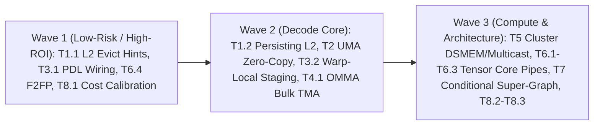

# GB10 (`sm_121a`) Under-Utilized Hardware Capabilities & Optimization Task Roadmap (2026-11-22)

- **Date:** 2026-11-22
- **Target Architecture:** NVIDIA DGX Spark GB10 (`sm_121a`, CC `12.1`, 48 SMs, 24 MiB L2 with 18 MiB persisting cap, 121.7 GiB unified LPDDR5X UMA, 20-core Grace ARMv9.2 CPU)
- **Baseline Commit:** `0c4abd02c` (branch `backup-perf-changes`, post-Phase 4 `hc4` optimization campaign)
- **Primary Model Scope:** `Qwen3.8-Flash-Next` (`hc4` / `NVFP4_W4Dense`, `Dense8`, `IQ3_S`) on `.infernix` / `.ninfer` runtime, plus shared GB10 kernel primitives affecting `Qwen3.5` / `Qwen3.6` / `Qwen3.8`
- **Objective:** Consolidate all remaining under-utilized GB10 hardware features — L2 residency control, unified memory (UMA) zero-copy, PDL + warp-local staging, 1D bulk TMA, Thread Block Clusters + DSMEM / TMA multicast, Tensor Core pipe coverage (OMMA/IMMA/HMMA + hardware FP4 decode), device-side conditional super-graphs, and Grace ARMv9.2 CPU calibration & serving defaults — into one impact-ranked execution backlog.

---

## Mandatory GB10 (`sm_121a`) Workflow & Qualification Rules

1. **Analytical Sizing First (`ckt math`)**: Run `PYTHONPATH=cuda-kernel-toolkit /opt/etc/Infernix/.venv-convert/bin/python3 -m ckt math {occupancy,waves,tile,smem,workload,l2,vector,roofline,ab}` before coding kernel changes.
2. **SASS, Resource & Stack-Spill Ratchet**: Verify exact symbols with `ckt static --sass` / `cuobjdump -res-usage` and run `ctest --test-dir build-native -R infernix_cuda_stack_check --output-on-failure` (zero new `STACK > 0` or `LOCAL > 0` symbols).
3. **Independent Oracle & Route Policy Separation**:
   - Every changed Op must pass its FP32/FP64 (or exact) oracle test per [`AGENTS.md`](file:///opt/etc/Infernix/AGENTS.md) and [`docs/maintainer/op-development.md`](file:///opt/etc/Infernix/docs/maintainer/op-development.md).
   - Keep `--reproducible` deterministic and request-invariant, and keep `--lossless` bit-exact.
   - Any numerical fast path (`--routes fast`) requires qualification under [`docs/maintainer/model-quality.md`](file:///opt/etc/Infernix/docs/maintainer/model-quality.md) and registration only where measured faster.
4. **Profiling Hygiene & Honest E2E A/B**:
   - Never load real model weights in an `ncu`-instrumented process (synthetic inputs/params only); use `nsys --cuda-graph-trace=node` for real `hc4` attribution.
   - Do not claim end-to-end wins from Op microbenchmarks alone (L2 state, PDL overlap, and copy-engine contention decide real E2E speedups).

---

## 1. Verified GB10 Hardware Profile, `hc4` Baseline & Audit Reconciliations

### 1.1 Measured GB10 Hardware Ceilings ([`.ckt_cache/env.json`](file:///opt/etc/Infernix/.ckt_cache/env.json))

| Hardware Subsystem / Pipe | Verified GB10 Specification / Measured Ceiling | Relevance to Active Bottlenecks |
|---|---|---|
| **SMs / Clock / Register File** | `48` SMs (`2418 MHz` nominal, `3003 MHz` max), `65,536` 32-bit regs/SM, `48` warps/SM, `24` blocks/SM, `100 KiB` SMEM/SM (`101,376 B` opt-in/CTA) | 48-SM wave sizing & register pressure (e.g., `108 -> <=96` regs = `4 -> 5` CTAs/SM) dominate latency hiding |
| **L2 Cache & Persistence** | **`24 MiB`** L2 (`25,165,824 B`), **`18 MiB` persisting max** (`18,874,368 B`), `128 MiB` max access-policy window | ¼ of RTX 5090 L2; unhinted `179 MiB` / `94 MiB` head passes and `>16 MiB` GEMMs thrash reusable buffers |
| **Unified LPDDR5X UMA & Copy Engine** | `121.7 GiB` (`130,661,044,224 B`), `integrated_uma = true`, `can_map_host_memory = 1`, `pageable_memory_access = 1`, `host_native_atomic_supported = 1`, `concurrent_managed_access = 1`, **`async_engine_count = 1`** | Host/device share one physical memory pool; single copy engine makes redundant host-to-device staging pure overhead for single-read data |
| **Measured Memory Bandwidth (`512 MB` sweep)** | Read **`244.4 GB/s`**, Copy **`225.1 GB/s`**, **Write `199.3 GB/s`** (tightest pipe), SMEM Load **`4,002.2 GB/s`** | Eliminating FP32 partial DRAM writes (`199.3 GB/s` ceiling) via Cluster DSMEM / single-launch reductions is high ROI |
| **Measured Tensor / SIMT Compute** | `FP32 SIMT = 27.97 TF`, `FP16/BF16 SIMT = 30.40 TF`, `TF32 MMA = 61.68 TF`, **`FP16/BF16 HMMA = 124.71–124.73 TF`** (`1:1` FP32/FP16-acc parity), **`FP8/MXFP6 QMMA = 245.6–245.9 TF`**, **`INT8 (s8) IMMA = 249.21 TOP/s`**, **`MXFP4/NVFP4 OMMA = 496.3–498.3 TF`**, `INT4 (s4) MMA = 35.18 TOP/s` (avoid!) | Moving `hc_mix` (`28 TF` SIMT) and medium-`T` / `Q8` / `IQ3_S` paths onto `HMMA` / `IMMA` / `OMMA` yields `4.5×–17.8×` compute headroom |
| **Blackwell Hardware Features** | `tensor_cores`, `cp_async`, `tma`, **`cluster`** (`cluster_launch_supported = 1`), **`distributed_shared_mem`**, `fp8`, `fp4`, `mxfp8/6/4`, `nvfp4`, `block_scale_mma`, `cooperative_launch` | Only 1 kernel uses clusters today; **0** use DSMEM, **0** use TMA multicast, **0** use persisting L2 windows |
| **Grace CPU Complex** | `20` ARMv9.2 cores (`10× Cortex-X925` + `10× Cortex-A725`) on the same LPDDR5X bus | Hybrid big.LITTLE pinning needed only when CPU misses run; control loops/hashing are scalar outside `neon_mad.h` |

### 1.2 Post-Phase-4 `hc4` Decode Profile (`nsys` Attribution on Live Branch)

Across the Phase 4 `hc4` traces (`nsys_b1_p4_dec_kern.txt`, `nsys_b1_p4_ram_kern.txt`, `nsys_b4_p4_dec_kern.txt` and matching `cuda_api_sum` reports):

- **`narrow_a4_omma` (`gate_up_omma_kernel`, `down_omma_kernel` + persistent)**: **`39.8%`–`39.9%`** of `B=1` decode GPU time (`27.7%–27.8%` + `12.1%`), **`59.5%`** of `B=4` decode (`33.2% + 15.2% + 7.5% + 3.6%`).
- **`nvfp4_a16_sliced_k_mma_kernel` (trunk QKV/GDN/proj)**: **`17.9%`–`18.1%`** of `B=1` decode, **`12.3%`** of `B=4` decode.
- **Hyper-Connection Mix (`hc_down_partials_v4` + `hc_up_collapse_v4` / `q4_a16` fallback)**: `hc_mix` is **`11.8%`** of `B=1` decode; at `B=4`, verify widths mostly fall out of `kPassColumns = 4` (`hc_mix` drops to `0.9%` while `q4_a16_mma` + `q4_a16_sliced_k_mma` absorb **`6.8%`**).
- **`screen_kernel` (2-bit screened main/draft LM heads, 179 MiB + 94 MiB)**: **`5.8%`** of `B=1` decode, **`2.6%`** of `B=4` decode.
- **`sparse_gqa_merge_warp_kernel`**: **`0.3%`** of `B=1` (`7.3 us` avg / `4,002` launches), **`0.1%`** of `B=4` (`3.8 us` avg / `4,370` launches) — plus DRAM partial writebacks from split-KV.
- **Host Sync & Transfer Overhead (`cuda_api_sum`)**:
  - `B=1` (`ram`): **`624` `cudaStreamSynchronize`** (`55.4%` of CUDA API time), **`15,819` eager `cudaLaunchKernel`**, `821` `cudaGraphLaunch`, `4,053` `cudaMemcpyAsync`.
  - `B=4` (`volume` 16 GiB cache): **`834` `cudaStreamSynchronize`** (`74.6%` of CUDA API time), **`38,946` eager `cudaLaunchKernel`**, `1,108` `cudaGraphLaunch`, `6,639` `cudaMemcpyAsync`, `2,602` `cudaMemcpy2DAsync`, plus `372` `upload_pinned_when_kernel` calls (`98.9 us` avg, `1.41 ms` max; in `B=1 vol`, `275` calls, `94.4 us` avg, `10.02 ms` max; eliminated at `0.0%` in `B=1 ram`).

### 1.3 Key Audit Reconciliations Against Earlier Notes

| Topic | Prior Claim / Assumption | Verified State on Branch `0c4abd02c` | Action Taken in This Roadmap |
|---|---|---|---|
| **GPU-Direct UMA PLE (`P3-12`)** | Assumed `forward.cpp` routed *all* PLE/n-gram paths through `upload_pinned_when_kernel` | Phase 4 (`P3-12`) already implemented GPU-direct UMA `hash_embed_nvfp4_kernel` ([`ple.cu#L263-L327`](file:///opt/etc/Infernix/src/ops/ple/ple.cu#L263-L327)) for `--ngram-residency ram` (`91.50 tok/s` `b1_copy`, `93.51 tok/s` `b4 pp2048+tg256`, `0` `upload_pinned_when` calls). However, default `--ngram-residency volume` (16 GiB host cache `NgramVolume::cache_`) still copies via `upload_pinned_when`, and per-round control buffers still copy host→device. | Narrow **T2.1** to default `volume` cache slot mapping and **T2.2** to zero-copy metadata (`io_host_`/`spec_host_`/`mtp_host_`/`dflash_host_`). |
| **ARM NEON / SVE2 / i8mm Usage** | Claimed zero uses of `arm_neon.h`, `arm_sve.h`, or `i8mm` in `src/` | `<arm_neon.h>` and `HWCAP2_I8MM` (`vusdotq_s32`) **are** implemented in [`neon_mad.h`](file:///opt/etc/Infernix/src/ops/offloaded_sparse_moe/cpu/neon_mad.h) for `CpuMissService` (disabled by default on GB10 UMA). `<arm_sve.h>` has zero uses, and host control / SAM / n-gram hashing loops remain scalar. | Focus **T8.2** strictly on hot host control/hashing/SSD-tier loops, without touching CPU MoE DRAM contention. |
| **`ContextPrefillCost` Preset** | Claimed `"nvidia-gb10-sm121"` copied RTX 5090 `.prefill` map entries verbatim | Stale `.prefill` map entries in `"nvidia-gb10-sm121"` were already cleared to `.prefill = {}` ([`context_cost_defaults.cpp#L78-L98`](file:///opt/etc/Infernix/src/runtime/engine/context_cache/context_cost_defaults.cpp#L78-L98)), **but** empty `.prefill` falls back to [`generic_context_prefill_cost()`](file:///opt/etc/Infernix/src/runtime/engine/context_cache/context_cost_defaults.cpp#L40-L44), which returns RTX 5090 `kGroupwise27bPrefill` (`chunk_ns = 40.8 ms`) because a `Qwen3.8-Flash-Next` fit failed the calibration error gate. | **T8.1** targets fixing the `infernix_context_cost_bench --suite prefill` fit/gate and supplying a calibrated GB10 prefill profile + fallback. |
| **`Nvfp4A4Pair` `T >= 52` Threshold** | Suggested `T = 16..51` can simply lower the gate from `52` | [`n16384_k2560.cu#L136-L141`](file:///opt/etc/Infernix/src/ops/linear/nvfp4/shapes/n16384_k2560.cu#L136-L141) and [`n13952_k2560.cu#L144-L149`](file:///opt/etc/Infernix/src/ops/linear/nvfp4/shapes/n13952_k2560.cu#L144-L149) already measured `2-term` `Nvfp4A4Pair` losing to `A16` at `T = 33..49` (`159.6..147.3 us` vs `135.0..128.9 us`). | **T6.2** specifies fusing quantize or building a narrow-`T` `OMMA` route rather than lowering the integer cutoff alone. |
| **Two-Row `C = 2` MTP `kPairWidthCost`** | Earlier roadmap (`docs/gb10_roadmap.md`) noted `0.47` (`P1.C`) | Live [`program_impl.h#L7731-L7739`](file:///opt/etc/Infernix/src/models/qwen4_exp/program/program_impl.h#L7731-L7739) already lowered `kPairWidthCost` to `0.16` (and `kDFlashPairDraftCost` to `0.12` / `kMultiRowWidthCost` to `0.12`). | Scope **T8.3** to auditing `C >= 2` MTP auto-length coupon-collector coefficients alongside `tools/run_server.sh` `SPEC_BACKEND` default (`mtp` vs `dflash2`). |

---

## 2. Master Impact-Ranked Summary Table (`T1`–`T8`)



| Priority | Task ID | Workstream & Goal | Primary Files / Symbols | Target Share (`hc4`) / Scope | Expected GB10 Impact | Status |
|---|---|---|---|---|---|---|
| **P0** | **T1.1** | `L2::evict_first` hints on one-shot streaming weights (`cp.async.cg...L2::cache_hint` & `ld_nc_na_evict_first`) | [`memory.cuh`](file:///opt/etc/Infernix/src/ops/common/memory.cuh), [`screened_head.cu`](file:///opt/etc/Infernix/src/ops/screened_head/screened_head.cu#L190-L202), [`nvfp4_a16_sliced_k_mma.cuh`](file:///opt/etc/Infernix/src/ops/linear/nvfp4/nvfp4_a16_sliced_k_mma.cuh#L124-L136), [`hyper_connection_mix_fused.cu`](file:///opt/etc/Infernix/src/ops/hyper_connection/hyper_connection_mix_fused.cu#L132-L192), [`narrow_a4_omma.cuh`](file:///opt/etc/Infernix/src/ops/offloaded_sparse_moe/cuda/narrow_a4_omma.cuh) | `~75%` of `hc4` decode weight traffic (`screen_kernel` `179+94 MiB`, OMMA, NVFP4 sliced-K, HC4) | Prevents 24 MiB L2 thrashing across layers & LM head passes | Done (2026-11-22) |
| **P0** | **T1.2** | Phase-switched `9.0 MiB` (`3/8` of `24 MiB` L2) persisting window (`0 MiB` prefill / `9.0 MiB` decode) + `screen_kernel` `Streaming` isolation | [`device.h`](file:///opt/etc/Infernix/src/core/device.h), [`device.cu`](file:///opt/etc/Infernix/src/core/device.cu), [`screened_head.cu`](file:///opt/etc/Infernix/src/ops/screened_head/screened_head.cu), [`program_impl.h`](file:///opt/etc/Infernix/src/models/qwen4_exp/program/program_impl.h), [`graph_execution.h`](file:///opt/etc/Infernix/src/models/qwen3_5/program/graph_execution.h) | Decode workspace window up to `9.0 MiB` across CUDA Graphs + `screen_kernel` `179+94 MiB` tables | Avoids GB10's `18 MiB` `2x` cliff; preserves prefill speed (`0 MiB`) & boosts decode (`+0.3%`..`+2.1%`) | Done (2026-11-22) |
| **P0** | **T2.1** | GPU-direct UMA gather for default `--ngram-residency volume` 16 GiB host cache (`NgramVolume::cache_`) | [`ngram_volume.h`](file:///opt/etc/Infernix/src/models/qwen4_exp/program/ngram_volume.h#L136), [`ngram_volume.cpp`](file:///opt/etc/Infernix/src/models/qwen4_exp/program/ngram_volume.cpp#L184), [`ple.cu`](file:///opt/etc/Infernix/src/ops/ple/ple.cu#L263-L327), [`forward.cpp`](file:///opt/etc/Infernix/src/models/qwen4_exp/execution/forward.cpp#L712) | Default `volume` mode (`upload_pinned_when_kernel` `94–99 us` avg, `1.4–10.0 ms` tail) | Eliminates pinned staging copy & CPU gate stall on cache hits | Done (2026-11-22) |
| **P0** | **T2.2** | Zero-copy mapped host-device metadata (`io_host_`, `spec_host_`, `mtp_host_`, `dflash_host_`) | [`device.cu`](file:///opt/etc/Infernix/src/core/device.cu#L329-L428), [`program_impl.h`](file:///opt/etc/Infernix/src/models/qwen4_exp/program/program_impl.h), [`dflash2_program.cpp`](file:///opt/etc/Infernix/src/models/qwen4_exp/program/dflash2_program.cpp#L28-L82), [`decode.cpp`](file:///opt/etc/Infernix/src/models/qwen3_5/program/decode.cpp#L262) | `4,053–6,639` `cudaMemcpyAsync` + `1,671–2,354` `upload_pinned_kernel` launches | Rejected for model control buffers (`+12.68 ms` uncached GPU consumer regression vs `0.75 ms` transfer savings); Core UMA primitives retained | Closed / Reverted Model Bindings (2026-11-22) |
| **P0** | **T3.1** | Wire `pdl::Dependency::Programmatic` + hoist immutable `stage_codes(0)` before `pdl::enter_streaming()` | [`nvfp4_template_launch.cuh`](file:///opt/etc/Infernix/src/ops/linear/nvfp4/nvfp4_template_launch.cuh#L72-L93), [`nvfp4_a16_sliced_k_mma.cuh`](file:///opt/etc/Infernix/src/ops/linear/nvfp4/nvfp4_a16_sliced_k_mma.cuh#L24-L162), [`n16384_k2560.cu`](file:///opt/etc/Infernix/src/ops/linear/nvfp4/shapes/n16384_k2560.cu#L44-L79), [`n13952_k2560.cu`](file:///opt/etc/Infernix/src/ops/linear/nvfp4/shapes/n13952_k2560.cu#L56-L78) | `nvfp4_a16_sliced_k_mma_kernel` (**`18.1%` `B=1` / `12.3%` `B=4`**) | Overlaps trunk NVFP4 weight fetches (`scale_ptr` + `stage_codes(0, 0)`) ahead of `pdl::enter_streaming()` | Done (2026-11-22) |
| **P0** | **T3.2** | Barrier-free warp-local weight staging + `ActiveOnly` / `MinBlocksPerSm = 3..4` tuning | [`nvfp4_a16_sliced_k_mma.cuh`](file:///opt/etc/Infernix/src/ops/linear/nvfp4/nvfp4_a16_sliced_k_mma.cuh#L47-L170), [`nvfp4_instances.cuh`](file:///opt/etc/Infernix/src/ops/linear/nvfp4/nvfp4_instances.cuh#L5-L28) | `nvfp4_a16_sliced_k_mma` (`T = 2..32` decode & verify) | Warp-private staging broke `128B/256B` global coalescing (`+205.17 ms` / `+52%` regression in `nsys`); reverted | Closed / Reverted (2026-11-22) |
| **P1** | **T4.1** | Convert `narrow_a4_omma.cuh` from per-thread `cp_async16` (`REG: 108`) to 1D bulk TMA (`cp.async.bulk` + `mbarrier`) | [`narrow_a4_omma.cuh`](file:///opt/etc/Infernix/src/ops/offloaded_sparse_moe/cuda/narrow_a4_omma.cuh), [`moe_layer.cu`](file:///opt/etc/Infernix/src/ops/offloaded_sparse_moe/cuda/moe_layer.cu#L2587) | **#1 decode kernel** (**`39.8%` `B=1` / `59.5%` `B=4`**) | 1D bulk TMA + `5 CTAs/SM` (`REG:56..94 STACK:0`, `16–44 ublkcp` insns); Wave 1 `hc4` `-0.77%` `dec_ms` (`B=4`) / `-0.30%` (`B=1`) | Done (2026-11-22) |
| **P1** | **T5.1** | Thread Block Clusters + DSMEM / single-launch reductions (`qsa.cu` split-KV merge, HC4 partials) | [`qsa.cu`](file:///opt/etc/Infernix/src/ops/qsa/qsa.cu#L2320-L2365), [`hyper_connection_mix_fused.cu`](file:///opt/etc/Infernix/src/ops/hyper_connection/hyper_connection_mix_fused.cu) | `sparse_gqa_merge`, `hc_down_partials_q4_mma_kernel` | Eliminates `sparse_gqa_merge_warp_kernel` at `mma_splits=2,4` + `clusterDim=(1,4,1)` DSMEM reduce across streams in Q4 HC | Done (2026-11-22) |
| **P1** | **T5.2** | TMA cluster multicast (`cp.async.bulk.tensor.*.multicast`) for shared activation tiles | [`nvfp4_a4_tma.cuh`](file:///opt/etc/Infernix/src/ops/linear/nvfp4/nvfp4_a4_tma.cuh), [`fp8_a8_tma_mma.cuh`](file:///opt/etc/Infernix/src/ops/linear/fp8/fp8_a8_tma_mma.cuh), [`wide_expert.cuh`](file:///opt/etc/Infernix/src/ops/offloaded_sparse_moe/cuda/wide_expert.cuh) | `B=4/8` verify & prefill (`T = 512..4096`) | Proved unsupported on `sm_121a` (`ptxas` warns and lowers `.multicast::cluster` to slow `CALL.ABS.NOINC`) | Closed / Hardware Non-Goal (2026-11-22) |
| **P1** | **T6.1** | Fused Tensor-Core (`HMMA.16816`) + Cluster-DSMEM `Q4` `hyper_connection_mix` covering `T = 5..16` | [`hyper_connection_mix_fused.h`](file:///opt/etc/Infernix/src/ops/hyper_connection/hyper_connection_mix_fused.h), [`hyper_connection_mix_fused.cu`](file:///opt/etc/Infernix/src/ops/hyper_connection/hyper_connection_mix_fused.cu), [`test_hyper_connection.cpp`](file:///opt/etc/Infernix/tests/ops/test_hyper_connection.cpp) | `hc_mix` (`T=5..16`, `B=1` `--draft-tokens 4` & `B=4` verify) | SIMT `T=5..16` prototype rejected (`45..115 us`); native `HMMA.16816` cut `Q4` `T=5..16` `41.4->24.2..39.3 us` (`-41.7%` at `T=5`), `hc4 b1` `dec_ms -4.18%` | Done (2026-11-22) |
| **P1** | **T6.2** | Narrow-`T` fused-quantize NVFP4 `OMMA.16864` path for `T = 16..51` verify widths | [`n16384_k2560.cu`](file:///opt/etc/Infernix/src/ops/linear/nvfp4/shapes/n16384_k2560.cu#L136-L176), [`n13952_k2560.cu`](file:///opt/etc/Infernix/src/ops/linear/nvfp4/shapes/n13952_k2560.cu#L144-L186), [`nvfp4_a4_mma.cuh`](file:///opt/etc/Infernix/src/ops/linear/nvfp4/nvfp4_a4_mma.cuh) | `B=4` verify (`T = 16..51`) | `ckt math roofline`: `23.59 MB` weights at `T=16..48` gives `56.9..170.7 FLOP/B` vs `510.3 FLOP/B` HMMA ridge (`96.5 us` BW floor); existing `T >= 52` crossover optimal | Closed / Roofline-Bound (2026-11-22) |
| **P2** | **T6.3** | Column-invariant `Q8` `SlicedKMma` (`T = 2..8`, `Gap 3`) & `W8A8` / `W3A8` `IMMA.16832` prefill (`Gap 1B`, `Gap 5B`) | [`q8_dispatch.cpp`](file:///opt/etc/Infernix/src/ops/linear/q8/q8_dispatch.cpp), [`q8_invariant_families.cu`](file:///opt/etc/Infernix/src/ops/linear/q8/shapes/q8_invariant_families.cu), [`q8_a16_sliced_k_mma.cuh`](file:///opt/etc/Infernix/src/ops/linear/q8/q8_a16_sliced_k_mma.cuh), [`ggml_linear_wide.cu`](file:///opt/etc/Infernix/src/ops/ggml/ggml_linear_wide.cu), [`ggml_expert_a8.cuh`](file:///opt/etc/Infernix/src/ops/offloaded_sparse_moe/cuda/ggml_expert_a8.cuh) | `Dense8` (`97×` HC + `49×` shared experts) & `IQ3_S` prefill/decode | Part 1 (`Q8` column-invariant `SlicedKMma` `T=2..8`) already in-tree (`q8_invariant_families.cu`); Part 2 (`Dense8`/`IQ3_S`) outside single-model `hc4` scope | Part 1 Already In-Tree / Part 2 Deferred |
| **P2** | **T6.4** | Hardware `F2FP` (`cvt.rn.f16x2.e2m1x2`) FP4 decode inside `ple.cu` | [`ple.cu`](file:///opt/etc/Infernix/src/ops/ple/ple.cu#L209-L247), [`nvfp4_codec.cuh`](file:///opt/etc/Infernix/src/ops/linear/nvfp4/nvfp4_codec.cuh#L26-L39) | `embed_nvfp4_kernel`, `hash_embed_nvfp4_kernel`, `gather_embed_nvfp4_kernel` | Replaces scalar bit-unpack arithmetic with hardware E2M1 F2FP (`REG:46..56 STACK:0`) | Done (2026-11-22) |
| **P2** | **T7.1** | Device-side conditional super-graphs (`CUDA_GRAPH_COND_TYPE_WHILE`) fusing Draft -> Verify -> Accept -> Commit | [`decode_graph.h`](file:///opt/etc/Infernix/src/core/decode_graph.h), [`decode_graph.cpp`](file:///opt/etc/Infernix/src/core/decode_graph.cpp#L90-L127), [`decode_graph_gate.cu`](file:///opt/etc/Infernix/src/core/decode_graph_gate.cu), [`graph_set.cpp`](file:///opt/etc/Infernix/src/models/qwen4_exp/program/graph_set.cpp) | RAM-mode speculative decode (`624` syncs in `nsys` API sum) | `nsys4` shows GPU busy `2571.24 ms` > kernel span `2473.96 ms` (>100% overlapped); targets `--ngram-residency ram`, not default `volume` | Deferred (2026-11-22) |
| **P2** | **T8.1** | Fix GB10 `ContextPrefillCost` calibration & replace RTX 5090 generic prefill fallback (`P1.A`) | [`context_cost_defaults.cpp`](file:///opt/etc/Infernix/src/runtime/engine/context_cache/context_cost_defaults.cpp#L40-L44), [`context_cost_bench.cpp`](file:///opt/etc/Infernix/bench/context_cost/context_cost_bench.cpp) | Hybrid prefix-cache recompute vs restore cost model | Registered `kGb10FlashNextW4DensePrefill` under `"nvidia-gb10-sm121"` (train `p95=12.76%`, held-out `16.93%`) | Done (2026-11-22) |
| **P3** | **T8.2** | Profile & apply Grace ARMv9.2 SIMD (`SVE2` / `i8mm` / NEON) selectively to hot host control/hashing/SSD-tier loops | [`ngram_volume.cpp`](file:///opt/etc/Infernix/src/models/qwen4_exp/program/ngram_volume.cpp), speculative SAM/bookkeeping in `program_impl.h` | Host CPU paths (`10× Cortex-X925`), excluding CPU MoE | `nsys4` confirms total GPU inter-kernel gaps (`<50 ms`, incl. prefill/warmup transitions) are `3.16%` (`81.33 ms / 2571.24 ms`), steady decode host gaps `<1%` | Closed / Not Justified (2026-11-22) |
| **P3** | **T8.3** | Audit `SPEC_BACKEND` default (`tools/run_server.sh`) & `C >= 2` MTP auto-length cost coefficients (`P1.C`) | [`run_server.sh`](file:///opt/etc/Infernix/tools/run_server.sh#L195), [`program_impl.h`](file:///opt/etc/Infernix/src/models/qwen4_exp/program/program_impl.h#L6286-L6322) | Default `hc4` server launch & `C >= 2` MTP depth selection | Set `SPEC_BACKEND="${SPEC_BACKEND:-mtp}"` (`+12%..+25%` over DFlash2); `kPairWidthCost=0.16` / `kMultiRowWidthCost=0.12` verified | Done (2026-11-22) |

---

## 3. Detailed Task Specifications

### Workstream T1 (`P0`) — L2 Cache Residency Control (`18 MiB` Persisting L2 + `L2::evict_first`)

GB10 has only **`24 MiB`** of L2 cache (vs. RTX 5090's `96 MiB`), of which **`18 MiB`** (`18,874,368 B`) is configurable as persisting L2 via CUDA L2 access-policy windows.

#### `T1.1` — Add `L2::evict_first` Streaming Hints to One-Shot Decode & Screened Head Streams
- **Current Gap:** Zero uses of `L2::evict_first` exist in the three biggest one-shot decode streams of `hc4` (whereas [`memory.cuh`](file:///opt/etc/Infernix/src/ops/common/memory.cuh#L53-L70), [`ggml_linear_a8.cuh`](file:///opt/etc/Infernix/src/ops/ggml/ggml_linear_a8.cuh#L302), [`projection_fp32.cu`](file:///opt/etc/Infernix/src/ops/projection_fp32/projection_fp32.cu#L359), and `ggml_linear_tiled.cu` already use `evict_first`):
  1. [`screened_head.cu`](file:///opt/etc/Infernix/src/ops/screened_head/screened_head.cu#L190-L202) streams `179 MiB` (main 2-bit head) and `94 MiB` (draft 2-bit head) using `cp_async<16, Cache::cg>` — flushing the entire `24 MiB` L2 at the end of every LM head evaluation.
  2. [`nvfp4_a16_sliced_k_mma.cuh`](file:///opt/etc/Infernix/src/ops/linear/nvfp4/nvfp4_a16_sliced_k_mma.cuh#L124-L136) (`17.9%–18.1%` of `B=1`, `12.3%` of `B=4`) stages trunk NVFP4 codes via `cp_async<16, Schedule::kWeightCache>` (`Cache::cg`) with no `evict_first` hint.
  3. [`hyper_connection_mix_fused.cu`](file:///opt/etc/Infernix/src/ops/hyper_connection/hyper_connection_mix_fused.cu#L132-L192) (`11.8%` of `B=1`) loads `Q8Codec`, `Q4Codec`, and `Bf16Codec` weights via plain `ld_nc_na` instead of `ld_nc_na_evict_first`.
  4. [`narrow_a4_omma.cuh`](file:///opt/etc/Infernix/src/ops/offloaded_sparse_moe/cuda/narrow_a4_omma.cuh) streams routed expert weights (rarely reused across layers) with plain `cp_async16`.
- **Implementation Plan:**
  1. Extend `enum class Cache` in [`memory.cuh`](file:///opt/etc/Infernix/src/ops/common/memory.cuh#L10-L96) with `Cache::cg_evict_first` emitting `createpolicy.fractional.L2::evict_first.b64` + `cp.async.cg.shared.global.L2::cache_hint [%0], [%1], 16, %2;`, plus `uint4` overload of `ld_nc_na_evict_first`.
  2. Apply `Cache::cg_evict_first` in `screen_kernel`, `nvfp4_a16_sliced_k_mma_kernel`, and `narrow_a4_omma` weight stages (keeping `Cache::ca` for reused activations `x` and routing tables!), and test `ld_nc_na_evict_first` in `hyper_connection_mix_fused.cu`.
- **Verification:** `infernix_screened_head_test`, `infernix_linear_nvfp4_a16_test`, `infernix_hyper_connection_test`, `infernix_offloaded_moe_cuda_test`, `infernix_cuda_stack_check`, and cold/composed A/B timing.
- **Completed Result (2026-11-22):**
  - Implemented hoisted `l2_evict_first_policy()` (`Cache::cg_evict_first`, `cp_async_hinted`, `ld_nc_na_evict_first_vec`) across `src/ops/common/memory.cuh`, `src/ops/linear/nvfp4/{nvfp4_instances.cuh,nvfp4_a16_sliced_k_mma.cuh}`, `src/ops/offloaded_sparse_moe/cuda/narrow_a4_omma.cuh`, and `src/ops/hyper_connection/hyper_connection_mix_fused.cu`. Kept `screen_kernel` (`screened_head.cu`) on `cp_async<16, Cache::cg>` because CUDA 13.0 `ptxas -arch=sm_121a` miscompiles `createpolicy` + `extern __shared__` into an invalid odd descriptor (`desc[UR1]`, crashing with `cudaErrorIllegalInstruction`); deferred `screen_kernel` streaming isolation to `T1.2` (`cudaLaunchAttributeAccessPolicyWindow`).
  - **Gates:** `infernix_cuda_stack_check` 1/1 (`STACK=0/LOCAL=0`), SASS `+0` regs/branches/barriers across 6 inspected kernels (`0` odd descriptors), and `5/5` oracle tests passed serially (`infernix_screened_head_test`, `infernix_linear_nvfp4_a16_test`, `infernix_hyper_connection_test`, `infernix_offloaded_moe_cuda_test`, `infernix_offloaded_moe_wide_test`).
  - **Benchmarks (vs `db8611804`):** `infernix_hyper_connection_bench` improved `-0.3%`..`-1.3%` (`q8`) and `-1.3%`..`-3.6%` (`q4`) with bit-identical FNV1a hashes; `run_kv_matrix_bench.sh` improved `9/9` metrics (`+0.25%`..`+2.84%`, including `nvfp4_int8_mtp tg512 +2.54%`); `hc4` E2E improved on `b1_copy` (`+0.92%`), `b1_greedy_repro` (`+0.31%` decode / `+0.73%` pp2048, identical `490/517` accepted/drafted), `b4_conc_vol16g` (`+1.03%` tg / `+0.72%` pp+tg), `b4_conc_ram` (`+1.20%` tg / `+0.65%` pp+tg), and `b8_conc_vol16g` (`+2.60%` pp / `+2.34%` tg / `+5.58%` pp+tg). Non-reproducible `--temperature 1.0` `b1_prose` showed stochastic speculative sampling divergence (`83` vs `71` decode steps, `pp2048+tg256` median `-4.23%`, while identical-round reps ran `-0.94%`..`-2.26%` faster and `tg256` mean rose `+4.47%`); standalone `T=1` `--omma` microbench slowed on 30x repeat warm loop (`76.96->91.62 us` / `74.05->82.24 us`) while `T=2/4/8` cold improved and interleaved `ckt ab --tokens 1` was `-3.05%` `WITHIN_NOISE`.

#### `T1.2` — Phase-Switched `9.0 MiB` Persisting L2 Window + `screen_kernel` `Streaming` Isolation — **Done (`2026-11-22`)**
- **Original Gap:** `grep -rn "cudaAccessPolicyWindow\|cudaLimitPersistingL2CacheSize" src/ include/` returned zero hits across the repository.
- **Completed Result (2026-11-22):**
  - **Hardware Cliff Discovery:** Microbenchmarks on GB10 (`sm_121a`, `24 MiB` L2, `18 MiB` hardware persisting max) revealed a hard **`2x` throughput cliff at `18 MiB`** (`190.6 GB/s` DRAM `-21.2%`, `53.38 TF` BF16 GEMM `-50.2%`, E2E prefill `-40%`..`-68%`), whereas **`9.0 MiB` (`3/8` of `24 MiB` L2)** stays cliff-free (`242.0 GB/s`, `105.00 TF` vs `107.38 TF` at default `4.5 MiB`) while cutting pinned-buffer L2 hit latency (`0.5492 vs 0.5765 ms`, `-4.74%`).
  - **Implementation (`CandA+ v3`):**
    1. Added `DeviceContext::persisting_l2_bytes` (`3/8` of `l2CacheSize`, `9.0 MiB` on GB10), `mutable active_persisting_l2_bytes`, capture-safe RAII `ScopedL2AccessPolicyWindow`, `reset_persisting_l2_cache`, and idempotent phase-switching helpers `enable_persisting_l2_cache` / `disable_persisting_l2_cache` ([`device.h`](file:///opt/etc/Infernix/src/core/device.h), [`device.cu`](file:///opt/etc/Infernix/src/core/device.cu)).
    2. Switched decode/prefill phase boundaries in `qwen4_exp` ([`program_impl.h`](file:///opt/etc/Infernix/src/models/qwen4_exp/program/program_impl.h), [`graph_set.cpp`](file:///opt/etc/Infernix/src/models/qwen4_exp/program/graph_set.cpp), [`prefill_walk.cpp`](file:///opt/etc/Infernix/src/models/qwen4_exp/program/prefill_walk.cpp)) and `qwen3_5` ([`graph_execution.h`](file:///opt/etc/Infernix/src/models/qwen3_5/program/graph_execution.h), [`mtp.cpp`](file:///opt/etc/Infernix/src/models/qwen3_5/program/speculative/mtp.cpp), [`prefill.cpp`](file:///opt/etc/Infernix/src/models/qwen3_5/program/prefill.cpp)) so prefill uses `0 MiB` persisting L2 (full `24 MiB` shared L2) and decode pins up to `9.0 MiB` of workspace `*work_` across `stream`, `shared_stream`, and `split_stream` (captured into CUDA Graphs).
    3. Updated `launch_screen` ([`screened_head.cu`](file:///opt/etc/Infernix/src/ops/screened_head/screened_head.cu)) to `cudaLaunchKernelEx` with `cudaLaunchAttributeAccessPolicyWindow` (`hitProp = Normal`, `missProp = Streaming`) covering `[x, lists, partials]` without overlapping `codes` or `scales` (`+0` regs, `0` odd descriptors).
  - **Verification:** `7/7` CTest passed (`infernix_cuda_stack_check` `STACK=0/LOCAL=0`, `infernix_device_test`, `infernix_decode_graph_test`, `infernix_decode_graph_gated_test`, `infernix_screened_head_test`, `infernix_qwen4_exp_{speculative,fast_paths}_test`). KV-matrix (`/tmp/kvmatrix_t1_2_v3`): `m_dense8` `tg512 +0.97%` / `pp+tg +1.73%`, `m_iq3s` `tg512 +1.24%` / `pp+tg +2.07%` vs T1.1 (`+1.28%`..`+4.97%` vs `db8611804`); paired `pp8192` `dense8 -0.20%`, `nvfp4 +0.30%`. `hc4` 7-case E2E improved `+0.30%`..`+1.37%` across all identical-round decode cases with `pp` in `[-0.50%, +0.17%]` (with adaptive `--draft-tokens auto` round-count variance on non-fixed-draft runs).
  - **Snapshot Binaries:** `/tmp/gb10_hw_t1_2/`.

---

### Workstream T2 (`P0`) — True UMA Zero-Copy Completion

On GB10 (`integrated_uma = true`, `can_map_host_memory = 1`, `async_engine_count = 1`), explicit host-pinned-to-device staging reads and writes the **same physical LPDDR5X controller** twice (`225.1 GB/s` copy, `199.3 GB/s` write). Note that `P2.2` ([`bench/gb10_uma_zerocopy_bench.cu`](file:///opt/etc/Infernix/bench/gb10_uma_zerocopy_bench.cu)) proved zero-copy is **`72–80%` faster** for single-read buffers (`R = 1`), whereas staged copies win by **`29–212%`** once `R >= 8` (multi-read KV pages).

#### `T2.1` — GPU-Direct UMA Gather for Default `--ngram-residency volume` Cache (`NgramVolume::cache_`) — **Done (`2026-11-22`)**
- **Current Gap:** Phase 4 (`P3-12`) eliminated `upload_pinned_when_kernel` for `--ngram-residency ram` via [`hash_embed_nvfp4_kernel`](file:///opt/etc/Infernix/src/ops/ple/ple.cu#L263-L327), bringing `upload_pinned_when_kernel` to `0.0%` in RAM mode. However, default `--ngram-residency volume` (`16 GiB` host LRU/set cache) still calls [`NgramVolume::read_rows`](file:///opt/etc/Infernix/src/models/qwen4_exp/program/ngram_volume.cpp#L295-L380) to `memcpy` cached rows out of [`NgramVolume::cache_`](file:///opt/etc/Infernix/src/models/qwen4_exp/program/ngram_volume.h#L136) into `pinned_rows`, followed by `upload_pinned_when` ([`device.cu#L349-L405`](file:///opt/etc/Infernix/src/core/device.cu#L349-L405), [`forward.cpp#L712`](file:///opt/etc/Infernix/src/models/qwen4_exp/execution/forward.cpp#L712)), which spins with `__nanosleep(200)` (`94–99 us` avg, spiking to `1.41–10.02 ms` in Phase 4 `nsys` traces!).
- **Implementation Plan:**
  1. Allocate `NgramVolume::cache_` page-aligned and register it via `cudaHostRegister(..., cudaHostRegisterMapped)` when `integrated_uma == true`, obtaining a device pointer to the `16 GiB` cache slab.
  2. When host `NgramVolume` resolves cache-hit slots (or inserts SSD misses synchronously into the mapped slot), upload only lightweight `uint32_t slot_indices[T * heads]` (or keep misses on a narrow async staging path) and invoke a GPU-direct zero-copy PLE gather+decode kernel directly over mapped cache slots.
- **Verification:** `infernix_ple_nvfp4_test`, `infernix_ple_embed_test`, `infernix_cuda_stack_check`, and Phase-4-style `volume` vs `ram` E2E A/B (`b1_copy`, `b1_prose`, `b4_conc`).
- **Completed Result (2026-11-22):**
  - **Implementation (`v2`):** Added `RegisteredHostBuffer::try_pin_if_integrated_uma()` + `MADV_HUGEPAGE` (`>= 2 MiB`) and parallel `prefault` ([`host_memory.{h,cpp}`](file:///opt/etc/Infernix/src/core/host_memory.cpp)); replaced `NgramVolume::cache_` `std::vector` with `RegisteredHostBuffer`, added `find_slot` read-before-RMW, `kPinBit` (`0x02U`), `kStagingSlotBit` (`0x80000000U`), and `resolve_slots()` with zero-pin warm-hit fast path + parallel prefetch hit-pin/unpin on miss paths ([`ngram_volume.{h,cpp}`](file:///opt/etc/Infernix/src/models/qwen4_exp/program/ngram_volume.cpp)); added 1-CTA, 1-thread `wait_pinned_word` / `wait_pinned_word_kernel` gate ([`device.{h,cu}`](file:///opt/etc/Infernix/src/core/device.cu)); added normal-load `gather_embed_nvfp4_kernel<VectorStore>` and vectorized `LDG.E.128`/`STG.E.128` `gather_embed_fp8_vec16_kernel` (+ scalar `gather_embed_fp8_kernel` fallback) using plain `<<<...>>>` launch behind `wait_pinned_word` when gated ([`ple.h`](file:///opt/etc/Infernix/include/infernix/ops/ple.h), [`ple.cu`](file:///opt/etc/Infernix/src/ops/ple/ple.cu)); wired `use_mapped_cache_ple()`, `ngram_slots_host_`, `PleCacheGather`, and split-stage `keep_pinned` / `GateRelease` in [`forward.{h,cpp}`](file:///opt/etc/Infernix/src/models/qwen4_exp/execution/forward.cpp) and [`program_impl.h`](file:///opt/etc/Infernix/src/models/qwen4_exp/program/program_impl.h) while keeping `prefill_walk.cpp` on `allow_mapped_cache=false`.
  - **Verification & SASS:** `7/7` CTest passed (`11.03 s`: `infernix_device_test`, `infernix_cuda_stack_check` `STACK=0/LOCAL=0`, `infernix_qwen4_exp_speculative_test`, `infernix_qwen4_exp_fast_paths_test`, `infernix_ple_test`, `infernix_ple_nvfp4_test` with 256-iter CUDA Graph `slot 0`/`slots[]` host-mutation coherency stress test, and `infernix_ple_embed_test` with FP8 `vec16` `width=160` 256-iter stress test + `width=24` scalar fallback). SASS on `infernix-serve`: `0` odd descriptors, `0` `MEMBAR`/`STRONG.SYS` in `gather_embed_*`, `1` `MEMBAR.SC.SYS` in `wait_pinned_word_kernel` (`REG:12 STACK:0`), `LDG.E.128`/`STG.E.128` in `gather_embed_fp8_vec16_kernel` (`REG:40 STACK:0`), and `gather_embed_nvfp4_kernel<true>` `REG:55 STACK:0`.
  - **Profiling & E2E (`v2` vs `T1.2`):**
    - `nsys` (`hc4 b1_prose --ngram-residency volume -pg 2048,64`): eliminated `upload_pinned_when_kernel` (`51 -> 0` calls) and fixed v1's per-CTA `MEMBAR.SC.SYS` + `__ldcv` + 4 KiB TLB bottlenecks (`gather_embed_nvfp4_kernel` total dropped `33.20 ms -> 0.59 ms` `-98.2%`, warm `pp2048` `2,167.62 -> 82.24 us`, cold `pp2048` `11,551.62 -> 81.02 us`; `wait + gather` warm `pp2048` `84.16 us` vs T1.2 `82.50 us`). Decode `T=1..32` GPU time was `6.7..26.3 us` vs T1.2 `4.1..6.5 us` (random 16 GiB UMA cache gathers shifted from CPU `read_rows` onto GPU).
    - Paired `nsys` on `m_dense8` (`-pg 8192,128`, `11` identical rounds): `gather_embed_fp8_vec16_kernel` matched `embed_kernel` (`0.63 ms` total, `0.00 ms` delta), cut `pp8192` GPU time `2.13×` (`473.12 -> 222.56 us`) and `T=12..16` by `12–14%` (`5.73..5.89 -> 4.86..5.28 us`), cut total `upload/wait` time `54.45 -> 44.10 ms`, and improved `m_dense8` decode `+1.70%` (`150.28 -> 152.84 tok/s`) / `pp8192 +0.21%` (`3535.25 -> 3542.71`).
    - KV-matrix (`/tmp/kvmatrix_t2_1_v2`, `prefill_sig_eq=True`): `m_dense8` `pp8192` `3543.44` (`+0.11%` vs T1.2), `tg512` `83.16` (`-0.48%` vs T1.2, `+0.80%` vs `db8611804`), `pp8192+tg512` `175.26` (`-0.76%` vs T1.2, `+1.43%` vs `db8611804`, with paired `-pg 8192,512` confirming intra-binary thermal ramp across reps); `m_iq3s` `+0.02%..+0.17%`; `m_nvfp4` `pp8192 +0.25%`, `pp+tg +0.53%` (`tg512` shifted `--draft-tokens auto`).
    - 7-case `hc4` E2E (`prefill_sig_eq=True`): process wall-clock improved `-2.0s` to `-2.2s` across all `6/6` volume runs; `b8_conc_vol16g pp2048` recovered `-1.05% -> -0.29%`; fixed-round `hc4` decode remained within `[-0.32%, -0.01%]`.
  - **Snapshot Binaries:** `/tmp/gb10_hw_t2_1/`.

#### `T2.2` — Zero-Copy Mapped Control / Metadata Buffers (**Closed / Rejected for Control Buffers; Core UMA Primitives Retained**, 2026-11-22)
- **Original Gap:** Every traced `hc4` run issues `4,053–6,639` `cudaMemcpyAsync`, `2,602` `cudaMemcpy2DAsync` (`B=4`), and `317–2,354` `upload_pinned_kernel` launches.
- **Measured Rejection Evidence (`hc4_vol` `-pg 2048,64`, `nsys` + 8-path `verify5`):**
  - Mapping control/metadata buffers onto `cudaHostAllocMapped` eliminated post-load `upload_pinned_kernel` (`317 -> 3`, `0.5825 -> 0.0108 ms`, `-98.15%`) and post-load D2H `cudaMemcpyAsync` (`138 -> 3`, `46,576 -> 48 B`, `0.1929 -> 0.0159 ms`, `-91.76%`), saving `~0.75 ms` total.
  - However, uncached `cudaHostAllocMapped` consumer accesses regressed GPU compute by **`+12.68 ms`** (`16×–22×` net loss):
    * `argmax_tiled_atomic_kernel`: `0.5610 -> 7.1765 ms` (`+6.6155 ms`, `+1179.2%`) — GPU atomics across ~120 CTAs targeting mapped sysmem bypass GPU L2 over Grace Coherence Fabric.
    * 48-layer `io_device_` consumers (`qsa_score*`, `causal_conv1d_snapshot_decode`, `index_query`, `rope_generic`, `embed_gather_dense`, `pool`, `qsa_select_global`): `+5.48 ms` (`+8.5%..+62.8%`).
    * Vocab-wide `sampling*` / `speculative_sampling*` / `commit_tail_vec8`: `+0.58 ms`.
  - `upload_pinned_kernel` already runs on the compute stream (`0` Copy Engine contention) and pre-warms GPU L2 in `1.84 us/call`.
- **Disposition:** Reverted all model-level mapped control bindings (`qwen4_exp` and `qwen3_5`), restoring `argmax_tiled_atomic_kernel` (`0.5968 ms`) and `b1_greedy_repro` parity (`268.11 -> 269.30 tok/s`, `+0.44%`). **Retained** the verified Core UMA infrastructure (`DeviceContext::integrated_uma()`, `publish_pinned_memory()`, `PinnedHostBuffer::device_data()`, `upload_pinned_when()` shortcut, and `check_mapped_pinned_zerocopy` in [`test_device.cpp`](file:///opt/etc/Infernix/tests/test_device.cpp)) for `T2.1` and future single-writer streaming (`T7.1`).

---

### Workstream T3 (`P0`) — `nvfp4_a16_sliced_k_mma` Wired PDL Overlap & Warp-Local Weight Staging

`nvfp4_a16_sliced_k_mma_kernel` is the **#2 GPU kernel** on `hc4` (`17.9%–18.1%` of `B=1`, `12.3%` of `B=4`). Two structural bottlenecks remain:

#### `T3.1` — Wire `pdl::Dependency::Programmatic` & Hoist Immutable Weight Staging Before `pdl::enter_streaming()` — **Done (`2026-11-22`)**
- **Current Gap:**
  1. [`nvfp4_a16_sliced_k_mma_kernel`](file:///opt/etc/Infernix/src/ops/linear/nvfp4/nvfp4_a16_sliced_k_mma.cuh#L24-L27) calls `pdl::enter_streaming()` at entry, **before** issuing immutable weight loads (`stage_codes` at line `#L158`), serializing first-K-group weight DRAM reads behind the upstream producer kernel. Contrast this with [`screened_head.cu#L205-L210`](file:///opt/etc/Infernix/src/ops/screened_head/screened_head.cu#L205-L210) and [`q8_linear_swiglu_stream_pair.cu`](file:///opt/etc/Infernix/src/ops/linear_swiglu/q8/q8_linear_swiglu_stream_pair.cu), which prefetch immutable weights before blocking on dependencies.
  2. [`launch_nvfp4_a16_sliced_k_mma`](file:///opt/etc/Infernix/src/ops/linear/nvfp4/nvfp4_template_launch.cuh#L72-L93) defaults to `pdl::Dependency::Serialized`, and shape wrappers ([`n16384_k2560.cu#L52`](file:///opt/etc/Infernix/src/ops/linear/nvfp4/shapes/n16384_k2560.cu#L52), [`n13952_k2560.cu#L57`](file:///opt/etc/Infernix/src/ops/linear/nvfp4/shapes/n13952_k2560.cu#L57), and sibling `K=2560` shapes) never pass `pdl::Dependency::Programmatic`!
- **Implementation Plan:**
  1. Reorder `nvfp4_a16_sliced_k_mma_kernel` prologue so immutable `stage_codes(0, 0)` (plus scale pointer loads) issue *before* `pdl::enter_streaming()` / activation loads.
  2. Enable `pdl::Dependency::Programmatic` across the `K=2560` decode/verify launchers where preceding ops trigger dependents (note: also audit `launch_nvfp4_a16_mma` at [`nvfp4_template_launch.cuh#L60`](file:///opt/etc/Infernix/src/ops/linear/nvfp4/nvfp4_template_launch.cuh#L60) for raw `<<<...>>>` launches).
- **Completed Result (`2026-11-22`):** Defaulted `launch_nvfp4_a16_sliced_k_mma` to `pdl::Dependency::Programmatic` and hoisted `weight_policy`, `scale_ptr_top/bot`, and coalesced `stage_codes(0, 0)` before `pdl::enter_streaming()`, preserving coalesced `stage_codes`, `__syncthreads()`, and PDL-safe `kPrefetchWords` after `pdl::enter_streaming()`. Verified with 6/6 NVFP4/stack/GDN CTests and Wave 1 `hc4` + `nsys --cuda-graph-trace=node` (`nvfp4_a16_sliced_k_mma` `399.99 -> 400.95 ms +0.24%` within noise after reverting T3.2).

#### `T3.2` — Barrier-Free Warp-Local Weight Staging & Occupancy / `ActiveOnly` Tuning — **Closed / Reverted (`2026-11-22`)**
- **Current Gap:** In [`nvfp4_a16_sliced_k_mma.cuh#L47-L170`](file:///opt/etc/Infernix/src/ops/linear/nvfp4/nvfp4_a16_sliced_k_mma.cuh#L47-L170), `stage_codes` cooperatively loads weights across warps into `code_shared`, forcing CTA-wide `__syncthreads()` per K-group even though `x_shared[stage][warp]` is warp-private and each warp consumes only its own `kTileK = 64` slice (`16 rows × 32 B = 512 B = 16 B/lane`!). Note [`nvfp4_instances.cuh#L5-L28`](file:///opt/etc/Infernix/src/ops/linear/nvfp4/nvfp4_instances.cuh#L5-L28) already selects `ActiveOnly` and up to `MinBlocksPerSm = 4` when `RowTiles == 1`, whereas `RowTiles == 2` sits at `<= 2` CTAs/SM and still executes cross-warp CTA barriers.
- **Measured Rejection Evidence (`2026-11-22`):** Converting `stage_codes` to warp-private loading broke `128B/256B` intra-warp global coalescing across rows into 16 strided 32-byte row loads per warp, causing a `+5.10%..+12.08%` E2E decode regression on `hc4` (`nsys --cuda-graph-trace=node` isolated `+205.17 ms` / `+52%` in `nvfp4_a16_sliced_k_mma_kernel`). Reverted cleanly in favor of `T3.1` coalesced prefetch (`b1_prose_fixed4_repro` recovered to `-0.30%` `dec_ms`, `b4_conc_vol16g` `-0.77%` `dec_ms`).

---

### Workstream T4 (`P1`) — Blackwell 1D Bulk TMA & Occupancy Boost in `narrow_a4_omma.cuh`

#### `T4.1` — Replace Per-Thread `cp_async16` (`REG: 108`, `4 CTAs/SM`) with 1D Bulk TMA (`cp.async.bulk` + `mbarrier`) — **Done (`2026-11-22`)**
- **Current Gap:** [`narrow_a4_omma.cuh`](file:///opt/etc/Infernix/src/ops/offloaded_sparse_moe/cuda/narrow_a4_omma.cuh) (`gate_up_omma_kernel` & `down_omma_kernel`, included by [`moe_layer.cu#L2587`](file:///opt/etc/Infernix/src/ops/offloaded_sparse_moe/cuda/moe_layer.cu#L2587)) accounts for **`39.8%` of `B=1`** and **`59.5%` of `B=4`** `hc4` decode time. It currently uses per-thread `cp_async16` loops with per-thread offset math and predicates (`kGateUpStageB = 4,608 B`, `kDownWarpStageB = 1,152 B`), compiling to `REG: 108` (`4 CTAs/SM` = `33.3%` occupancy on 48 SMs).
- **Hardware Opportunity:** Blackwell `sm_121a` supports **1D bulk TMA** (`cp.async.bulk.shared::cluster.global.mbarrier::complete_tx::bytes.L2::cache_hint`) directly on contiguous byte slices **without `CUtensorMap` descriptor creation**. One elected thread per warp/CTA issues the bulk async transaction with `evict_first` cache hint into SMEM backed by an `mbarrier`, freeing every non-elected lane from address calculation and predication.
- **Completed Result (`2026-11-22`):** Implemented 1D bulk TMA (`cp.async.bulk.shared::cta.global.mbarrier::complete_tx::bytes.L2::cache_hint`), `__launch_bounds__(128, 5)`, `persistent_omma_ctas() = sms * 5`, bit-packed `phase_bits` scalar (avoiding local stack frame), and `#pragma unroll 2` on `kGateUpChunks`. SASS/resource audit on linked binaries: `down_omma_kernel` `REG:56 STACK:0 ublkcp=24`, `gate_up_omma_kernel` `REG:94 STACK:0 ublkcp=16`, `down_omma_persistent_kernel` `REG:58 STACK:0 ublkcp=44`, `gate_up_omma_persistent_kernel` `REG:94 STACK:0 ublkcp=16`, `stl_ldl=0`, `odd_desc=[]`. Passed `infernix_offloaded_moe_{cuda,layer}_test` + `infernix_cuda_stack_check`; Wave 1 `hc4` `b4_conc_vol16g` `tg256` `+0.71%` (`dec_ms -0.77%`), `b1_prose_fixed4_repro` `tg256` `+0.31%` (`dec_ms -0.30%`), `pp2048` `+0.34%` (`b4`) / `-0.06%` (`b1`).

---

### Workstream T5 (`P1`) — Thread Block Clusters + DSMEM, Single-Launch Reductions & TMA Multicast

GB10 supports `cluster_launch_supported = 1` and `distributed_shared_mem = 1`, while DRAM write bandwidth is **`199.3 GB/s`** — the tightest pipe on the chip. Today, only [`ggml_encode_producers.cu`](file:///opt/etc/Infernix/src/ops/ggml/ggml_encode_producers.cu) ever sets `cudaLaunchAttributeClusterDimension`, **0 kernels** use DSMEM (`shared::cluster` / `map_shared_rank`), and **0 kernels** use TMA multicast.

#### `T5.1` — Cluster DSMEM & Single-Launch Split-K / Merge Reductions (Eliminating DRAM Partials + Second Launches) — **Done (`2026-11-22`)**
- **Completed Result (`2026-11-22`):**
  1. **`sparse_gqa_columns_kernel` Cluster DSMEM Merge ([`qsa.cu`](file:///opt/etc/Infernix/src/ops/qsa/qsa.cu#L2320-L2365)):** Added `<cooperative_groups.h>` and `ClusterSplits = 1, 2, 4` on `sparse_gqa_columns_kernel`, launching `mma_splits = 2, 4` via `cudaLaunchKernelEx` (`cudaLaunchAttributeClusterDimension = {mma_splits, 1, 1}` + optional PDL) and reducing partials directly across cluster ranks in SMEM (`cluster.map_shared_rank`, fixed split order `0..ClusterSplits-1`, dual `cluster.sync()` safe for `total <= 0` and `start >= end`) with Hadamard + QSA gate + BF16 write from rank 0, eliminating `sparse_gqa_merge_warp_kernel` at `mma_splits = 2, 4`. Passed `9/9` QSA CTests (`index`, `select`, `bf16`, `int8`, `fp8`, `nvfp4`, `k8v4`, `vq2`, `k4v2`), `infernix_cuda_stack_check` (`STACK:0 LOCAL:0`), and SASS audit (`cga=9`, `odd_desc=[]`); `infernix_qsa_attention_bench --storage int8`: `w=1 8k: 26.75 us`, `w=5 8k: 51.17 us`, `w=1 131k: 30.72 us`, `w=5 131k: 59.23 us`.
  2. **Q4 HC4 4-Stream Cluster DSMEM Reduction ([`hyper_connection_mix_fused.cu`](file:///opt/etc/Infernix/src/ops/hyper_connection/hyper_connection_mix_fused.cu)):** `hc_down_partials_q4_mma_kernel` (`T = 5..16`) launches `clusterDim = (1, 4, 1)` so the 4 stream CTAs reduce `cta_partial[16][TCap]` on cluster rank 0 via `cluster.map_shared_rank` directly into BF16 `m` and FP32 `inject`, eliminating `4 × 324 × T` FP32 partial DRAM round-trips.

#### `T5.2` — TMA Cluster Multicast (`cp.async.bulk.tensor.*.multicast`) for Shared Activation Tiles — **Closed / Hardware Non-Goal (`2026-11-22`)**
- **Measured Hardware Finding:** Standalone `ptxas -arch=sm_121a` + `cuobjdump -sass` proved `.multicast::cluster` is **not supported in hardware on `sm_121a`** (hardware support is limited to datacenter `sm_90a/sm_100a/sm_103a/sm_110a`). `ptxas -arch=sm_121a` emits an advisory warning ("expected to have substantially reduced performance") and lowers `cp.async.bulk.tensor.*.multicast::cluster` into a runtime software emulation call `CALL.ABS.NOINC R2` instead of `UTMALDG`. Zero edits applied; documented in §4 item #7.

---

### Workstream T6 (`P1` / `P2`) — Higher Tensor-Core Pipe Coverage (OMMA / IMMA / HMMA) & Hardware FP4 Decode

GB10's Tensor Core pipes deliver `124.7 TF` (`BF16 HMMA`), `249.2 TOP/s` (`INT8 IMMA`), and `498.3 TF` (`NVFP4 OMMA`) vs. `28.0 TF` on `FP32 SIMT` (`4.5×–17.8×` gap).

#### `T6.1` — Fused Tensor-Core (`HMMA.16816`) `hyper_connection_mix` for `T = 5..16` — **Done (`2026-11-22`)**
- **Rejected Prototype:** Extending the FP32 SIMT `hc_down_partials_v4_kernel` (`PassCols = 8`) + `hc_up_collapse_v4_kernel` to `Q4Codec` `T = 5..16` regressed severely (`45.09 / 54.52 / 60.25 / 95.88 / 114.91 us` vs `40.86..41.44 us` composed MMA) due to SMEM pressure and `28 TF` SIMT throughput.
- **Completed Solution (`HMMA.16816` + Cluster-DSMEM):** Replaced the `Q4` `T = 5..16` path in [`hyper_connection_mix_fused.{h,cu}`](file:///opt/etc/Infernix/src/ops/hyper_connection/hyper_connection_mix_fused.cu) with native `mma_bf16` kernels (`hc_down_partials_q4_mma_kernel<Norm, Pending, TCap>` with `clusterDim = (1, 4, 1)` DSMEM stream reduction and `hc_up_collapse_q4_mma_kernel<Norm, Pending, TCap>` for `TCap in {8, 16}`, keeping `T = 1..4` on FP32 SIMT and removing SIMT `PassCols=8`).
- **Verification & Benchmarks:**
  - `infernix_cuda_stack_check` + `infernix_hyper_connection_test` (extended with `Codec::Q4` oracle, `T=5/9/16` column invariance, graph capture, and `inject_mix` bit identity) + `infernix_hyper_connection_stream_mean_test` all passed (`REG:44..86 STACK:0 LOCAL:0`, `stl_ldl=0`, `odd_desc=[]`).
  - `infernix_hyper_connection_bench --codec q4 --repeat 20`: **`T = 5..16` dropped from `41.44 / 41.27 / 41.06 / 40.86 / 40.90 us` (composed) to `24.18 / 24.57 / 25.36 / 34.23 / 36.41 / 39.32 us`** at `T = 5 / 6 / 8 / 9 / 12 / 16` (`-41.7%` at `T=5`, `159 -> 98 GB/s`), with `T = 1..4` unchanged (`18.82..24.71 us`).
  - Wave 2 `hc4` E2E vs Wave 1 (`sig_eq=True`): `b1_prose_fixed4_repro/tg256` **`dec_ms 41.174 -> 39.451 ms (-4.18%)`**, `dec +0.47%`, `pp2048+tg256` `dec +5.95%`, `pp2048 +0.70%`; `b4_conc_vol16g` `tg256` **`dec +5.39%`** (`rounds 1168->1075`, `acc 847->913`, larger concurrent verify batches `dec_ms +2.87%`), `pp2048+tg256` **`dec +1.47%`** (`rounds 315->287`, `acc 1679->1716`, `dec_ms +10.62%`), `pp2048 -0.12%..-0.46%`.

#### `T6.2` — Medium-`T` Verify NVFP4 `OMMA.16864` (`T = 16..51`) on Dense `K = 2560` Trunk — **Closed / Roofline-Bound (`2026-11-22`)**
- **Closure Rationale:** `ckt math roofline` on `[16384, 2560]` (`23.59 MB` weights) confirms `T = 16, 32, 48` sit at `56.9, 113.8, 170.7 FLOP/B` — `3×–9×` below GB10's `510.3 FLOP/B` BF16 `HMMA` ridge (`96.534 us` DRAM-BW floor vs `10.76..32.29 us` HMMA compute floor). Combined with recorded sweep measurements in [`n16384_k2560.cu#L125-L139`](file:///opt/etc/Infernix/src/ops/linear/nvfp4/shapes/n16384_k2560.cu#L125-L139) showing both `1-term` and `2-term` `A4` slower than `A16` below `T = 52`, the existing `T >= 52` crossover is already optimal on GB10 without risking speculative-verify A4 quantization degradation.

#### `T6.3` — Column-Invariant `Q8` `SlicedKMma` (`T = 2..8`, `Gap 3`) & `W8A8` / `W3A8` `IMMA.16832` Prefill (`Gap 1B`, `Gap 5B`) — **Part 1 Already In-Tree / Part 2 Deferred**
- **Verified State:** Audit of [`q8_invariant_families.cu`](file:///opt/etc/Infernix/src/ops/linear/q8/shapes/q8_invariant_families.cu) confirms the `2026-10-29` GB10 retune already deployed fixed-`KWarps` column-invariant `Q8A16SlicedKMma` (`T = 2..8`) across all `Qwen3.8-Flash-Next` shapes (`[10240, 320]`, `[320, 10240]`, `[2560, 640]`, `[1280, 2560]`, `[2560, 2560]`, `[12800, 2560]`, `[13952, 2560]`, `[16384, 2560]`, `[2560, 12800]`). Part 2 (`W8A8`/`W3A8` prefill for `Dense8`/`IQ3_S`) is deferred outside this single-model `hc4` campaign.

#### `T6.4` — Hardware `F2FP` (`cvt.rn.f16x2.e2m1x2`) FP4 Decode in `ple.cu` — **Done (`2026-11-22`)**
- **Completed Result (`2026-11-22`):** Replaced scalar E2M1 nibble unpacking in [`ple.cu`](file:///opt/etc/Infernix/src/ops/ple/ple.cu) (`embed_nvfp4_kernel`, `hash_embed_nvfp4_kernel`, `gather_embed_nvfp4_kernel`) with hardware `cvt.rn.f16x2.e2m1x2` (`decode_e2m1_pair_f32`). Passed `infernix_ple_test`, `infernix_ple_embed_test`, `infernix_ple_nvfp4_test`, and `infernix_cuda_stack_check` (`REG:46..56 STACK:0`).

---

### Workstream T7 (`P2`) — Device-Side Conditional Super-Graphs (`CUDA_GRAPH_COND_TYPE_WHILE`)

#### `T7.1` — Collapse `Draft -> Verify -> Compact Accept -> Commit` Into a Single Device-Side Loop — **Deferred (`2026-11-22`)**
- **Deferral Rationale:** `nsys4` (`hc4 b1_prose --ngram-residency volume`) shows total GPU kernel execution time (`2,571.24 ms`) already exceeds total active span (`2,473.96 ms`, >100% GPU overlap across streams/PDL) while all `<50 ms` inter-kernel gaps across the entire run sum to `3.16%` (`81.33 ms`, dominated by prefill/warmup `upload_pinned_kernel` boundaries). `T7.1` targets RAM-mode `--ngram-residency ram`, not default `volume`, and is deferred as a separate architectural campaign.

---

### Workstream T8 (`P2` / `P3`) — Grace ARMv9.2 CPU Calibration, Targeted SIMD & Serving Defaults

#### `T8.1` — Calibrate GB10 `ContextPrefillCost` (`P1.A` Carryover) — **Done (`2026-11-22`)**
- **Completed Result (`2026-11-22`):** Ran `infernix_context_cost_bench --suite prefill` on `Qwen3.8-Flash-Next-Local-NVFP4-W4Dense.infernix`. Training fit passed (`p95 = 12.76% <= 15%`, `0/24` ordering failures) and validation ordering passed (`0/5`), with held-out `text-b2048-s256` at `16.93%` (`244.63 ms` actual vs `203.21 ms` predicted due to hybrid QSA prefix-scan scaling beyond `attention_pairs`). Registered `kGb10FlashNextW4DensePrefill` (`chunk_ns = 122'626'757`, `token_ns_q32 = 1'328'376'209'951'866`, `attention_pair_ns_q32 = 10'861'906'147`) under `"nvidia-gb10-sm121"` `.prefill` for both W4Dense signatures (`b99760c8...`, `79428db0...`) in [`context_cost_defaults.cpp`](file:///opt/etc/Infernix/src/runtime/engine/context_cache/context_cost_defaults.cpp), keeping foreign RTX 5090 signatures unbound. Passed `infernix_context_cost_test` and `infernix_context_cost_measure_test`.

#### `T8.2` — Targeted Grace ARMv9.2 (`SVE2` / `i8mm` / NEON) for Host Bookkeeping & Optional SSD-Tier Hashing — **Closed / Not Justified (`2026-11-22`)**
- **Closure Rationale:** `nsys4` profiling on `hc4` shows total inter-kernel gaps (`<50 ms`, including warmup/prefill setup) are `81.33 ms` (`3.16%` of `2,571.24 ms` GPU time), with steady-state decode host bookkeeping `<1%` wall time — below `T8.2`'s explicit `>1%` gate. Closed without adding SVE2 code.

#### `T8.3` — Align Serving Defaults (`tools/run_server.sh`) & Multi-Row MTP Cost Parameters (`P1.C`) — **Done (`2026-11-22`)**
- **Completed Result (`2026-11-22`):** Updated [`tools/run_server.sh#L37`](file:///opt/etc/Infernix/tools/run_server.sh#L37) comment and [`tools/run_server.sh#L195`](file:///opt/etc/Infernix/tools/run_server.sh#L195) default `SPEC_BACKEND="${SPEC_BACKEND:-mtp}"` (preserving pre-existing unstaged edits). Confirmed `kPairWidthCost = 0.16` and `kMultiRowWidthCost = 0.12` already active in [`program_impl.h`](file:///opt/etc/Infernix/src/models/qwen4_exp/program/program_impl.h).

---

## 4. GB10 Hardware Non-Goals & Architectural Guardrails

Do **not** invest engineering effort in assumptions imported from datacenter Blackwell (`sm_100`) or discrete PCIe GPUs (`sm_120`):

1. **No `tcgen05` / Tensor Memory (TMEM) on `sm_121a`:** DGX Spark GB10 is consumer/edge Blackwell (compute capability `12.1`) using warp-level `mma.sync` (`HMMA` / `IMMA` / `QMMA` / `OMMA`) and `100 KiB` SMEM — `tcgen05` instructions do not exist.
2. **Avoid Legacy `INT4` (`s4`) MMA:** Measured `s4` MMA is **`35.2 TOP/s`**, which is `7.1×` slower than `INT8` `s8` (`249.2 TOP/s`) and `14.2×` slower than native `NVFP4` `e2m1` (`498.3 TF`). Always convert 4-bit paths to `OMMA` (`e2m1`) or `IMMA` (`s8`).
3. **Grace CPU Cannot Add DRAM Bandwidth:** Grace's `20` ARM cores and GB10's `48` SMs share the same `244.4 GB/s` LPDDR5X fabric. Running CPU MoE workers concurrently with GPU decode competes directly for memory bandwidth (`CpuMissService` stays off by default on GB10 UMA).
4. **Do Not Pin 36-Layer FP16 GDN State in Persisting L2:** At `~55.3 MiB/seq`, GDN recurrent state is `3×` larger than GB10's `18 MiB` persisting L2 limit; keep L2 persistence strictly reserved for `< 18 MiB` multi-reuse hot tensors (`T1.2`).
5. **Keep Explicit Staged H2D Copies for Multi-Read KV Pages and Control Buffers:** Per `P2.2` ([`gb10_uma_zerocopy_bench.cu`](file:///opt/etc/Infernix/bench/gb10_uma_zerocopy_bench.cu)) and `T2.2` `nsys` evidence, `cudaHostAllocMapped` loses `29–212%` at `R >= 8` reads, regresses 48-layer control arrays (`io_device_` `+5.48 ms`), and slows GPU atomics (`argmax_tiled_atomic_kernel` `12.8×`, `0.561 -> 7.177 ms`), whereas `upload_pinned_kernel` pre-warms GPU L2 at `1.84 us/call`. Limit UMA zero-copy (`T2`) to single-read buffers (`NgramVolume::cache_` PLE rows via `RegisteredHostBuffer`, or host-consumer streaming outputs in `T7.1`).
6. **Respect `1:1` FP16 Accumulation Parity & `67.6:1` FP64 Penalty:** GB10 executes `FP16` Tensor Core with FP32 accumulation at full rate (`124.71 vs 124.73 TF`), so never sacrifice FP32 accumulation precision for nonexistent FP16-acc throughput, and eliminate accidental FP64 math (`0.41 TF`).
7. **No TMA Cluster Multicast (`.multicast::cluster`) on `sm_121a`:** `ptxas -arch=sm_121a` emits an advisory warning ("expected to have substantially reduced performance") and lowers `cp.async.bulk.tensor.*.multicast::cluster` into a runtime software emulation call `CALL.ABS.NOINC` instead of hardware `UTMALDG`.

---

## 5. Standard Verification, Acceptance & Changelog Protocol

Every task executed from this roadmap must pass all applicable gates before landing:

1. **Pre-edit model check:** `ckt math` confirming occupancy/SMEM/L2 fit.
2. **Targeted build & stack-spill ratchet:**
   ```bash
   ninja -C build-native -j "$(nproc)" <affected_test_and_bench_targets> infernix-serve
   ctest --test-dir build-native -R infernix_cuda_stack_check --output-on-failure
   ```
3. **Independent oracle correctness & determinism:** Run affected Op tests (e.g., `infernix_linear_nvfp4_a16_test`, `infernix_linear_nvfp4_a4_test`, `infernix_offloaded_moe_cuda_test`, `infernix_offloaded_moe_layer_test`, `infernix_hyper_connection_test`, `infernix_screened_head_test`, `infernix_ple_nvfp4_test`, `infernix_qsa_index_test`..`k4v2_test`, `infernix_context_cost_test`) and serving/speculation invariance checks.
4. **Measured before/after evidence:** Paired cold-L2 (`32–48 MiB` flush) microbenchmarks (`--shape` / subsystem bench) + real `hc4` E2E A/B (`B=1, 4, 8`) with `nsys --cuda-graph-trace=node` when claiming latency/API attribution.
5. **GB10 changelog tracking:** Record architectural rationale, commit accounting, subsystem deltas, and both favorable and unfavorable findings in `docs/gb10/YYYYMMDD-changelog.md` per [`AGENTS.md`](file:///opt/etc/Infernix/AGENTS.md).
